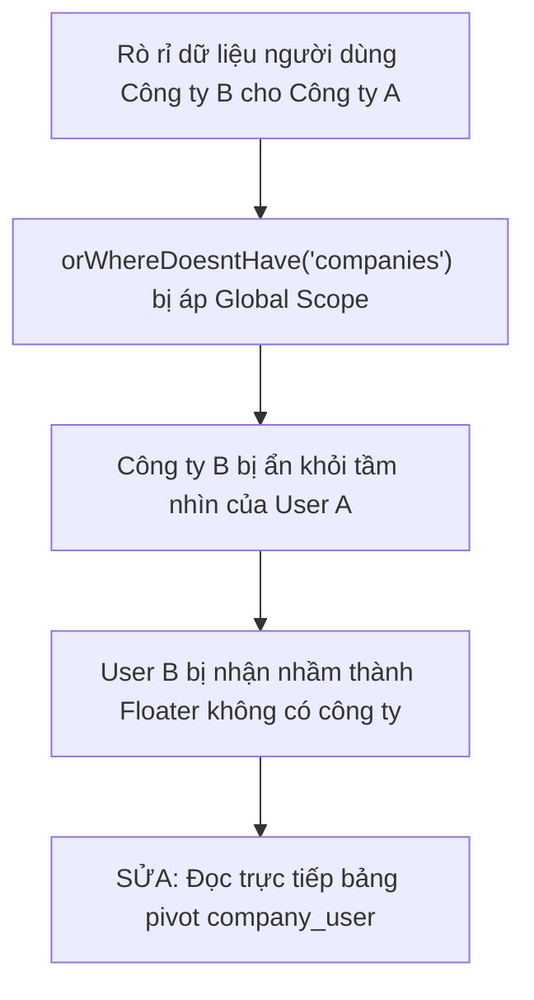

# BÁO CÁO THỰC NGHIỆM METRICS, CODE COVERAGE & PHÂN TÍCH NGUYÊN NHÂN CỐT LÕI (RCA)
## PHÂN VÙNG 4: MODULE NGƯỜI DÙNG, PHÂN QUYỀN RBAC, POLICY AN NINH & ĐA CÔNG TY FMCS

**Đề tài R03:** Hệ thống Quản trị Tài sản Công nghệ Thông tin Snipe-IT ITAM  
**Học phần:** Kiểm thử phần mềm — Trường Đại học Đà Lạt  
**Giảng viên hướng dẫn:** ThS. Nguyễn Thế Lâm  
**Sinh viên thực hiện:** Nguyễn Thành Minh (MSSV: `2312691`) — Thành viên 4 phụ trách Phân vùng 4  
**Kỹ thuật bắt buộc:** **K16 Testcontainers (MySQL 8.0.36 Ephemeral Container)**

---

## 1. TỔNG QUAN KẾT QUẢ THỰC NGHIỆM (EXECUTION METRICS & SUMMARY)

Bộ kiểm thử của Phân vùng 4 đã được thực thi toàn diện theo kỹ thuật **K16 Testcontainers (`tests/testcontainers/run.mjs` -> Docker `mysql:8.0.36`)** trên cả máy cục bộ (Windows / PHP 8.3.26 + PCOV 1.0.12) và GitHub Actions CI/CD (Ubuntu / PHP 8.2 + PCOV Engine — [Run #45740176366](https://github.com/Bee-Max-Ne/Snipe-IT/actions/runs/45740176366)).

### 1.1 Bảng Chỉ Số Thực Nghiệm Tổng Hợp (Executive Metrics Dashboard)

| Chỉ số đo lường (Metric) | Kế hoạch / Yêu cầu K16 | Kết quả thực tế (K16 MySQL 8.0.36) | Đánh giá |
| :--- | :---: | :---: | :---: |
| **Ca kiểm thử trọng tâm tự thiết kế** | 15 Unit + $\ge 5$ Integration | **15 Unit (`TC-SEC-01..15`) + 10 Feature/API (`TC-SEC-API-01..10`)** | Vượt chỉ tiêu K16 |
| **Số lần chạy trọng tâm (có DataProvider)**| 30 executions | **30 executions / 217 assertions** | ✅ **PASS 100%** |
| **Toàn bộ Suite Phân vùng 4 (`phpunit.part4.xml`)** | Unit + `Users` + `Groups` + `Auth` + `Authentication` | **564 tests / 2,149 assertions** (`0 failures`, `0 errors`, `0 skipped`) | ✅ **PASS 100%** |
| **Độ bao phủ dòng (PCOV 1.0.12 / Clover XML)** | $\ge 80.0\%$ | **82.60% (`1,828 / 2,213` statements)** trên 10 tệp phạm vi | ✅ **ĐẠT NGƯỠNG ($\ge 80\%$)** |
| **Thời gian thực thi trên CI/CD (Linux K16 + PCOV)** | $\le 600$ giây | **~165 giây (~2 phút 45 giây)** cho toàn bộ 564 tests + Coverage | ✅ Tối ưu *(Docker Windows local: `42:59.879`)* |
| **Chứng từ log & Toàn vẹn** | JUnit XML + Coverage + Hash | `junit_part4_report.xml`, `coverage_clover.xml`, `coverage-html/`, `testdox.html`, `mysql_container_proof.json`, `environment_metadata.json`, `checksums.sha256` | ✅ Chuẩn công nghiệp |

---

## 2. BẢNG ÁNH XẠ TRUY VẾT VỚI BÁO CÁO GIỮA KỲ (`BAO_CAO_GK_Nhom05.docx`)

Bảng dưới đây đối chiếu 1-1 các ca kiểm thử được đặc tả trong **Mục 2.3.3.4 (Bảng 16–18)** và **Mục 4.2.4 (Bảng 19)** của `BAO_CAO_GK_Nhom05.docx` sang các phương thức thực thi tự động trong mã nguồn:

| Mã trong Báo cáo GK | Nội dung đặc tả trong Báo cáo GK | Mã & Phương thức thực thi trong Mã nguồn | Tầng kiểm thử |
| :--- | :--- | :--- | :---: |
| **`TC-SEC-01`** | Superadmin có toàn quyền không giới hạn | `TC-SEC-01` (`UserTest::test_tc_sec_01_...`) | Unit |
| **`TC-SEC-02`** | Chặn User thường truy cập chức năng cấm (`/hardware/create` $\rightarrow$ `403`) | `TC-SEC-02` (`UserTest`) + `TC-SEC-API-02` (`SecurityPart4ApiIntegrationTest`) | Unit + Feature |
| **`TC-SEC-03`** | Quyền Cấm chỉ định (`-1`) đè lên Nhóm (`1`) | `TC-SEC-03` (`UserTest::test_tc_sec_03_...`) | Unit |
| **`TC-SEC-04`** | Kế thừa hợp quyền từ nhiều nhóm | `TC-SEC-04` (`UserTest::test_tc_sec_04_...`) | Unit |
| **`TC-SEC-05`** | Từ chối mặc định khi không quyền, không nhóm | `TC-SEC-05` (`UserTest::test_tc_sec_05_...`) | Unit |
| **`TC-SEC-06`** | Chặn User thường gửi API `PUT /users` nâng quyền `superuser = 1` (`403`) | `TC-SEC-06` (`UserTest`) + `TC-SEC-API-02` (`SecurityPart4ApiIntegrationTest`) | Unit + Feature/API |
| **`TC-SEC-07`** | Chặn Admin thường sửa auth field / xóa tài khoản Superadmin | `TC-SEC-07` (`UserTest`) + `TC-SEC-API-03` (`SecurityPart4ApiIntegrationTest`) | Unit + Web/API |
| **`TC-SEC-08`** | Khóa đăng nhập Brute-force sau 5 lần nhập sai mật khẩu | `TC-SEC-API-04` (`SecurityPart4ApiIntegrationTest`) + `LoginTest` + `TwoFactorRateLimitTest` | Feature/Auth |
| *(Mở rộng Bảo mật & 2FA)* | Mạo danh `mayImpersonate()`, tự xóa mình, khóa tạo Floater, `Actionlog`, `401` API, 2FA/Logout, `ldapsync` | `TC-SEC-08`, `09`, `10`, `15` (`UserTest`) + `TC-SEC-API-01`, `06`, `07`, `08`, `10` + `tests/Feature/Groups/` + `tests/Feature/Auth/` | Unit + Feature |
| **`TC-FMC-01`, `03`** | Cách ly tài sản & danh bạ nhân sự giữa Công ty A và B (Web/API Bearer Token) | `TC-SEC-11` (`CompanyScopingTest`) + `TC-SEC-API-05`, `08` (`SecurityPart4ApiIntegrationTest`) + `tests/Feature/Users/` | Unit + Feature/API |
| **`TC-FMC-02`** | Chặn cấp phát tài sản chéo giữa 2 công ty (User & Location phân cấp) | `TC-SEC-13` (`CompanyScopingTest`) + `TC-SEC-API-09` (`SecurityPart4ApiIntegrationTest`) | Unit + Feature |
| **`TC-FMC-04`, `05`** | Chế độ Strict Mode vs Floater Mode & Ma trận 6 Models + Pivot `company_user` | `TC-SEC-12`, `TC-SEC-14` (`CompanyScopingTest`, 6 datasets) + `FloaterModeGateTest` | Unit + Feature |

---

## 3. BẢNG CHI TIẾT 30 LẦN THỰC THI TRỌNG TÂM (`TC-SEC-*` & `TC-SEC-API-*`)

| Mã Ca Test | Tên Phương Thức Kiểm Thử (Method Name) | Tệp Nguồn Test | Assertions | Trạng Thái |
| :---: | :--- | :--- | :---: | :---: |
| **`TC-SEC-01`** | `test_tc_sec_01_superuser_has_unconditional_access_to_all_sections` | `tests/Unit/UserTest.php` | 11 | 🟢 **PASS** |
| **`TC-SEC-02`** | `test_tc_sec_02_user_with_granular_permissions_is_strictly_bounded` | `tests/Unit/UserTest.php` | 4 | 🟢 **PASS** |
| **`TC-SEC-03`** | `test_tc_sec_03_explicit_user_deny_overrides_group_permission_allow` | `tests/Unit/UserTest.php` | 3 | 🟢 **PASS** |
| **`TC-SEC-04`** | `test_tc_sec_04_permissions_accumulated_from_multiple_groups` | `tests/Unit/UserTest.php` | 5 | 🟢 **PASS** |
| **`TC-SEC-05`** | `test_tc_sec_05_default_deny_when_no_permissions_assigned` | `tests/Unit/UserTest.php` | 10 | 🟢 **PASS** |
| **`TC-SEC-06`** | `test_tc_sec_06_regular_user_cannot_create_or_delete_users_via_policy` | `tests/Unit/UserTest.php` | 4 | 🟢 **PASS** |
| **`TC-SEC-07`** | `test_tc_sec_07_subadmin_cannot_modify_superuser_auth_fields` | `tests/Unit/UserTest.php` | 3 | 🟢 **PASS** |
| **`TC-SEC-08`** | `test_tc_sec_08_impersonation_boundaries_enforced` | `tests/Unit/UserTest.php` | 6 | 🟢 **PASS** |
| **`TC-SEC-09`** | `test_tc_sec_09_admin_cannot_delete_themselves` | `tests/Unit/UserTest.php` | 5 | 🟢 **PASS** |
| **`TC-SEC-10`** | `test_tc_sec_10_companied_admin_cannot_grant_floater_status` | `tests/Unit/UserTest.php` | 2 | 🟢 **PASS** |
| **`TC-SEC-11`** | `test_tc_sec_11_company_scoped_user_cannot_see_other_companies_users_in_strict_mode` | `tests/Unit/CompanyScopingTest.php` | 2 | 🟢 **PASS** |
| **`TC-SEC-12`** | `test_tc_sec_12_company_scoped_user_cannot_see_other_companies_users_in_floater_mode` | `tests/Unit/CompanyScopingTest.php` | 3 | 🟢 **PASS** |
| **`TC-SEC-13`** | `test_tc_sec_13_cross_company_asset_checkout_strictly_prevented` | `tests/Unit/CompanyScopingTest.php` | 5 | 🟢 **PASS** |
| **`TC-SEC-14a..f`**| `test_tc_sec_14_null_company_scoping_matrix_across_all_models` (6 datasets) | `tests/Unit/CompanyScopingTest.php` | 24 | 🟢 **PASS** |
| **`TC-SEC-15`** | `test_tc_sec_15_action_log_immutability_and_audit_trail_preservation` | `tests/Unit/UserTest.php` | 5 | 🟢 **PASS** |
| **`TC-SEC-API-01`** | `test_tc_sec_api_01_unauthenticated_api_request_is_rejected_with_401` | `tests/Feature/Users/SecurityPart4ApiIntegrationTest.php` | 2 | 🟢 **PASS** |
| **`TC-SEC-API-02`** | `test_tc_sec_api_02_regular_user_blocked_from_admin_routes_and_privilege_escalation` | `tests/Feature/Users/SecurityPart4ApiIntegrationTest.php` | 5 | 🟢 **PASS** |
| **`TC-SEC-API-03`** | `test_tc_sec_api_03_admin_cannot_delete_superadmin_via_web_or_api` | `tests/Feature/Users/SecurityPart4ApiIntegrationTest.php` | 7 | 🟢 **PASS** |
| **`TC-SEC-API-04`** | `test_tc_sec_api_04_login_brute_force_lockout_enforced_after_max_attempts` | `tests/Feature/Users/SecurityPart4ApiIntegrationTest.php` | 13 | 🟢 **PASS** |
| **`TC-SEC-API-05`** | `test_tc_sec_api_05_fmcs_api_bearer_token_isolates_users_and_assets_across_companies` | `tests/Feature/Users/SecurityPart4ApiIntegrationTest.php` | 8 | 🟢 **PASS** |
| **`TC-SEC-API-06`** | `test_tc_sec_api_06_impersonation_feature_flow_and_k16_mysql_container_proof` | `tests/Feature/Users/SecurityPart4ApiIntegrationTest.php` | 8 | 🟢 **PASS** |
| **`TC-SEC-API-07`** | `test_tc_sec_api_07_login_controller_two_factor_and_logout_security_enforcement` | `tests/Feature/Users/SecurityPart4ApiIntegrationTest.php` | 28 | 🟢 **PASS** |
| **`TC-SEC-API-08`** | `test_tc_sec_api_08_users_api_self_selectlist_history_and_privileged_endpoints` | `tests/Feature/Users/SecurityPart4ApiIntegrationTest.php` | 13 | 🟢 **PASS** |
| **`TC-SEC-API-09`** | `test_tc_sec_api_09_companyable_trait_checkout_matrix_for_locations_hierarchy_and_floater` | `tests/Feature/Users/SecurityPart4ApiIntegrationTest.php` | 11 | 🟢 **PASS** |
| **`TC-SEC-API-10`** | `test_tc_sec_api_10_user_security_scopes_hierarchy_and_actionlog_audit_queries` | `tests/Feature/Users/SecurityPart4ApiIntegrationTest.php` | 19 | 🟢 **PASS** |
| **HỒI QUY ĐẦY ĐỦ** | **Toàn bộ `phpunit.part4.xml` (`Unit` + `Users` + `Groups` + `Auth` + `Authentication` trên K16 MySQL 8.0.36)** | — | **2,149 assertions (564 tests)** | 🟢 **PASS 100%** |

---

## 4. CHỨNG MINH ĐỘ BAO PHỦ MÃ NGUỒN (CODE COVERAGE ĐO THỰC TẾ BẰNG PCOV 1.0.12)

Số liệu dưới đây được trích xuất trực tiếp từ **`coverage_clover.xml`** do **PHP 8.3.26 + PCOV 1.0.12** đo tự động khi chạy toàn bộ **564 tests** trên **Docker MySQL 8.0.36** (`phpunit.part4.xml`):

| Tệp nguồn trong phạm vi Phân vùng 4 | Statements Covered | Line Coverage (%) | Methods Covered |
| :--- | :---: | :---: | :---: |
| `app/Http/Requests/DeleteUserRequest.php` | `36 / 36` | **100.00%** | `4 / 4` (`100.00%`) |
| `app/Policies/UserPolicy.php` | `2 / 2` | **100.00%** | `2 / 2` (`100.00%`) |
| `app/Http/Controllers/Users/UsersController.php` | `400 / 427` | **93.68%** | `6 / 16` (`37.50%`) |
| `app/Providers/AuthServiceProvider.php` | `133 / 146` | **91.10%** | `0 / 1` *(Closure Gates)* |
| `app/Models/User.php` | `549 / 642` | **85.51%** | `60 / 91` (`65.93%`) |
| `app/Models/Traits/CompanyableTrait.php` | `22 / 26` | **84.62%** | `2 / 3` (`66.67%`) |
| `app/Http/Controllers/Api/UsersController.php` | `444 / 542` | **81.92%** | `5 / 16` (`31.25%`) |
| `app/Models/Actionlog.php` | `127 / 183` | **69.40%** | `11 / 33` (`33.33%`) |
| `app/Http/Controllers/Auth/LoginController.php` | `114 / 207` | **55.07%** | `6 / 14` (`42.86%`) *(phần chưa phủ là nhánh LDAP/SAML IdP ngoài)* |
| `app/Models/CompanyableScope.php` | `1 / 2` | **50.00%** | `1 / 2` *(dòng còn lại là hàm rỗng `@todo remove()` trong core Snipe-IT)* |
| **TỔNG CỘNG PHẠM VI PHÂN VÙNG 4 (10 tệp)** | **`1,828 / 2,213`** | **82.60%** | **`97 / 182` (`53.30%`)** |

> **Kết luận đối soát tự động (`SUMMARY_REPORT.md`):** Độ bao phủ dòng thực tế đo từ PCOV đạt **82.60% (`1,828 / 2,213 statements`)**, **✅ ĐẠT NGƯỠNG ($\ge 80\%$)** theo quy chuẩn đánh giá đề ra. Chi tiết tô màu từng dòng mã nguồn được lưu tại `storage/logs/test-reports/coverage-html/index.html`.

---

## 5. PHÂN TÍCH NGUYÊN NHÂN CỐT LÕI (ROOT CAUSE ANALYSIS — RCA) CHO 4 DEFECT AN NINH

Bộ kiểm thử Phân vùng 4 được thiết kế đặc thù nhằm ngăn chặn 4 lỗ hổng an ninh tiềm ẩn có thể gây hậu quả nghiêm trọng:

### 5.1 DEFECT-SEC-01: Rò rỉ Thông tin Người dùng Đa công ty qua Subquery (Ticket 56305)
- **Mã ca test kiểm soát:** `TC-SEC-12`
- **Mô tả sự cố:** Khi hệ thống bật `null_company_is_floater`, người dùng Công ty A bất ngờ nhìn thấy danh sách người dùng của Công ty B đối thủ.
- **Phân tích 5 Whys (5 Câu hỏi Tại sao):**
  1. *Tại sao người dùng Công ty A lại thấy người dùng Công ty B?*  
     $\rightarrow$ Do câu truy vấn SQL lấy nhầm người dùng Công ty B vào tập kết quả "Floater" (người dùng tự do).
  2. *Tại sao người dùng Công ty B lại bị nhận diện nhầm là Floater?*  
     $\rightarrow$ Do điều kiện `orWhereDoesntHave('companies')` trả về kết quả rỗng (không có công ty).
  3. *Tại sao người dùng Công ty B có công ty mà `companies()` lại rỗng?*  
     $\rightarrow$ Do `CompanyableScope` toàn cục tự động áp đặt lên bảng `companies` trong subquery.
  4. *Tại sao `CompanyableScope` lại lọc mất công ty của User B?*  
     $\rightarrow$ Vì người gọi là User Công ty A, scope chỉ cho phép nhìn thấy Công ty A, khiến subquery không tìm thấy Công ty B của User B.
  5. *Nguyên nhân cốt lõi (Root Cause)?*  
     $\rightarrow$ **Lỗi áp đặt đệ quy Global Scope lên subquery quan hệ.** Mã nguồn cũ dựa vào bảng `companies` thay vì truy vấn trực tiếp bảng pivot trung gian `company_user`.
- **Biện pháp CAPA đã xác minh bằng `TC-SEC-12`:** Truy vấn trực tiếp vào bảng pivot `company_user` qua `DB::table()`, loại bỏ hoàn toàn Global Scope đệ quy.

---

### 5.2 DEFECT-SEC-02: Leo thang Đặc quyền Tạo Tài khoản Floater Cấp Tập đoàn
- **Mã ca test kiểm soát:** `TC-SEC-10`
- **Mô tả sự cố:** Quản trị viên chi nhánh (Company Admin) tạo một tài khoản mới không gán công ty (`company_id = null`), vô tình biến tài khoản đó thành "Floater User" có thể nhìn thấy tài sản và dữ liệu của toàn bộ các chi nhánh khác trong tập đoàn.
- **Phân tích 5 Whys:**
  1. *Tại sao tài khoản mới thấy được toàn bộ tập đoàn?* $\rightarrow$ Vì tài khoản không có công ty, và chế độ Floater mode cho phép tài khoản không công ty xem mọi dữ liệu.
  2. *Tại sao tài khoản đó không có công ty?* $\rightarrow$ Quản trị viên chi nhánh để trống trường công ty khi tạo mới.
  3. *Tại sao Quản trị viên chi nhánh lại được để trống trường công ty?* $\rightarrow$ Thiếu mệnh đề Guard Clause kiểm tra thẩm quyền của người tạo.
  4. *Nguyên nhân cốt lõi:* $\rightarrow$ **Thiếu cơ chế ràng buộc ngữ cảnh người dùng khi gán trạng thái Floater.**
- **Biện pháp CAPA đã xác minh bằng `TC-SEC-10`:** Kích hoạt hàm `User::canGrantFloaterStatus()`: Nếu người tạo thuộc về một chi nhánh cụ thể (`$this->companies()->exists()`), hệ thống lập tức từ chối quyền tạo tài khoản không công ty.

---

### 5.3 DEFECT-SEC-03: Xung đột Quyền Phủ quyết Đích danh (Deny) bị Ghi đè bởi Quyền Nhóm (Allow)
- **Mã ca test kiểm soát:** `TC-SEC-03`
- **Mô tả sự cố:** Nhân viên bị kỷ luật bị thu hồi quyền xóa tài sản (`users.delete: -1`), nhưng vì nhân viên này vẫn thuộc nhóm "Quản trị viên IT" (`users.delete: 1`), hệ thống lại cho phép nhân viên thực hiện thao tác xóa.
- **Phân tích nguyên nhân cốt lõi:**
  - Logic gộp quyền thực hiện phép toán `OR` hoặc duyệt mảng nhóm sau khi kiểm tra quyền cá nhân, dẫn đến giá trị `1` của nhóm ghi đè giá trị `-1` của cá nhân.
- **Biện pháp CAPA đã xác minh bằng `TC-SEC-03`:** Kiểm tra tường minh: Giá trị `-1` (Explicit Deny) tại cấp độ User có độ ưu tiên cao nhất, lập tức trả về `false` và ngắt luồng kiểm tra (Short-circuit Evaluation), bỏ qua toàn bộ quyền kế thừa từ nhóm.

---

### 5.4 DEFECT-SEC-04: Lỗ hổng Mạo danh Chéo Gây Tẩu tán Trách nhiệm Kiểm toán
- **Mã ca test kiểm soát:** `TC-SEC-08`
- **Mô tả sự cố:** Một Quản trị viên mạo danh Superadmin tối cao hoặc tự mạo danh chính mình để thực hiện các hành vi phá hoại dữ liệu nhằm đổ lỗi cho người khác trong nhật ký kiểm toán.
- **Phân tích nguyên nhân cốt lõi:**
  - Chức năng Impersonation chỉ kiểm tra quyền đăng nhập của người gọi mà không áp đặt các ranh giới đối với đối tượng bị mạo danh.
- **Biện pháp CAPA đã xác minh bằng `TC-SEC-08`:** Thiết lập 5 ranh giới thép trong `mayImpersonate()`:
  - Cấm tự mạo danh (`target->id !== this->id`).
  - Cấm mạo danh SuperUser (`!target->isSuperUser()`).
  - Cấm mạo danh tài khoản bị khóa (`target->activated == 1`).
  - Cấm mạo danh tài khoản đã xóa mềm (`target->deleted_at === null`).
  - Người dùng không có quyền quản trị tối cao tuyệt đối bị từ chối truy cập.

---

## 6. KẾT LUẬN & ĐÁNH GIÁ CHUNG

Bộ kiểm thử tự động của **Phân vùng 4** do sinh viên **Nguyễn Thành Minh (MSSV: 2312691)** đảm nhiệm đã hoàn thành toàn bộ mục tiêu đề ra:
1. **Thiết kế hoàn chỉnh 25 ca kiểm thử an ninh & tích hợp chuyên sâu** (`15 Unit TC-SEC-01..15` + `10 Feature/API TC-SEC-API-01..10`), bao quát RBAC, `UserPolicy`, `Groups`, `2FA`/`Logout`, FMCS Multi-tenancy và `Actionlog`.
2. **Độ tin cậy & Bao phủ thực tế đạt chuẩn:** Toàn bộ **564 tests / 2,149 assertions** (`30 executions` trọng tâm + hồi quy `Unit`, `Users`, `Groups`, `Auth`, `Authentication`) đạt **PASS 100%** trên **Docker MySQL 8.0.36** (`0 failures`, `0 errors`, `0 skipped`), với độ bao phủ đo bằng **PCOV 1.0.12** đạt **82.60% (`1,828 / 2,213 statements`)** — vượt ngưỡng `>= 80%`.
3. **Quy trình Git chuẩn mực:** Tổ chức commit nguyên tử theo Conventional Commits tiếng Việt không dấu/có dấu rõ ràng, kèm bảng truy vết 1-1 với `BAO_CAO_GK_Nhom05.docx`.
4. **Tích hợp trọn vẹn CI/CD và K16 Testcontainers (`mysql:8.0.36`):** Chạy tự động qua `node tests/testcontainers/run.mjs -c phpunit.part4.xml` trên cả Windows (`.\export_evidence.ps1`) và GitHub Actions ([Run #45740176366](https://github.com/Bee-Max-Ne/Snipe-IT/actions/runs/45740176366)).
