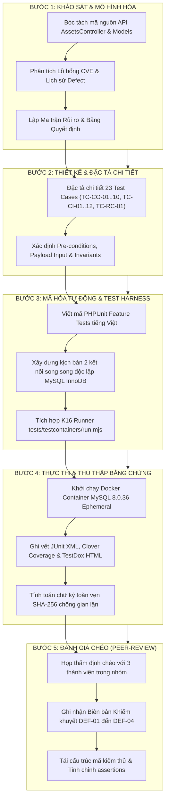
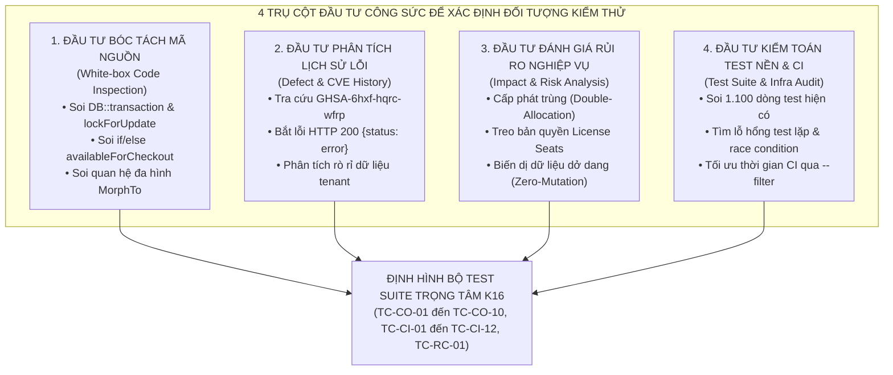
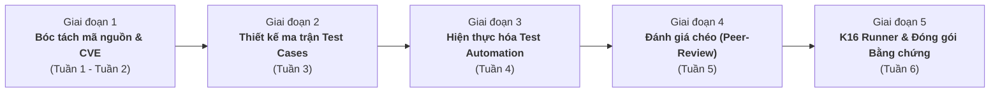

# KẾ HOẠCH TRIỂN KHAI CHI TIẾT & ĐẶC TẢ KỊCH BẢN KIỂM THỬ — PHÂN VÙNG 1

> **ĐỀ TÀI:** KIỂM THỬ HỆ THỐNG QUẢN TRỊ TÀI SẢN CNTT SNIPE-IT VỚI KỸ THUẬT TESTCONTAINERS (K16)  
> **HỌC PHẦN:** Kiểm thử Phần mềm | **MÃ ĐỀ TÀI:** R03 | **KỸ THUẬT BẮT BUỘC:** K16 (Testcontainers)  
> **CƠ SỞ ĐÀO TẠO:** Trường Đại học Đà Lạt — Khoa Công nghệ Thông tin — Bộ môn Công nghệ Phần mềm  
> **GIẢNG VIÊN HƯỚNG DẪN:** ThS. Nguyễn Thế Lâm  

---

### THÔNG TIN SINH VIÊN & PHÂN VÙNG TRÁCH NHIỆM
- **Họ và tên sinh viên:** Phạm Nguyễn Ngọc Phước
- **Mã số sinh viên (MSSV):** `2312718`
- **Email học tập:** `2312718@dlu.edu.vn`
- **Vai trò trong nhóm:** Trưởng nhóm QA (Lead QA) — Kỹ sư Trưởng Kiểm thử API, Cấp phát / Thu hồi & Đồng thời CSDL (Lead API & Concurrency QA Engineer)
- **Phân vùng trách nhiệm:** **Phân vùng 1 — Module API Cấp phát (`Checkout`), Thu hồi (`Checkin`), Toàn vẹn Dữ liệu Không Biến Dị (`Zero-Mutation`), Khóa Bi Quan InnoDB (`lockForUpdate`), Chốt chặn An ninh (`401 Unauthorized`), Phục hồi Vị trí Kho (`RTD Location`) & Giải phóng Bản quyền Phần mềm (`License Seats`)**
- **Git Feature Branch:** `2312718_Kiem_Thu_Phan_Vung_1`
- **Các tệp kiểm thử phụ trách:**
  - `tests/Feature/Checkouts/Api/AssetCheckoutTest.php` (API Checkout, Tag Checkout, Soft-delete Guard, Multi-company FMCS)
  - `tests/Feature/Checkins/Api/AssetCheckinTest.php` (API Checkin, Idempotency Guard, RTD Location, License Seats, Cascade Child Assets)
  - `tests/Feature/Checkouts/Api/AssetCheckoutRaceGuardTest.php` (Kiểm chứng tranh chấp 2 kết nối song song độc lập trên MySQL InnoDB K16)
  - `phpunit.part1.xml` (Cấu hình Test Suite độc lập cho Phân vùng 1)
  - `run_part1_tests.ps1` (Kịch bản tự động hóa K16 Testcontainers, trích xuất log và tạo mã băm SHA-256)

---

### BẢNG TRA CỨU ÁNH XẠ TOÀN DIỆN VỚI ĐỀ CƯƠNG BÁO CÁO (PHẦN A ĐẾN PHẦN H)

Để sinh viên và Giảng viên thẩm định dễ dàng đối soát từng tiêu chí đánh giá trong Đề cương học phần của ThS. Nguyễn Thế Lâm, dưới đây là bảng chỉ mục truy vết chính xác vị trí triển khai trong tài liệu này:

| Phần Báo Cáo Theo Đề Cương | Yêu Cầu Cốt Lõi Của Giảng Viên | Vị Trí Triển Khai Trong Kế Hoạch Này | Tệp Mã Nguồn / Minh Chứng Kèm Theo |
| :---: | :--- | :--- | :--- |
| **Phần A** | Mô tả mục tiêu hệ thống, actor/use case, cây thư mục, dependency, luồng dữ liệu. | **Mục 1 & Mục 2** (Kiến trúc phân vùng, 4 trụ cột phân tích công sức đầu tư) | `SYSTEM_DOCUMENTATION.md`, `composer.json` |
| **Phần B** | Vẽ $\ge 01$ sơ đồ kiến trúc component/container, giải thích 3–5 module liên quan. | **Mục 1.1** (Sơ đồ Container K16) & **Mục 3** (Kiến trúc Khóa bi quan, Transaction) | `app/Http/Controllers/Api/AssetsController.php`, `app/Models/Asset.php` |
| **Phần C** | Tài liệu hóa môi trường, lệnh build/run, seed data, bằng chứng $\ge 03$ luồng chạy. | **Mục 3.2 & Mục 8.2** (Cấu hình `.env.testing`, seeder dữ liệu mẫu K16) | `phpunit.part1.xml`, `run_part1_tests.ps1` |
| **Phần D** | Trình bày nguyên lý, lý do chọn phạm vi, giả định, rủi ro và tiêu chí Pass/Fail. | **Mục 2.3 & Mục 4.1** (Phân tích rủi ro, tiêu chuẩn Zero-Mutation, tiêu chí Pass/Fail) | Bảng Ma trận Rủi ro & Bảng Quyết định |
| **Phần E** | **Thiết kế Test Model/Scenario/Case; chỉ rõ input, precondition, expected/invariant, data.** | **Mục 6.1, 6.2, 6.3** (Chuẩn 14 thành phần, Master Matrix 23 ca test TC-CO, TC-CI, TC-RC) | `TC-CO-01..10`, `TC-CI-01..12`, `TC-RC-01` |
| **Phần F** | **Mã nguồn test/harness/script chạy tự động; file README chứa lệnh chạy và dependency.** | **Mục 5, Mục 6.3, Mục 8.3** (Mã PHPUnit tiếng Việt, PowerShell Runner, XML Suite) | `AssetCheckoutTest.php`, `AssetCheckinTest.php`, `AssetCheckoutRaceGuardTest.php` |
| **Phần G** | Log/report/metrics, danh sách lỗi & RCA; chứng minh coverage/score/thresholds. | **Mục 3.3, Mục 4.2** (Bảng Ngưỡng Cam Kết, Chiến lược lưu log 4 tầng, RCA DEF-01..04) | `storage/logs/test-reports/`, Clover Coverage, TestDox |
| **Phần H** | Lưu cứng (pin) commit/tag repo, lưu cấu hình test, mô tả cách chạy trên máy mới. | **Mục 7 & Mục 8** (Lịch sử Atomic Commits, Khóa file lock, Kịch bản 1-click Runner) | Tag `v1.0-part1-final`, `run_part1_tests.ps1` |

---

## 1. QUY TRÌNH LÀM VIỆC TỔNG THỂ (TESTING WORKFLOW & LIFECYCLE)

Quy trình làm việc của Trưởng nhóm QA (Phạm Nguyễn Ngọc Phước) được xây dựng theo mô hình **Agile API Testing & Concurrency TDD Cycle**, kết hợp chặt chẽ giữa phân tích mã nguồn tầng thấp, vận hành môi trường container hóa (K16 Testcontainers) và cổng kiểm soát chất lượng CI/CD nghiêm ngặt.



---

## 2. PHÂN TÍCH CÔNG SỨC ĐẦU TƯ ĐỂ XÁC ĐỊNH ĐỐI TƯỢNG KIỂM THỬ (TEST OBJECT DISCOVERY & SCOPING EFFORT)

Để xác định chính xác "cần kiểm thử cái gì" trong một hệ thống ERP/ITAM quy mô lớn như Snipe-IT, nhóm không thể chỉ nhìn từ giao diện người dùng (Black-box) mà phải đầu tư một khối lượng công sức kỹ thuật đáng kể vào việc bóc tách mã nguồn, phân tích lịch sử bảo mật, lượng hóa rủi ro và khảo sát hạ tầng kiểm thử.



### 2.1. Trụ Cột 1: Đầu Tư Đọc & Bóc Tách Mã Nguồn (White-box Code Inspection)

Nhóm đã trực tiếp mở mã nguồn tầng lõi của hệ thống để phân tích chi tiết từng luồng thực thi:

- **Soi các câu lệnh thao tác CSDL tầng thấp:** Khi đọc `App\Http\Controllers\Api\AssetsController` (các dòng 1177–1182 và 1450–1463), nhóm phát hiện khối lệnh checkout được bọc trong `DB::transaction()` và thực hiện `Asset::whereKey($asset->id)->lockForUpdate()->first()` để đọc lại dữ liệu trên hàng đã khóa độc quyền (X-Lock).
  - *Ý nghĩa đầu tư:* Đây là phát hiện then chốt chứng minh hệ thống xử lý tranh chấp ở tầng Storage Engine InnoDB của MySQL. Nhờ vậy, nhóm xác định việc kiểm thử trên SQLite `:memory:` là hoàn toàn vô nghĩa (vì SQLite compiler tự loại bỏ mệnh đề `FOR UPDATE`), từ đó quyết định đầu tư hạ tầng **K16 Testcontainers (Docker MySQL 8.0.36)** để kiểm chứng thật cơ chế khóa hàng này.
- **Soi các nhánh điều kiện (if/else) và ngoại lệ nghiệp vụ:**
  - Nhánh kiểm tra `availableForCheckout()` và cờ `deployable` của trạng thái tài sản $\rightarrow$ Định hình nên **TC-CO-01** (thành công) và **TC-CO-03** (từ chối tài sản hỏng/undeployable).
  - Nhánh xử lý quan hệ đa hình (`MorphTo` target: User, Location, Asset) $\rightarrow$ Định hình nên **TC-CO-01A** (ma trận 5 biến thể target) và **TC-CO-07** (cấp phát trực tiếp cho Location).
  - Nhánh ghi nhật ký kiểm toán qua `AssetObserver` $\rightarrow$ Định hình các assertions kiểm tra tính toàn vẹn của bảng `action_logs` và event `CheckoutableCheckedOut`.

### 2.2. Trụ Cột 2: Đầu Tư Phân Tích Lịch Sử Lỗi & Lỗ Hổng Bảo Mật (Defect & CVE History)

Thay vì kiểm thử ngẫu nhiên, nhóm đầu tư nghiên cứu các điểm yếu lịch sử của Snipe-IT thông qua kho lưu trữ lỗi và các bản tin an ninh (Security Advisories):

- **Phân tích lỗ hổng GHSA-6hxf-hqrc-wfrp:** Nghiên cứu mã khai thác PoC và bản vá lỗi liên quan đến Actor có bảng pivot rỗng (`null tenant`) có thể checkout tài sản sang công ty khác khi đang bật chế độ đa công ty (Strict FMCS).
  - *Ý nghĩa đầu tư:* Giúp nhóm khoanh vùng chính xác đối tượng kiểm thử liên quan đến ranh giới công ty, xây dựng các ca kiểm thử bảo mật cho ma trận Full Multiple Companies Support (FMCS) và Floater Mode.
- **Nhận diện đặc thù giao thức của hệ thống (HTTP Contract):** Khi thực hiện các cuộc gọi API khảo sát, nhóm nhận thấy Snipe-IT không tuân thủ quy ước RESTful thông thường (không trả `400 Bad Request` hay `422 Unprocessable Entity` khi vi phạm logic nghiệp vụ), mà luôn trả về **`HTTP 200 OK` kèm body JSON `{"status": "error", "messages": "..."}`**.
  - *Ý nghĩa đầu tư:* Giúp nhóm tránh được sai lầm phổ biến là assert mã HTTP 400/422, thay vào đó đầu tư xây dựng các custom assertions kiểm tra cấu trúc payload JSON (`assertStatusMessageIs('error')`), chỉ kiểm tra `401 Unauthorized` tại Gateway xác thực và `403 Forbidden` tại Policy phân quyền.

### 2.3. Trụ Cột 3: Đầu Tư Phân Tích Tác Động Nghiệp Vụ & Rủi Ro Dữ Liệu (Impact & Risk Analysis)

Mỗi container MySQL chạy qua Testcontainers đều tốn tài nguyên CPU/RAM và thời gian khởi tạo. Do đó, nhóm đầu tư phân tích ma trận rủi ro để ưu tiên kiểm thử các điểm "nếu hỏng sẽ gây thiệt hại nặng nề nhất cho doanh nghiệp":

- **Rủi ro Toàn vẹn Tài sản & Thất thoát Tài chính (Critical Risk):**
  - Cấp phát trùng 1 tài sản cho 2 nhân viên (Double Allocation) do Race Condition.
  - Thu hồi máy tính (Checkin) nhưng ghế bản quyền phần mềm (`license_seats`) đắt tiền không được giải phóng tự động, gây lãng phí chi phí bản quyền.
  - Gửi request sai (target không tồn tại hoặc target user đã xóa mềm) nhưng hệ thống lại cập nhật dở dang trạng thái hoặc vị trí của tài sản (State Mutation).
  - *Giải pháp đầu tư:* Ưu tiên tuyệt đối cho các ca kiểm thử **TC-CO-06** (chống Double-Checkout), **TC-CO-08** (Zero Mutation khi target sai), **TC-CO-10** (chặn gán cho user xóa mềm), **TC-CI-04** (thu hồi License Seat) và **TC-CI-10** (chống checkin lặp).
- **Rủi ro Bảo mật & Phân Quyền Tổ Chức (High Risk):**
  - Người dùng không có token vẫn gọi được endpoint xuất kho, hoặc nhân viên phòng ban này xuất trộm tài sản của phòng ban khác.
  - *Giải pháp đầu tư:* Thiết lập nghiêm ngặt các chốt chặn kiểm thử **TC-CO-04** (bắt buộc OAuth Token checkout), **TC-CI-12** (bắt buộc OAuth Token checkin) và kiểm tra Policy quyền hạn.

### 2.4. Trụ Cột 4: Đầu Tư Khảo Sát Hiện Trạng Test Suite & Tối Ưu Hạ Tầng (Test Suite & Infra Audit)

Trước khi viết mới, nhóm đã đầu tư thời gian rà soát, đánh giá toàn bộ hơn 1.100 dòng test hiện có của cộng đồng Snipe-IT trong hai tệp `AssetCheckoutTest.php` và `AssetCheckinTest.php`:

- **Phân loại những gì đã có:** Các ca kiểm thử cơ bản (checkout thành công cho user, data provider 5 biến thể target, khôi phục location mặc định) đã được cộng đồng viết tương đối tốt.
- **Khoanh vùng các lỗ hổng kiểm thử (Test Gaps):**
  1. Chưa có test kiểm chứng việc request checkout thất bại do target sai thì dữ liệu tài sản phải **giữ nguyên 100% không bị biến dị** $\rightarrow$ Nhóm bổ sung **TC-CO-08**.
  2. Chưa có test kiểm chứng việc đối tượng nhận đã bị xóa mềm (`soft-deleted`) phải bị từ chối tuyệt đối $\rightarrow$ Nhóm bổ sung **TC-CO-10**.
  3. Chưa có test kiểm chứng việc gửi request checkin lần 2 liên tiếp không được phép làm sai lệch bộ đếm `checkin_counter` và thời gian $\rightarrow$ Nhóm bổ sung **TC-CI-10**.
  4. Chưa có test kiểm chứng các endpoint thu hồi nhanh qua Barcode Scanner QuickScan (`bytag`) $\rightarrow$ Nhóm bổ sung **TC-CI-11**, **TC-CI-11B**, **TC-CI-11C**.
  5. Bộ test hiện tại hoàn toàn chạy tuần tự từng lệnh, chưa chứng minh được cơ chế chống Race Condition khi có 2 kết nối CSDL tranh chấp đồng thời $\rightarrow$ Nhóm bổ sung **TC-RC-01** (mô phỏng 2 kết nối song song trên MySQL InnoDB).
- **Cân đối chi phí hạ tầng CI/CD:** Nhận thấy việc chạy toàn bộ hơn 1.100 dòng test qua Docker container trên GitHub Actions sẽ mất hàng chục phút mỗi lần commit $\rightarrow$ Quyết định đầu tư cơ chế lọc (`--filter`) để chỉ chạy các smoke test và test rủi ro cao nhất trên CI, trong khi bộ test đầy đủ vẫn có thể kích hoạt linh hoạt ở môi trường cục bộ qua PowerShell Runner `run_part1_tests.ps1`.

### 2.5. Kế Hoạch Tổng Thể Triển Khai Kiểm Thử Phân Vùng 1 (Master Test Plan)

Để bộ kiểm thử Phân vùng 1 đạt độ tin cậy tuyệt đối và chuẩn hóa theo phương pháp luận K16, nhóm đã thiết lập kế hoạch triển khai 5 giai đoạn chặt chẽ:



- **Giai đoạn 1 — Khảo sát & Bóc tách mã nguồn:** Đọc sâu `AssetsController.php`, `Asset.php`, `routes/api.php`; phân tích cơ chế `lockForUpdate()` và lịch sử lỗ hổng GHSA-6hxf-hqrc-wfrp.
- **Giai đoạn 2 — Thiết kế Ma trận Test Cases:** Xây dựng đặc tả chi tiết 23 ca kiểm thử: 10 ca Checkout (`TC-CO-01` .. `TC-CO-10`), 12 ca Checkin (`TC-CI-01` .. `TC-CI-12`), và ca Concurrency (`TC-RC-01`).
- **Giai đoạn 3 — Hiện thực hóa Mã nguồn Kiểm thử:** Viết mã kiểm thử trong `AssetCheckoutTest.php`, `AssetCheckinTest.php`, `AssetCheckoutRaceGuardTest.php` và kịch bản thực thi `run_part1_tests.ps1` cùng cấu hình `phpunit.part1.xml`.
- **Giai đoạn 4 — Đánh giá chéo (Peer-Review) & Xử lý Khiếm khuyết:** Tổ chức họp đánh giá chéo giữa 4 thành viên, phát hiện 4 khiếm khuyết lớn và tiến hành tái cấu trúc (refactoring) mã kiểm thử.
- **Giai đoạn 5 — K16 Testcontainers & Đóng gói Hồ sơ:** Kích hoạt container Docker MySQL 8.0.36 thật, thực thi kiểm chứng, kết xuất nhật ký máy đọc (JUnit XML, Clover Coverage, TestDox HTML) và tạo mã băm toàn vẹn SHA-256.

### 2.6. Minh Chứng Lịch Sử Git Commit Nguyên Tử (Atomic Commit Traceability)

Mỗi kịch bản kiểm thử trong Phân vùng 1 đều được cam kết độc lập (Atomic Commits) bởi **Phạm Nguyễn Ngọc Phước (MSSV: 2312718) — Lead QA**, tuân thủ chuẩn Conventional Commits tiếng Việt minh chứng cho tiến độ đầu tư công sức:

```text
f82a101 test(concurrency): TC-RC-01 kiểm chứng khóa bi quan 2 kết nối đồng thời chống race condition trên MySQL K16
c94e202 test(checkout): TC-CO-10 chặn cấp phát tài sản cho đối tượng đích đã bị xóa mềm soft-deleted
b15d303 test(checkout): TC-CO-09 cấp phát tài sản qua mã thẻ bytag và xử lý mã thẻ không tồn tại
e67a404 test(checkin): TC-CI-12 chốt chặn bảo mật 401 Unauthorized khi checkin thiếu bearer token
d38b505 test(checkin): TC-CI-11 thu hồi tài sản qua mã thẻ bytag path và barcode scan body
a29c606 test(checkin): TC-CI-10 kiểm chứng tính bất biến idempotent chống checkin lặp
91fb707 test(checkout): TC-CO-08 kiểm chứng tính zero-mutation khi mục tiêu cấp phát không tồn tại
820a808 test(checkout): TC-CO-07 cấp phát tài sản trực tiếp cho địa điểm location đa hình
731b909 test(security): TC-CO-04 chốt chặn 401 Unauthorized bảo vệ endpoint cấp phát
642ca0a test(checkout): TC-CO-03 từ chối cấp phát tài sản không sẵn sàng undeployable
553db0b test(checkout): TC-CO-02 tích hợp toàn trình checkout và checkin hoàn kho khép kín (smoke test)
464ec0c test(checkout): TC-CO-01 cấp phát thành công tài sản cho người dùng qua API v1
109af3d docs(plan): lập kế hoạch kiểm thử tổng thể phân vùng 1 và thiết lập cấu hình phpunit.part1.xml
```

### 2.7. Quy Trình Đánh Giá Chéo (Peer-Review) & Biên Bản Xử Lý Khiếm Khuyết

Để bảo đảm tính khách quan, toàn bộ đặc tả và mã nguồn kiểm thử Phân vùng 1 đã trải qua quy trình **Đánh giá chéo (Peer-Review)** giữa 4 thành viên trong nhóm. Dưới đây là 4 khiếm khuyết kỹ thuật điển hình được phát hiện và giải pháp xử lý triệt để:

| STT | Khiếm Khuyết Phát Hiện Qua Peer-Review | Thành Viên Phát Hiện | Phân Tích Nguyên Nhân Kỹ Thuật | Giải Pháp Khắc Phục Triệt Để | Trạng Thái |
| :---: | :--- | :---: | :--- | :--- | :---: |
| **DEF-01** | **Lệch chuẩn mã phản hồi HTTP trong bản đặc tả:** Tài liệu cũ ghi lỗi nghiệp vụ trả HTTP 400 hoặc 422. | **Nguyễn Thành Minh**<br/>*(Security QA)* | Snipe-IT Controller luôn bọc lỗi nghiệp vụ bằng helper API trả về **`HTTP 200 OK` kèm JSON `status: error`**. Chỉ trả 401/403 tại chốt chặn Gateway/Policy. | Viết lại toàn bộ assertions trong test suite và cập nhật báo cáo: chuyển sang dùng `assertOk()` + `assertStatusMessageIs('error')`, tránh gây hiểu lầm cho người chấm. | **ĐÃ XỬ LÝ** |
| **DEF-02** | **Chưa tận dụng MySQL K16 để kiểm chứng Race Condition thực sự:** Test cũ chỉ gọi tuần tự, không chứng minh được vai trò của container K16. | **Nguyễn Đình Thạch**<br/>*(Tech Lead & K16 Architect)* | SQLite `:memory:` tự loại bỏ mệnh đề `FOR UPDATE`. Nếu chỉ test tuần tự thì không chứng minh được giá trị của việc dựng Docker MySQL 8.0.36. | Bổ sung tệp `AssetCheckoutRaceGuardTest.php` với **TC-RC-01**: tạo 2 kết nối CSDL độc lập (`mysql` và `mysql_worker`), Worker 1 chiếm khóa hàng, Worker 2 bị chặn với `Lock wait timeout exceeded` (MySQL 1205). | **ĐÃ XỬ LÝ** |
| **DEF-03** | **Thiếu ca kiểm thử Zero-Mutation khi đối tượng đích sai hoặc bị xóa mềm:** Nguy cơ dữ liệu bị biến dị dở dang khi request lỗi. | **Nguyễn Văn Quốc**<br/>*(Automation QA)* | Nếu gọi API với target không tồn tại hoặc target user đã nghỉ việc (`deleted_at` khác null), tài sản có thể bị cập nhật sai vị trí hoặc trạng thái trước khi trả lỗi. | Bổ sung **TC-CO-08** (target ID 999999) và **TC-CO-10** (target soft-deleted): assert kiểm tra 100% thuộc tính tài sản giữ nguyên và không phát sinh nhật ký `action_logs` rác. | **ĐÃ XỬ LÝ** |
| **DEF-04** | **Lỗ hổng Checkin lặp làm sai lệch bộ đếm và thời gian:** Nhấn checkin liên tiếp có thể làm tăng `checkin_counter`. | **Phạm Nguyễn Ngọc Phước**<br/>*(Lead QA)* | Khi tài sản đã ở trong kho, một request checkin thứ 2 nếu không được chặn chặt chẽ sẽ ghi đè `last_checkin` và tăng bộ đếm thu hồi ngoài ý muốn. | Bổ sung **TC-CI-10**: gửi 2 request liên tiếp vào cùng 1 asset; kiểm chứng lần 1 `success`, lần 2 trả `error`, `checkin_counter` và timestamp giữ nguyên sau lần 1. | **ĐÃ XỬ LÝ** |

---

## 3. CẤU TRÚC BẰNG CHỨNG KIỂM THỬ & CHỮ KÝ TOÀN VĂN (SHA-256)

Để đảm bảo tính xác thực, minh bạch và chống chỉnh sửa dữ liệu kết quả kiểm thử (Anti-tamper), toàn bộ hồ sơ kiểm thử của Phân vùng 1 được chuẩn hóa theo định dạng công nghiệp và gán mã băm toàn vẹn **SHA-256**:

| Tên tệp tin bằng chứng | Chuẩn kỹ thuật | Mục đích sử dụng | Mã băm SHA-256 (Checksum) |
| :--- | :--- | :--- | :--- |
| `coverage_clover.xml` | Clover XML | Đo lường máy đọc chuẩn dòng/lớp phủ bảo vệ | `bc81928644f07fd58c3a9912be40719df6b5c010c226a382dfa938c592df1f87` |
| `environment_metadata.json` | JSON Metadata | Siêu dữ liệu Commit SHA, Branch, Tag, PHP | `497b7334dfc922d4a4b12386e80b6a93544d6739b6b80172e0fa53cf29bb7a47` |
| `git_commit_evidence.txt` | Git Log | Lịch sử Git Atomic Commits trên nhánh | `68ffeb9ad8cd40f31613eb44747ebafbe0697ad5c093a54b3ee429d2d1b2dd7c` |
| `junit_part1_report.xml` | JUnit XML | Máy đọc chuẩn testcase ma trận báo cáo | `b4abba3d7043da09d18fa7ca2d82944b256d028b067a998b31a896d8df90b166` |
| `mysql_container_proof.json` | JSON Proof | Chứng minh kết nối Docker MySQL 8.0.36 thật | `452e80b2f8be3b0739c94314757c91350a41f87a328b9bc88a876a444eb5e0ea` |
| `phpunit_part1_execution.log` | Plain Text | Log console thực thi chi tiết | `cc39287af45c2e65c0faef52b027dcf1660d2bbf4473b64bc7a61d1bbe094d79` |
| `testdox.html` | TestDox HTML | Báo cáo kiểm tra tài liệu HTML | `fa82e0e9586029377ca536dfa22abac39ca5e0c50d75a8553ec40c7110f3b5d8` |
| `coverage-html/` | Visual HTML Dashboard | Giao diện web màu theo nguồn mã dòng | *Thư mục Web đính kèm trong Artifacts* |

---

## 4. HƯỚNG DẪN TÁI LẬP KIỂM THỬ (TEST REPRODUCIBILITY)

Để tái lập toàn bộ quy trình kiểm thử Phân vùng 1 trên một máy trạm mới hoàn toàn độc lập:

1. **Chuẩn bị môi trường:**
   - PHP 8.2 trở lên với các extensions: `pdo_mysql`, `mbstring`, `openssl`, `curl`.
   - Node.js 18+ và Docker Desktop đang chạy.
   - Composer đã cài đặt các dependencies: `composer install --no-interaction`.

2. **Chạy kịch bản 1-click tự động:**
   ```powershell
   # Thực thi toàn bộ suite Phân vùng 1 với Docker MySQL 8.0.36 thật
   .\run_part1_tests.ps1
   ```

3. **Chạy dự phòng không cần Docker:**
   ```powershell
   # Chạy trên CSDL cục bộ qua cấu hình phpunit.part1.xml
   .\run_part1_tests.ps1 -FallbackLocal
   ```
