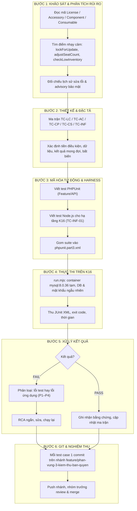
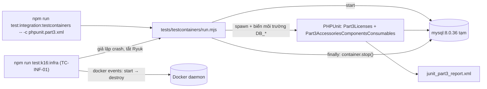
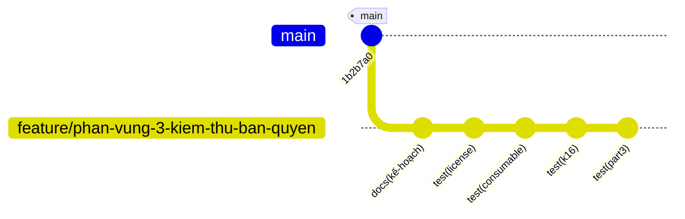

# KẾ HOẠCH TRIỂN KHAI CHI TIẾT & ĐẶC TẢ KỊCH BẢN KIỂM THỬ — PHÂN VÙNG 3

> **ĐỀ TÀI:** KIỂM THỬ HỆ THỐNG QUẢN TRỊ TÀI SẢN CNTT SNIPE-IT VỚI KỸ THUẬT TESTCONTAINERS (K16)  
> **HỌC PHẦN:** Kiểm thử Phần mềm | **MÃ ĐỀ TÀI:** R03 | **KỸ THUẬT BẮT BUỘC:** K16 (Testcontainers)  
> **CƠ SỞ ĐÀO TẠO:** Trường Đại học Đà Lạt — Khoa Công nghệ Thông tin — Bộ môn Công nghệ Phần mềm  
> **GIẢNG VIÊN HƯỚNG DẪN:** ThS. Nguyễn Thế Lâm  

---

### THÔNG TIN SINH VIÊN & PHÂN VÙNG TRÁCH NHIỆM
- **Họ và tên sinh viên:** Nguyễn Đình Thạch
- **Mã số sinh viên (MSSV):** `2314506`
- **Vai trò trong nhóm:** Thành viên 3 — Team Leader & Infrastructure Lead (theo README)
- **Phân vùng trách nhiệm:** **Phân vùng 3 — Bản quyền phần mềm (`License`, `LicenseSeat`), Phụ kiện (`Accessory`), Linh kiện (`Component`), Vật tư tiêu hao (`Consumable`) & hạ tầng K16 (`tests/testcontainers/run.mjs`)**
- **Git Feature Branch:** `feature/phan-vung-3-kiem-thu-ban-quyen`
- **Các tệp kiểm thử & cấu hình phụ trách:**
  - `phpunit.part3.xml` — cấu hình 2 suite và phạm vi đo coverage 12 tệp mã nguồn của Phân vùng 3
  - `tests/Unit/Models/LicenseTest.php` — `TC-LC-01`
  - `tests/Feature/Licenses/Api/LicenseProductKeyMaskingTest.php` — `TC-LC-02`
  - `tests/Feature/Licenses/Api/LicenseSeatAllocationLimitTest.php` — `TC-LC-03`, `TC-LC-05`
  - `tests/Feature/Licenses/Api/UpdateLicenseTest.php` — `TC-LC-04` (**mới**)
  - `tests/Feature/Accessories/Api/AccessoryQuantityOnCheckoutTest.php` — `TC-AC-01`, `TC-AC-02`
  - `tests/Feature/Components/Api/ComponentAttachToAssetTest.php` — `TC-CP-01`
  - `tests/Feature/Checkins/Api/ComponentCheckinTest.php` — `TC-CP-02` (test gốc của Snipe-IT, đưa vào phạm vi)
  - `tests/Feature/Checkouts/Api/ConsumableCheckoutTest.php` — `TC-CS-01`
  - `tests/Feature/Consumables/ConsumableLowStockAlertTest.php` — `TC-CS-02` (**mới**)
  - `tests/testcontainers/crash-cleanup.test.mjs` + `tests/testcontainers/fixtures/CrashingProcessTest.php` — `TC-INF-01` (**mới**)

> [!NOTE]
> **Trạng thái thực thi (cập nhật sau khi chạy K16 trên máy cục bộ, 26/11/2026):**
> - `phpunit.part3.xml` trên MySQL `8.0.36` tạm: **PASS 200/200 test, 733 assertion, 0 failure, 0 error**, thời gian khoảng 19 phút (PHP 8.4.26, PHPUnit 11.5.55).
> - `TC-INF-01` (`npm run test:k16:infra`): **PASS 2/2** (crash PHPUnit exit 255; không tìm thấy PHP), thời gian 28 giây.
> - Chưa đo coverage: máy chạy chưa có PCOV/Xdebug (xem mục 3.3). Chưa có lần chạy GitHub Actions cho cấu hình này.

---

### BẢNG TRA CỨU ÁNH XẠ VỚI ĐỀ CƯƠNG BÁO CÁO (PHẦN A ĐẾN PHẦN H)

| Phần Báo Cáo | Yêu Cầu Cốt Lõi | Vị Trí Trong Kế Hoạch Này | Tệp / Minh Chứng |
| :---: | :--- | :--- | :--- |
| **Phần A** | Mục tiêu hệ thống, actor, module, luồng dữ liệu | Mục 1, Mục 2 | `app/Models/License.php`, `Accessory.php`, `Component.php`, `Consumable.php` |
| **Phần B** | Sơ đồ kiến trúc, 3–5 module liên quan | Mục 1.1 (sơ đồ K16), Mục 6.1 (module & điểm nhạy cảm) | `app/Http/Controllers/Api/*`, `app/Models/Traits/AdjustsQuantity.php` |
| **Phần C** | Môi trường, lệnh build/run, seed data, bằng chứng chạy | Mục 3, Mục 8 | `tests/testcontainers/run.mjs`, `.env.testing.example` |
| **Phần D** | Nguyên lý, phạm vi, giả định, rủi ro, tiêu chí Pass/Fail | Mục 4, Mục 6.1 | Bảng rủi ro Phân vùng 3 |
| **Phần E** | **Test model / scenario / case: input, precondition, expected, invariant, data** | **Mục 6.2, 6.3** | `TC-LC-01..05`, `TC-AC-01..02`, `TC-CP-01..02`, `TC-CS-01..02`, `TC-INF-01` |
| **Phần F** | **Mã test / harness / script tự động; README lệnh chạy** | **Mục 5, Mục 6.3, Mục 8** | `phpunit.part3.xml`, `crash-cleanup.test.mjs`, `package.json` (`test:k16:infra`) |
| **Phần G** | Log / report / metrics, danh sách lỗi & RCA | Mục 3.2, Mục 4 | `storage/logs/test-reports/junit_part3_report.xml` |
| **Phần H** | Pin commit/tag, lưu cấu hình test, chạy trên máy mới | Mục 7, Mục 8 | Nhánh `feature/phan-vung-3-kiem-thu-ban-quyen` |

---

## 1. QUY TRÌNH LÀM VIỆC TỔNG THỂ (TESTING WORKFLOW & LIFECYCLE)



### 1.1 Sơ đồ thực thi K16 của Phân vùng 3



---

## 2. CÁC GIAI ĐOẠN CÔNG VIỆC CHI TIẾT (WORK BREAKDOWN STRUCTURE)

| Giai đoạn | Công việc | Đầu ra | Ước lượng |
| :--- | :--- | :--- | :---: |
| 1. Khảo sát | Đọc mã 4 module, liệt kê 9 điểm `lockForUpdate`, cơ chế `adjustSeatCount`, `checkLowInventory`, khối `finally` của runner | Danh sách điểm nhạy cảm (mục 6.1) | 2 giờ |
| 2. Phân tích rủi ro | Lịch sử sửa lỗi (118/661 commit sửa lỗi trong 3 năm), 1 advisory High (chèn phụ kiện chéo công ty) | Bảng rủi ro (mục 4.3) | 1,5 giờ |
| 3. Thiết kế | Đặc tả 3 test case mới, gắn mã cho các test đã có | Ma trận mục 6.2 | 1,5 giờ |
| 4. Hiện thực | `TC-LC-04`, `TC-CS-02`, `TC-INF-01`, `phpunit.part3.xml`, script `test:k16:infra` | Mã test | 3 giờ |
| 5. Thực thi | Chạy từng test và toàn bộ suite trên K16, xử lý lỗi phát sinh | JUnit XML, log | 2 giờ |
| 6. Nghiệm thu | Commit theo từng test case, cập nhật tài liệu, bàn giao nhóm trưởng | Nhánh Git | 1 giờ |

---

## 3. PHƯƠNG PHÁP & TIÊU CHUẨN THU THẬP BẰNG CHỨNG KIỂM THỬ

### 3.1 Các kênh thu thập bằng chứng
| Kênh | Công cụ | Nội dung |
| :--- | :--- | :--- |
| Kết quả test | PHPUnit `--log-junit` | Số test, assertion, failure, error, thời gian từng ca |
| Mã thoát | `run.mjs` (`process.exitCode`) | Mã thoát của PHPUnit được chuyển nguyên vẹn ra ngoài |
| Vòng đời container | `docker events` (TC-INF-01) | Sự kiện `start` và `destroy` của container `mysql:8.0.36` |
| Phiên bản mã | `git rev-parse HEAD` | Commit được kiểm thử |
| Môi trường | `php -v`, `node -v`, `docker version` | Ghi kèm khi báo cáo |

### 3.2 Lưu trữ log
- JUnit XML ghi vào `storage/logs/test-reports/junit_part3_report.xml` (thư mục đã nằm trong `.gitignore`, không commit).
- Khi nộp báo cáo, chép file JUnit và log console sang thư mục minh chứng của nhóm, đặt tên kèm ngày và mã commit.

### 3.3 Lệnh chạy

```powershell
# Toàn bộ Phân vùng 3 trên MySQL 8.0.36 tạm (Docker phải đang chạy)
npm run test:integration:testcontainers -- -c phpunit.part3.xml

# Chỉ một test case
npm run test:integration:testcontainers -- tests/Feature/Licenses/Api/UpdateLicenseTest.php --filter=tc_lc_04

# TC-INF-01: dọn container khi crash
npm run test:k16:infra
```

> [!WARNING]
> **Không chạy `vendor/bin/phpunit` trực tiếp.** Repo không có `.env.testing`; PHPUnit sẽ dùng CSDL trong `.env` và xóa dữ liệu. Luôn chạy qua runner K16.
>
> **Coverage:** máy chạy hiện chưa có PCOV/Xdebug nên chưa có số coverage. Khi cần, cài PCOV rồi thêm `--coverage-text` sau dấu `--`.

---

## 4. QUY TRÌNH XỬ LÝ: TRƯỜNG HỢP PHÁT HIỆN LỖI VÀ KHÔNG CÓ LỖI

### 4.1 Khi test FAIL
1. **Phân loại trước khi sửa:** lỗi nằm ở test (giả định sai, dữ liệu sai) hay ở ứng dụng.
2. Ghi nhận theo mức độ: **P1** mất/sai dữ liệu, vượt quyền · **P2** nghiệp vụ chính sai · **P3** chức năng phụ · **P4** hiển thị.
3. RCA ngắn (nguyên nhân → bằng chứng → cách sửa), sửa, chạy lại trên K16.

**Ví dụ thực tế trong lúc làm Phân vùng 3 (lỗi phía test, không phải lỗi ứng dụng):**

| Ca | Hiện tượng | Nguyên nhân | Cách xử lý |
| :--- | :--- | :--- | :--- |
| TC-CS-02 | `Error: Call to undefined method AlertRecipient::getKey()` | `Notification::fake()` gọi `getKey()` trên người nhận, nhưng `AlertRecipient` không phải model Eloquent | Kiểm tra lệnh `snipeit:inventory-alerts` qua output, giống test gốc `SendInventoryAlertsTest` |
| TC-INF-01 | Test báo “Runner phải khởi động ít nhất 1 container” dù runner chạy đúng | Docker daemon chỉ giữ ~256 sự kiện gần nhất; hàng trăm sự kiện `exec_*` (kiểm tra sức khỏe MySQL) đẩy mất sự kiện `start` khi đọc lại `docker events --since` sau khi chạy | Mở luồng `docker events` trước khi chạy runner, chỉ lọc `start`/`destroy` |
| `phpunit.part3.xml` | `Comment must not contain '--'` | Chú thích XML chứa lệnh có hai dấu gạch ngang | Chuyển lệnh chạy sang mục 3.3 của tài liệu này |

### 4.2 Khi test PASS
- Ghi số test/assertion/thời gian vào mục Trạng thái.
- Với test mới, kiểm tra test **có khả năng bắt lỗi** (mutation testing thủ công): cài một lỗi nhỏ vào mã ở bản sao tạm (git worktree), chạy lại, test phải FAIL, rồi hoàn nguyên.

**Kết quả mutation của 3 test case mới (26/11/2026):**

| Lỗi cài thử | Mã bị sửa | Kết quả |
| :--- | :--- | :--- |
| M-LC04: cho xóa cả ghế đang cấp khi giảm số ghế | `License::adjustSeatCount()` bỏ điều kiện `whereNull('assigned_to')->whereNull('asset_id')` | **Bị bắt:** 2/2 test TC-LC-04 FAIL |
| M-CS02: cảnh báo khi còn lại **bằng** `min_amt` | `Helper::checkLowInventory()` đổi `<` thành `<=` | **Bị bắt:** test TC-CS-02 kịch bản 1 FAIL tại điểm biên còn 3 = `min_amt` |
| M-INF01: bỏ `await container.stop()` trong khối `finally` | `tests/testcontainers/run.mjs` | **Bị bắt:** 2/2 test TC-INF-01 FAIL, báo đúng mã container bị bỏ lại |

### 4.3 Rủi ro của Phân vùng 3
| Rủi ro | Mức | Test case liên quan |
| :--- | :---: | :--- |
| Cấp ghế license vượt số ghế đã mua | Cao | TC-LC-03, TC-LC-05 |
| Giảm số ghế làm mất ghế đang cấp cho người dùng | Cao | TC-LC-04 |
| Lộ product key cho người không có quyền | Trung bình | TC-LC-02 |
| Số lượng phụ kiện/linh kiện/vật tư sai sau checkout–checkin | Trung bình | TC-AC-01..02, TC-CP-01..02, TC-CS-01 |
| Không cảnh báo khi vật tư xuống dưới mức tối thiểu | Trung bình | TC-CS-02 |
| Container MySQL bị bỏ lại khi lần chạy crash (tốn tài nguyên CI, lộ DB tạm) | Trung bình | TC-INF-01 |
| Cấp phát đồng thời vượt giới hạn (9 điểm `lockForUpdate`) | Cao | **Chưa có test** — cần hai kết nối CSDL độc lập, để giai đoạn sau |

---

## 5. TÍCH HỢP CI/CD

- Workflow hiện có: `.github/workflows/testcontainers.yml` (Ubuntu, PHP 8.2, Docker sẵn có).
- Đề xuất thêm 2 bước cho Phân vùng 3 trong workflow của nhóm:
  ```yaml
  - run: npm run test:integration:testcontainers -- -c phpunit.part3.xml
  - run: npm run test:k16:infra
  ```
- Cổng chất lượng: nhánh chỉ được merge khi cả hai bước trên PASS; không dùng retry để che lỗi chập chờn.
- Khi CI thất bại: tải JUnit XML từ artifact, phân loại theo mục 4.1, sửa trên chính nhánh feature.

---

## 6. THIẾT KẾ KỊCH BẢN KIỂM THỬ

### 6.1 Module và điểm nhạy cảm
| Module | Mã nguồn chính | Điểm nhạy cảm |
| :--- | :--- | :--- |
| License & ghế | `app/Models/License.php`, `LicenseSeat.php`, `Api/LicensesController.php`, `Api/LicenseSeatsController.php` | `adjustSeatCount()` chỉ xóa ghế trống; `freeSeat(lock: true)`; `availCount()` loại ghế đã gán và ghế unreassignable |
| Phụ kiện | `app/Models/Accessory.php`, `Api/AccessoriesController.php` | Khóa hàng khi checkout; số lượng còn lại |
| Linh kiện | `app/Models/Component.php`, `Api/ComponentsController.php` | Số lượng gán qua pivot `assigned_qty` |
| Vật tư tiêu hao | `app/Models/Consumable.php`, `Api/ConsumablesController.php`, `Helper::checkLowInventory()` | Cảnh báo khi `còn lại < min_amt + alert_threshold` (nhỏ hơn hẳn) |
| Hạ tầng K16 | `tests/testcontainers/run.mjs` | `finally { await container.stop(); }`, xóa `.env.testing` tạm |

### 6.2 Ma trận kịch bản kiểm thử (Master Test Matrix)
| Mã | Tên | Tệp / hàm | Loại | Ưu tiên | Trạng thái |
| :--- | :--- | :--- | :--- | :---: | :--- |
| TC-LC-01 | Tính toán ghế license (log thêm/bớt ghế, % còn lại, ghế trống) | `LicenseTest` | Unit | Trung bình | Đã có |
| TC-LC-02 | Che product key theo quyền | `LicenseProductKeyMaskingTest` | Feature/API | Trung bình | Đã có |
| TC-LC-03 | Không cấp vượt số ghế | `LicenseSeatAllocationLimitTest::test_license_seat_allocation_limits` | Feature/API | Cao | Đã có |
| **TC-LC-04** | **Chặn giảm số ghế xuống dưới số ghế đang cấp** | `UpdateLicenseTest::test_tc_lc_04_*` | Feature/API | Cao | **Mới** |
| TC-LC-05 | Thu hồi và cấp lại ghế, số ghế trống qua API | `LicenseSeatAllocationLimitTest` (2 hàm) | Feature/API | Cao | Đã có |
| TC-AC-01 | Checkout phụ kiện giảm tồn, không vượt số còn lại | `AccessoryQuantityOnCheckoutTest` | Feature/API | Trung bình | Đã có |
| TC-AC-02 | Checkin phụ kiện hoàn tồn | `AccessoryQuantityOnCheckoutTest` | Feature/API | Trung bình | Đã có |
| TC-CP-01 | Gắn linh kiện vào tài sản, checkin toàn phần/một phần | `ComponentAttachToAssetTest` | Feature/API | Trung bình | Đã có |
| TC-CP-02 | Checkin linh kiện: quyền, số lượng, đa công ty, log | `ComponentCheckinTest` (Api) | Feature/API | Trung bình | Đã có (test gốc) |
| TC-CS-01 | Checkout vật tư: quyền, số lượng, log, đa công ty, hết hàng | `ConsumableCheckoutTest` (Api) | Feature/API | Trung bình | Đã có |
| **TC-CS-02** | **Cảnh báo chạm ngưỡng tối thiểu `min_amt` sau khi xuất vật tư** | `ConsumableLowStockAlertTest` | Feature/API + Console | Trung bình | **Mới** |
| **TC-INF-01** | **Dọn container MySQL khi lần chạy K16 bị crash** | `crash-cleanup.test.mjs` | Hạ tầng (Node.js) | Trung bình | **Mới** |

### 6.3 Đặc tả chi tiết 3 test case mới

#### 📋 TC-LC-04: Chặn cắt giảm tổng số ghế xuống nhỏ hơn số ghế đang cấp phát
| Thành phần | Nội dung |
| :--- | :--- |
| Mục tiêu | Không thể làm mất ghế đang cấp cho người dùng bằng cách giảm tổng số ghế |
| Kỹ thuật | Phân tích giá trị biên (giảm xuống dưới / đúng bằng số ghế đang cấp) |
| Tiền điều kiện | License 5 ghế, 3 ghế đã gán cho 3 người dùng; người thực hiện có quyền `licenses.edit` |
| Bước 1 | `PATCH /api/v1/licenses/{id}` với `seats = 2` |
| Kết quả mong đợi 1 | Phản hồi `status = error`; `seats` vẫn = 5; vẫn 5 bản ghi ghế; 3 ghế vẫn gán; không có log `delete seats` |
| Bước 2 (biên) | `PATCH` với `seats = 3` |
| Kết quả mong đợi 2 | `status = success`; còn 3 ghế, cả 3 là ghế đang gán; có log `delete seats` với `quantity = 2` |
| Bất biến | Số ghế đang gán không bao giờ giảm do thao tác sửa số ghế |
| Cơ sở mã | `License::adjustSeatCount()` chỉ xóa ghế có `assigned_to` và `asset_id` NULL; thiếu ghế trống thì trả `false` và hủy lưu |
| Hàm test | `test_tc_lc_04_cannot_reduce_seats_below_number_of_assigned_seats`, `test_tc_lc_04_reducing_seats_down_to_assigned_count_only_removes_free_seats` |

#### 📋 TC-CS-02: Cảnh báo chạm ngưỡng tối thiểu `min_amt` khi xuất vật tư tiêu hao
| Thành phần | Nội dung |
| :--- | :--- |
| Mục tiêu | Sau khi xuất vật tư qua API, hệ thống cảnh báo đúng thời điểm số còn lại xuống dưới mức tối thiểu |
| Kỹ thuật | Phân tích giá trị biên quanh `min_amt` và `min_amt + alert_threshold` |
| Tiền điều kiện | Bật cảnh báo (`alerts_enabled = 1`, có `alert_email`) |
| Kịch bản 1 | `qty = 5`, `min_amt = 3`, `alert_threshold = 0`: xuất 2 (còn 3 = `min_amt`) → **chưa** cảnh báo, lệnh `snipeit:inventory-alerts` báo “No low inventory items found”; xuất thêm 1 (còn 2) → cảnh báo, lệnh báo “below minimum inventory” |
| Kịch bản 2 | `qty = 10`, `min_amt = 3`, `alert_threshold = 2`: còn 6 → chưa cảnh báo; còn 4 (< 5) → cảnh báo dù vẫn trên `min_amt` |
| Kịch bản 3 | `min_amt = NULL`: xuất hết vẫn không cảnh báo |
| Bất biến | Cảnh báo khi và chỉ khi `còn lại < min_amt + alert_threshold` |
| Ghi chú | Test gốc `CheckLowInventoryTest` đã thử điểm biên với số lượng đặt sẵn; TC-CS-02 bổ sung luồng đầu-cuối qua checkout API thật và lệnh gửi cảnh báo |
| Hàm test | `test_tc_cs_02_low_stock_alert_fires_only_after_remaining_drops_below_min_amt`, `test_tc_cs_02_alert_threshold_widens_the_warning_band`, `test_tc_cs_02_consumable_without_min_amt_is_never_flagged` |

#### 📋 TC-INF-01: Dọn container MySQL khi lần chạy K16 bị crash
| Thành phần | Nội dung |
| :--- | :--- |
| Mục tiêu | Chứng minh khối `finally { await container.stop(); }` trong `run.mjs` luôn dọn container, kể cả khi lần chạy thất bại đột ngột |
| Tiền điều kiện | Docker đang chạy; không có lần chạy K16 nào khác chạy song song |
| Cô lập yếu tố | Tắt Ryuk (`TESTCONTAINERS_RYUK_DISABLED=true`) để chắc chắn việc dọn là do `finally`, không phải do Ryuk |
| Kịch bản a | PHPUnit chết đột ngột: fixture `CrashingProcessTest` gọi `exit(255)` → runner trả mã 255 |
| Kịch bản b | Không tìm thấy PHP (`PHP_BINARY` trỏ tới file không tồn tại) → runner ném lỗi “PHP CLI was not found” |
| Kết quả mong đợi | Trong `docker events` có ít nhất 1 container `mysql:8.0.36` được `start` và mọi container đó đều có `destroy`; `docker ps -a` không còn container đó; `.env.testing` tạm được xóa lại như trước khi chạy |
| Lệnh | `npm run test:k16:infra` |

---

## 7. QUY CHUẨN QUẢN LÝ MÃ NGUỒN (GIT WORKFLOW)

### 7.1 Nhánh
- Nhánh làm việc: `feature/phan-vung-3-kiem-thu-ban-quyen`, tách từ `main` tại commit `1b2b7a0`.
- Thành viên push nhánh; nhóm trưởng review và merge vào `main`.

### 7.2 Commit theo từng test case
Theo quy chuẩn Conventional Commits tiếng Việt của nhóm, **mỗi test case một commit**:



---

## 8. TÁI LẬP TRÊN MÁY MỚI

1. Cài PHP ≥ 8.2, Composer, Node.js ≥ 18, Docker Desktop (đang chạy).
2. `composer install` và `npm install`.
3. Nếu `php` không có trong PATH, đặt `PHP_BINARY` trỏ tới `php.exe`.
4. Chạy các lệnh ở mục 3.3. Runner tự tạo `.env.testing` tạm từ `.env.testing.example` và xóa sau khi chạy.
