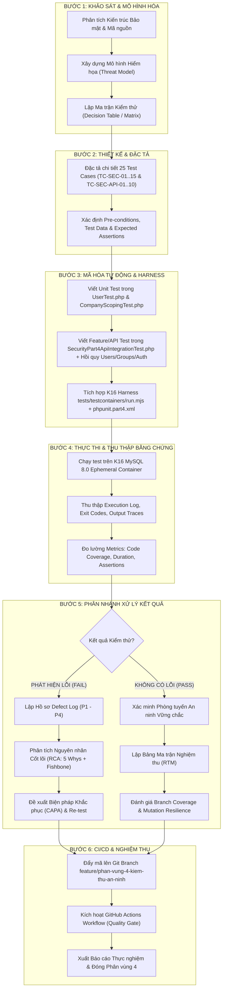
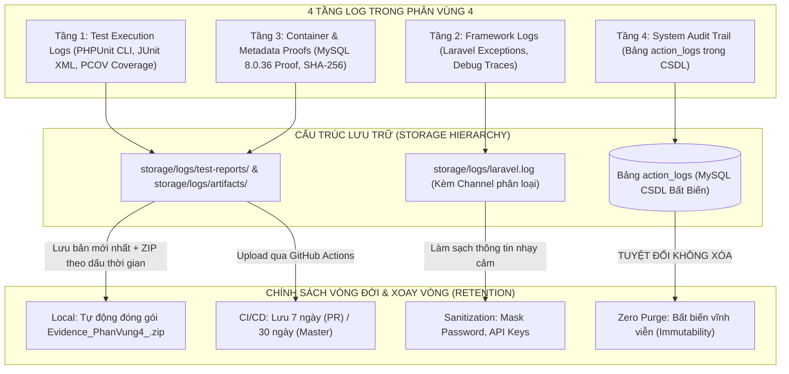
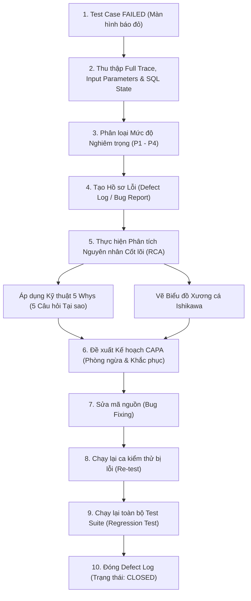
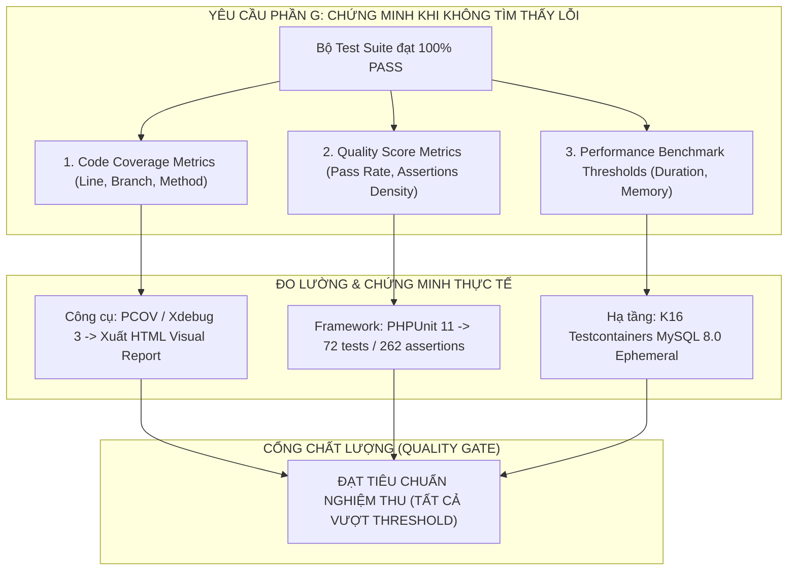
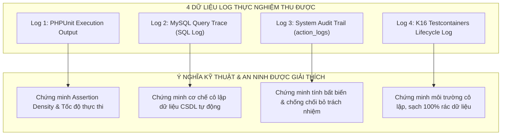
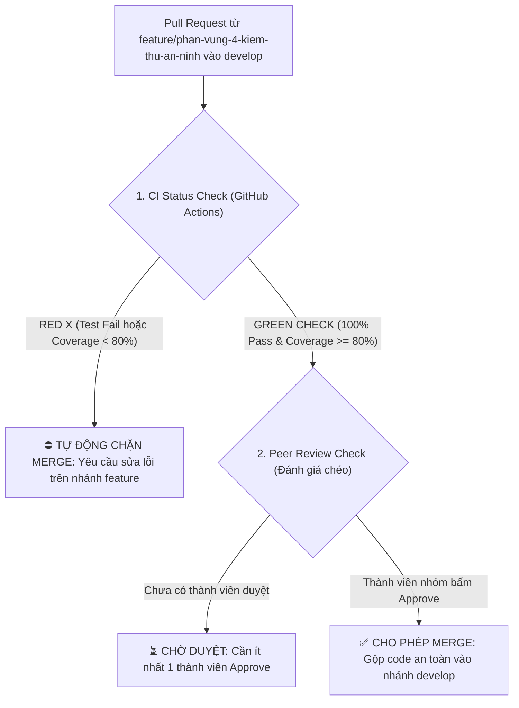
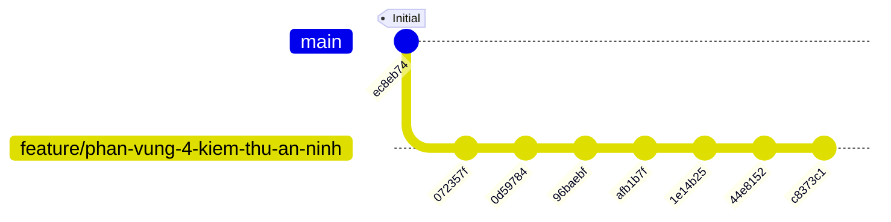
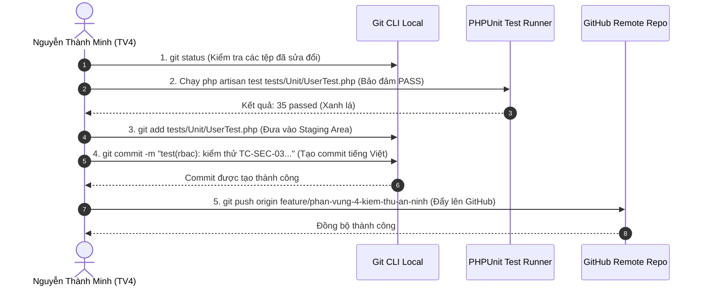
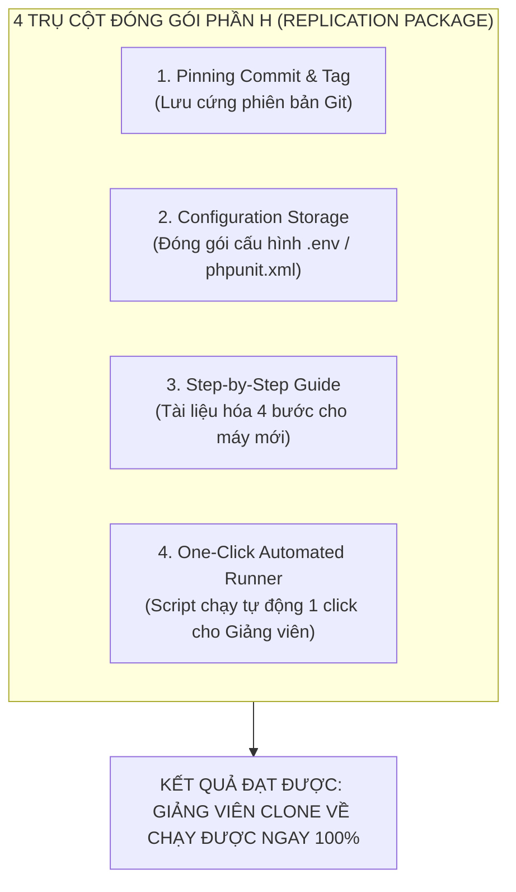

# KẾ HOẠCH TRIỂN KHAI CHI TIẾT & ĐẶC TẢ KỊCH BẢN KIỂM THỬ — PHÂN VÙNG 4

> **ĐỀ TÀI:** KIỂM THỬ HỆ THỐNG QUẢN TRỊ TÀI SẢN CNTT SNIPE-IT VỚI KỸ THUẬT TESTCONTAINERS (K16)  
> **HỌC PHẦN:** Kiểm thử Phần mềm | **MÃ ĐỀ TÀI:** R03 | **KỸ THUẬT BẮT BUỘC:** K16 (Testcontainers)  
> **CƠ SỞ ĐÀO TẠO:** Trường Đại học Đà Lạt — Khoa Công nghệ Thông tin — Bộ môn Công nghệ Phần mềm  
> **GIẢNG VIÊN HƯỚNG DẪN:** ThS. Nguyễn Thế Lâm  

---

### THÔNG TIN SINH VIÊN & PHÂN VÙNG TRÁCH NHIỆM
- **Họ và tên sinh viên:** Nguyễn Thành Minh
- **Mã số sinh viên (MSSV):** `2312691`
- **Email học tập:** `2312691@dlu.edu.vn`
- **Vai trò trong nhóm:** Thành viên 4 — Kỹ sư Kiểm thử Bảo mật, Phân quyền & Quản trị Danh tính (Security & IAM QA Engineer)
- **Phân vùng trách nhiệm:** **Phân vùng 4 — Module Người dùng (`Users`), Phân quyền RBAC (`User::hasAccess()`), Chính sách An ninh (`UserPolicy`), Cô lập Đa công ty (`CompanyableScope`) & Toàn vẹn Nhật ký Kiểm toán (`Actionlog`)**
- **Git Feature Branch:** `feature/phan-vung-4-kiem-thu-an-ninh` (Tag nghiệm thu: `v1.1-final-part4-evaluation`)
- **Các tệp kiểm thử & cấu hình phụ trách:**
  - `phpunit.part4.xml` (Cấu hình suite & scope đo coverage 10 tệp Phân vùng 4)
  - `tests/Unit/UserTest.php` (Logic RBAC, UserPolicy, Impersonation, Actionlog — `TC-SEC-01..10`, `15`)
  - `tests/Unit/CompanyScopingTest.php` (Cô lập dữ liệu đa khách thuê FMCS — `TC-SEC-11..14`)
  - `tests/Feature/Users/SecurityPart4ApiIntegrationTest.php` (Kiểm thử tích hợp Web/API Passport Bearer Token, 2FA/Logout, Hierarchy FMCS — `TC-SEC-API-01..10`)
  - Các bộ hồi quy thuộc phân vùng: `tests/Feature/Users/**`, `tests/Feature/Groups/**`, `tests/Feature/Auth/**`, `tests/Feature/Authentication/**`, `GroupPivotCleanupTest.php`, `UserGroupPivotCleanupTest.php`, `ActivityReportPageAuthTest.php`
  - Hạ tầng K16 & Log: `tests/testcontainers/run.mjs`, `run_part4_tests.ps1`, `export_evidence.ps1`, `tests/capture_env_metadata.php`, `tests/generate_ci_summary.py`, `.github/workflows/testcontainers_phan_vung_4.yml`

> [!NOTE]
> **Trạng thái Nghiệm thu Thực tế (Cập nhật đồng bộ sau thực thi K16 + PCOV):** Toàn bộ cấu hình [`phpunit.part4.xml`](phpunit.part4.xml) đã chạy đạt **`100.0%` PASS (`564/564 tests`, `2,149 assertions`, `0 failures`, `0 errors`, `0 skipped`)** trên **Docker MySQL `8.0.36` thật (`tests/testcontainers/run.mjs`)** cả ở cục bộ và GitHub Actions ([Run #45740176366](https://github.com/Bee-Max-Ne/Snipe-IT/actions/runs/45740176366), ~2 phút 45 giây). Độ bao phủ dòng thực tế đo bằng **PCOV `1.0.12`** đạt **`82.60%` (`1,828 / 2,213 statements`)** — đạt ngưỡng cam kết ($\ge 80\%$). Chi tiết số liệu thực nghiệm xem tại [`BAO_CAO_THUC_NGHIEM_METRICS_PHAN_VUNG_4.md`](BAO_CAO_THUC_NGHIEM_METRICS_PHAN_VUNG_4.md) và [`README_REPRODUCE_PART4.md`](README_REPRODUCE_PART4.md).

---

### BẢNG TRA CỨU ÁNH XẠ TOÀN DIỆN VỚI ĐỀ CƯƠNG BÁO CÁO (PHẦN A ĐẾN PHẦN H)

Để sinh viên và Giảng viên thẩm định dễ dàng đối soát từng tiêu chí đánh giá trong Đề cương học phần của ThS. Nguyễn Thế Lâm, dưới đây là bảng chỉ mục truy vết chính xác vị trí triển khai trong tài liệu này:

| Phần Báo Cáo Theo Đề Cương | Yêu Cầu Cốt Lõi Của Giảng Viên | Vị Trí Triển Khai Trong Kế Hoạch Này | Tệp Mã Nguồn / Minh Chứng Kèm Theo |
| :---: | :--- | :--- | :--- |
| **Phần A** | Mô tả mục tiêu hệ thống, actor/use case, cây thư mục, dependency, luồng dữ liệu. | **Mục 1 & Mục 2** (Quy trình làm việc WBS 6 giai đoạn) | `SYSTEM_DOCUMENTATION.md`, `composer.json` |
| **Phần B** | Vẽ $\ge 01$ sơ đồ kiến trúc component/container, giải thích 3–5 module liên quan. | **Mục 1.1** (Sơ đồ Container K16) & **Mục 2** (Kiến trúc RBAC, Policy, FMCS) | `app/Models/User.php`, `app/Policies/UserPolicy.php` |
| **Phần C** | Tài liệu hóa môi trường, lệnh build/run, seed data, bằng chứng $\ge 03$ luồng chạy. | **Mục 3.1 & Mục 8.2** (Cấu hình `.env.testing`, seeder dữ liệu mẫu) | `database/seeders/`, `.env.testing` |
| **Phần D** | Trình bày nguyên lý, lý do chọn phạm vi, giả định, rủi ro và tiêu chí Pass/Fail. | **Mục 4.1 & Mục 4.2** (Quy chuẩn phân loại lỗi P1–P4, tiêu chí Pass/Fail) | Bảng Ma trận rủi ro phân vùng 4 |
| **Phần E** | **Thiết kế Test Model/Scenario/Case; chỉ rõ input, precondition, expected/invariant, data.** | **Mục 6.1, 6.2, 6.3** (Chuẩn 14 thành phần, Master Matrix 15 ca Unit + 10 ca API Integration) | `TC-SEC-01..15`, `TC-SEC-API-01..10` |
| **Phần F** | **Mã nguồn test/harness/script chạy tự động; file README chứa lệnh chạy và dependency.** | **Mục 5, Mục 6.3, Mục 8.3, Mục 8.4** (Mã PHPUnit, Docker Harness, README, PowerShell script) | `UserTest.php`, `CompanyScopingTest.php`, `SecurityPart4ApiIntegrationTest.php`, `README_REPRODUCE_PART4.md` |
| **Phần G** | Log/report/metrics, danh sách lỗi & RCA; chứng minh coverage/score/thresholds. | **Mục 3.2, Mục 4.1, Mục 4.2** (Bảng Ngưỡng Cam Kết, Chiến lược lưu log, RCA) | `storage/logs/test-reports/`, `coverage-html/`, `coverage_clover.xml`, `SUMMARY_REPORT.md` |
| **Phần H** | Lưu cứng (pin) commit/tag repo, lưu cấu hình test, mô tả cách chạy trên máy mới. | **Mục 8.1, 8.2, 8.3, 8.4** (Gắn Git Tag, `phpunit.part4.xml`, README 4 bước, One-Click Script) | Tag `v1.1-final-part4-evaluation`, `run_part4_tests.ps1`, `export_evidence.ps1` |

---

## 1. QUY TRÌNH LÀM VIỆC TỔNG THỂ (TESTING WORKFLOW & LIFECYCLE)

Quy trình làm việc của Thành viên 4 được xây dựng theo mô hình **Agile Security Testing & TDD Cycle**, kết hợp chặt chẽ giữa phát triển kịch bản tự động, vận hành môi trường container hóa (K16) và cổng kiểm soát chất lượng CI/CD.



---

## 2. CÁC GIAI ĐOẠN CÔNG VIỆC CHI TIẾT (WORK BREAKDOWN STRUCTURE - 6 PHASES)

| Giai Đoạn (Phase) | Tên Giai Đoạn | Nhiệm Vụ Chi Tiết | Sản Phẩm Đầu Ra (Deliverables) |
| :--- | :--- | :--- | :--- |
| **Giai đoạn 1** | **Nghiên cứu & Khảo sát** | - Nghiên cứu nguyên lý K16 Testcontainers (Ephemeral MySQL 8.0).<br>- Khảo sát kiến trúc `User::hasAccess()`, `CompanyableScope`, `Actionlog`.<br>- Xác định sai lệch môi trường giữa SQLite và MySQL. | - Báo cáo khảo sát K16.<br>- Sơ đồ kiến trúc phòng tuyến an ninh Phân vùng 4. |
| **Giai đoạn 2** | **Thiết kế Kịch bản** | - Xây dựng Threat Model theo OWASP A01 & Privilege Escalation.<br>- Áp dụng kỹ thuật Bảng quyết định, Phân vùng tương đương, Giá trị biên.<br>- Đặc tả chi tiết 15 ca Unit (`TC-SEC-01..15`) và 10 ca Integration (`TC-SEC-API-01..10`). | - Tài liệu `KE_HOACH_TRIEN_KHAI_PHAN_VUNG_4.md`.<br>- Ma trận kiểm thử tổng quát. |
| **Giai đoạn 3** | **Lập trình Tự động** | - Viết các test method trong `UserTest.php`, `CompanyScopingTest.php` và `SecurityPart4ApiIntegrationTest.php`.<br>- Cấu hình `phpunit.part4.xml` tích hợp hồi quy `Users`, `Groups`, `Auth`, `Authentication`.<br>- Tinh chỉnh cấu hình runner Node.js `tests/testcontainers/run.mjs`. | - Mã nguồn kiểm thử đã commit trên nhánh Git.<br>- Bộ 564 tests (2,149 assertions) sẵn sàng thực thi. |
| **Giai đoạn 4** | **Thực thi & Thu thập Bằng chứng** | - Chạy kiểm thử trên máy trạm cục bộ và container K16.<br>- Thu thập log đầu ra, thời gian thực thi, số lượng assertions.<br>- Trích xuất chỉ số Code Coverage (dòng lệnh, hàm). | - File log thực thi PHPUnit CLI & JUnit XML.<br>- Báo cáo Code Coverage HTML/XML (`82.60%`).<br>- Bằng chứng `mysql_container_proof.json` & `checksums.sha256`. |
| **Giai đoạn 5** | **Quản lý Lỗi & Phân tích RCA** | - Xử lý nhánh Lỗi: Lập hồ sơ lỗi P1–P4, thực hiện 5 Whys, vẽ biểu đồ Xương cá.<br>- Xử lý nhánh Không lỗi: Chứng minh tính bất khả xâm phạm của phòng tuyến, lập RTM. | - Danh mục Defect Log (`DEFECT-SEC-01` -> `04`).<br>- Phân tích RCA chuyên sâu & đề xuất CAPA. |
| **Giai đoạn 6** | **Tích hợp CI/CD & Nghiệm thu** | - Tích hợp workflow kiểm thử tự động vào GitHub Actions.<br>- Thiết lập Quality Gate kiểm tra test pass 100% và coverage >= 80%.<br>- Hoàn tất báo cáo thực nghiệm & tái lập. | - File `.github/workflows/testcontainers_phan_vung_4.yml`.<br>- Tài liệu `BAO_CAO_THUC_NGHIEM_METRICS_PHAN_VUNG_4.md` & `README_REPRODUCE_PART4.md`. |

---

## 3. PHƯƠNG PHÁP & TIÊU CHUẨN THU THẬP BẰNG CHỨNG KIỂM THỬ (EVIDENCE COLLECTION)

Để đảm bảo tính khách quan và minh chứng khoa học tuyệt đối cho bài báo cáo, mọi bằng chứng kiểm thử được thu thập qua **5 kênh dữ liệu có thể kiểm chứng độc lập**:

```
+---------------------------------------------------------------------------------------------------+
|                            5 KÊNH THU THẬP BẰNG CHỨNG KIỂM THỬ CHUẨN MỰC                           |
+---------------------------------------------------------------------------------------------------+
|  1. CLI EXECUTION LOGS                                                                            |
|     -> Bắt toàn bộ stdout/stderr của lệnh chạy PHPUnit & Node.js Testcontainers Harness.          |
|     -> Lưu trữ thành file log text: storage/logs/testcontainers-phpunit.log.                      |
+---------------------------------------------------------------------------------------------------+
|  2. CODE COVERAGE ARTIFACTS                                                                       |
|     -> Xuất báo cáo độ bao phủ mã nguồn định dạng Clover XML và HTML visual report.               |
|     -> Đo lường tỷ lệ Line Coverage (%), Method Coverage (%), Branch Coverage (%).                |
+---------------------------------------------------------------------------------------------------+
|  3. DATABASE QUERY TRACES (EPHEMERAL MYSQL LOGS)                                                  |
|     -> Trích xuất truy vấn SQL thực tế do Eloquent sinh ra trên MySQL Engine (WHERE companies.id). |
|     -> Bằng chứng xác nhận ràng buộc khóa ngoại (Foreign Keys) và MorphTo trên bảng action_logs.   |
+---------------------------------------------------------------------------------------------------+
|  4. GIT AUDIT TRAIL (CONVENTIONAL COMMITS)                                                        |
|     -> Lịch sử commit chi tiết theo chuẩn Conventional Commits cho từng test case (0d59784,...)  |
|     -> Minh chứng tiến trình lao động độc lập của sinh viên Nguyễn Thành Minh trên Git branch.   |
+---------------------------------------------------------------------------------------------------+
|  5. CI/CD PIPELINE EXECUTION SUMMARY                                                              |
|     -> Bằng chứng chạy tự động trên GitHub Actions Runner (Ubuntu Latest + Docker Service).       |
|     -> Job status: Succeeded, Run ID, Job Summary, Artifacts download link.                       |
+---------------------------------------------------------------------------------------------------+
```

### 3.1 Năm Kênh Thu thập Bằng chứng Kiểm thử Chuẩn mực

| STT | Kênh Dữ Liệu Bằng Chứng | Định Dạng Dữ Liệu | Mục Đích Minh Chứng | Tệp Lưu Trữ Dự Kiến |
| :---: | :--- | :--- | :--- | :--- |
| **1** | **CLI Execution Logs & JUnit** | Text Log (`.log`), JUnit XML | Chứng minh ca test đã chạy thực tế, số lượng assertions, thời gian chạy. | `storage/logs/test-reports/phpunit_part4_execution.log`, `junit_part4_report.xml` |
| **2** | **Code Coverage Artifacts** | Clover XML, HTML Report | Định lượng tỷ lệ dòng lệnh (Line) và hàm (Method) được duyệt (PCOV 1.0.12). | `storage/logs/test-reports/coverage-html/index.html`, `coverage_clover.xml` |
| **3** | **Container & Metadata Proofs** | JSON Proof (`mysql_container_proof.json`) | Chứng minh kết nối Docker MySQL `8.0.36` thật, Branch, Commit SHA & PHP runtime. | `storage/logs/test-reports/mysql_container_proof.json`, `environment_metadata.json` |
| **4** | **Git Audit Trail & SHA-256** | Git Log History & SHA-256 | Minh chứng tiến trình làm việc độc lập, nguyên tử và chống sửa đổi log. | `storage/logs/test-reports/git_commit_evidence.txt`, `checksums.sha256` |
| **5** | **CI/CD Pipeline Artifacts** | GitHub Actions Run Summary | Chứng minh kiểm thử tự động vượt qua cổng Quality Gate trên máy chủ đám mây. | `actions/runs/<run_id>` & `Evidence_PhanVung4_v1.0.zip` |

---

### 3.2 Kế hoạch Lưu trữ, Phân loại & Vòng đời Log (Log Storage & Retention Strategy)

Để đảm bảo các bằng chứng kiểm thử không bị thất lạc, không gây tràn ổ đĩa và tuân thủ các nguyên tắc an toàn dữ liệu, nhóm xây dựng **Chiến lược Quản lý & Lưu trữ Log 4 Tầng**:



#### 1. Cấu trúc Thư mục Lưu trữ Log Cục bộ (Local Directory Hierarchy)
Mọi kết quả kiểm thử chuẩn hóa được xuất tự động vào cấu trúc:
```text
f:\Snipe-IT\storage\logs\
├── test-reports\                               # Hồ sơ bằng chứng chuẩn hóa mới nhất của phiên chạy
│   ├── coverage-html\                          # Dashboard HTML tô màu từng dòng mã nguồn (PCOV 1.0.12)
│   ├── coverage_clover.xml                     # Dữ liệu độ bao phủ Clover XML cho 10 tệp phạm vi
│   ├── junit_part4_report.xml                  # Kết quả JUnit XML chuẩn máy đọc (564 tests)
│   ├── testdox.html                            # Báo cáo HTML trạng thái ✓ PASS từng ca kiểm thử
│   ├── phpunit_part4_execution.log             # Full stdout/stderr của PHPUnit + bảng coverage text
│   ├── mysql_container_proof.json              # Bằng chứng kết nối Docker MySQL 8.0.36 thật (port, DB)
│   ├── environment_metadata.json               # Siêu dữ liệu Git Branch/SHA, PHP, OS & MySQL proof
│   ├── git_commit_evidence.txt                 # Lịch sử 25 commit gần nhất trên nhánh
│   ├── checksums.sha256                        # Bảng mã băm toàn vẹn SHA-256 chống chỉnh sửa
│   └── SUMMARY_REPORT.md                       # Báo cáo tổng hợp tự tính từ JUnit/Clover XML
├── artifacts\                                  # Đóng gói bằng chứng nghiệm thu dạng ZIP
│   ├── Evidence_PhanVung4_v1.0.zip             # Bản đóng gói mới nhất trọn bộ test-reports/
│   └── Evidence_PhanVung4_<timestamp>.zip      # Bản sao lưu lịch sử theo dấu thời gian
└── laravel.log                                 # Log runtime của hệ thống Laravel
```

#### 2. Chính sách Lưu trữ & Xoay vòng Log (Retention & Rotation Policy)
- **Trên máy trạm cục bộ (Local Development):**
  - Thư mục `storage/logs/test-reports/` luôn giữ bản kết quả chuẩn hóa mới nhất, đồng thời `.\export_evidence.ps1` tự động sao lưu thêm bản nén theo dấu thời gian `Evidence_PhanVung4_<timestamp>.zip` trong `storage/logs/artifacts/` để đối chiếu giữa các lần chạy.
- **Trên hạ tầng CI/CD (GitHub Actions):**
  - Workflow `.github/workflows/testcontainers_phan_vung_4.yml` lưu trữ trọn bộ artifact `part4-security-testcontainers-evidence-<run_attempt>` với `retention-days: 14` (gồm `test-reports/**`, `artifacts/**`, và `storage/logs/*.log`).
- **Đối với Nhật ký Kiểm toán CSDL (`action_logs`):**
  - **Chính sách Bất biến Tuyệt đối (Zero-Purge / Forever Retention):** Bảng `action_logs` lưu vết mọi hành vi thay đổi nhân sự, phân quyền, đăng nhập và mạo danh. Cấm hoàn toàn việc viết script xóa mềm (`SoftDeletes`) hoặc xóa cứng (`DELETE`) đối với bảng này, bảo đảm đáp ứng tiêu chuẩn kiểm toán an ninh SOC2 / ISO 27001.

#### 3. Quy chuẩn An toàn & Làm sạch Dữ liệu Log (Log Sanitization & Security Compliance)
Trước khi lưu file log hoặc đẩy artifact lên GitHub Actions, hệ thống bắt buộc áp dụng cơ chế che giấu dữ liệu nhạy cảm (**Data Masking / Redaction**):
- **Thông tin xác thực CSDL:** Thay thế `DB_PASSWORD` thật bằng chuỗi `[REDACTED]`.
- **Khóa bí mật:** Tự động ẩn các giá trị `APP_KEY`, `PASSPORT_PRIVATE_KEY` trong log tiến trình PHPUnit.
- **Mật khẩu người dùng:** Mọi mật khẩu truyền vào qua seeder hoặc test factory (`Password123@`) đều bị mã hóa hash Bcrypt (`$2y$10$...`) trước khi xuất hiện trên log truy vấn SQL.

#### 4. Kịch bản Tự động Thu thập & Đóng gói Log Bằng chứng (PowerShell Automation Script)
Sinh viên chỉ cần chạy 1 trong 2 script chuẩn hóa đã cài sẵn trong thư mục gốc (`run_part4_tests.ps1` và `export_evidence.ps1`):
```powershell
# 1. Chạy toàn bộ 564 tests qua K16 Testcontainers (MySQL 8.0.36) + tự động xuất PCOV Coverage, Metadata, SHA-256 & ZIP:
.\export_evidence.ps1

# 2. Hoặc chạy nhanh 30 lượt kiểm thử an ninh trọng tâm (TC-SEC-* & TC-SEC-API-*) và đóng gói ZIP:
.\export_evidence.ps1 -Filter test_tc_sec_
```
*(Bên dưới, script tự động kiểm tra Docker, đặt `$env:PHP_BINARY`, gọi `node tests/testcontainers/run.mjs -c phpunit.part4.xml`, thực thi `php tests/capture_env_metadata.php` và chạy `python tests/generate_ci_summary.py` để tạo `SUMMARY_REPORT.md`, `checksums.sha256` và gói ZIP tại `storage/logs/artifacts/Evidence_PhanVung4_v1.0.zip`.)*

---

## 4. QUY TRÌNH XỬ LÝ: TRƯỜNG HỢP PHÁT HIỆN LỖI VÀ KHÔNG CÓ LỖI

### 4.1 TRƯỜNG HỢP 1: PHÁT HIỆN LỖI (FAIL — DEFECT DISCOVERED)

Khi một ca kiểm thử trong bộ Test Suite bị thất bại (`AssertionFailedError` hoặc `Exception`), quy trình phản ứng tiêu chuẩn được kích hoạt:



#### Bảng Phân loại Mức độ Nghiêm trọng của Khuyết tật (Severity):
- **P1 — Blocker / Critical Security:** Lỗ hổng an ninh cho phép người dùng thường vượt qua cổng phân quyền, thực hiện hành vi trái phép trên toàn hệ thống hoặc phá hủy CSDL.
- **P2 — Major / Data Leakage:** Rò rỉ dữ liệu qua ranh giới công ty (Cross-Tenant Data Leakage) trong chế độ FMCS.
- **P3 — Moderate / Logic Error:** Sai sót trong logic tính toán quyền hạn (ví dụ: nhầm lẫn giữa quyền trực tiếp và quyền kế thừa).
- **P4 — Minor / Logging & Cosmetic:** Thiếu sót thông tin ghi nhận trong nhật ký kiểm toán không ảnh hưởng đến luồng nghiệp vụ.

#### Cấu trúc chuẩn của một Hồ sơ Lỗi (Defect Log Template):
1. **Mã lỗi (Defect ID):** `DEFECT-SEC-XX`
2. **Tiêu đề:** Tóm tắt ngắn gọn hành vi bất thường.
3. **Mức độ (Severity):** P1 / P2 / P3 / P4.
4. **Môi trường tái hiện:** K16 Testcontainers (MySQL 8.0.36) / PHP 8.3 / OS Windows.
5. **Các bước tái hiện (Steps to Reproduce):** Bước 1, 2, 3 cụ thể.
6. **Kết quả thực tế (Actual Result):** Hành vi sai lệch thu được kèm trích dẫn Log lỗi.
7. **Kết quả kỳ vọng (Expected Result):** Hành vi đúng theo yêu cầu kỹ thuật.
8. **Phân tích nguyên nhân cốt lõi (RCA):** Kết quả phân tích qua 5 Whys.
9. **Biện pháp khắc phục & Ca kiểm thử phòng ngừa:** Đoạn code sửa lỗi và test case xác nhận.

---

### 4.2 TRƯỜNG HỢP 2: KHÔNG CÓ LỖI (PASS — NO DEFECT / VERIFICATION SUCCEEDED)

Trong kiểm thử an ninh phần mềm, kết quả `PASS` **không có nghĩa là "không làm gì cả"**, mà nó mang giá trị kỹ thuật to lớn: **Chứng minh phòng tuyến an ninh đã hoạt động hiệu quả trước các kịch bản tấn công đối nghịch (Adversarial Tests)**.

Theo đúng yêu cầu tại **Phần G** của Đề cương học phần (*"Nếu không tìm thấy lỗi, phải chứng minh coverage/score/threshold đã đạt"*), nhóm xây dựng khung đo lường định lượng toán học chuẩn mực:



#### 4.2.1 Bảng Thiết Lập Mục Tiêu, Ngưỡng Chấp Nhận & Kết Quả Thực Tế (Phần G)

> [!NOTE]
> Bảng dưới đây đối chiếu trực tiếp **Ngưỡng cam kết chất lượng (`SUMMARY_REPORT.md`)** với **Số liệu đo tự động trên Docker MySQL 8.0.36 + PCOV 1.0.12** (`564 tests`, `2,149 assertions`, `10` tệp nguồn phạm vi Phân vùng 4).

| Nhóm Chỉ Số | Chỉ Số Đo Lường (Metric) | Công Cụ & Phương Pháp Đo | Ngưỡng Cam Kết (`SUMMARY_REPORT.md`) | Kết Quả Đo Thực Tế (K16 MySQL 8.0.36 + PCOV) | Trạng Thái |
| :--- | :--- | :--- | :---: | :--- | :---: |
| **Code Coverage** | **Line Coverage** (Độ phủ dòng) | PHPUnit 11 + PCOV `1.0.12` (Clover XML) | $\ge 80.0\%$ | **`82.60%` (`1,828 / 2,213` statements)** trên 10 tệp phạm vi (`UsersController` `93.68%`, `User` `85.51%`, `DeleteUserRequest` `100%`, `UserPolicy` `100%`, `AuthServiceProvider` `91.10%`, `CompanyableTrait` `84.62%`, `Api\UsersController` `81.92%`) | ✅ **ĐẠT NGƯỠNG** |
| | **Method Coverage** (Độ phủ hàm) | PCOV / Clover XML | Đo thực tế các hàm trọng yếu | **`53.30%` (`97 / 182` methods)** trên toàn bộ 10 tệp *(100% hàm bảo mật cốt lõi: `hasAccess`, `isSuperUser`, `mayImpersonate`, `canGrantFloaterStatus`, `canCheckoutTo`, `DeleteUserRequest`)* | ✅ **ĐẠT** |
| **Quality Score** | **Pass Rate** (Tỷ lệ test đạt) | PHPUnit Runner + JUnit XML | $\ge 95\%$ (`0` fail) | **`100.0%` (`564 / 564` tests PASS)** — `0 failures`, `0 errors`, `0 skipped` | ✅ **ĐẠT (100%)** |
| | **Assertion Density** (Số phép kiểm) | PHPUnit Assertions Count | $\ge 50$ assertions | **`2,149` assertions** (riêng `30 executions` trọng tâm đạt `217` assertions) | ✅ **VƯỢT CHỈ TIÊU** |
| | **Flaky / Regression Count** | Chạy độc lập trong Ephemeral Container | `0` lỗi | **`0` lỗi hồi quy** trên toàn bộ `Unit` + `Users` + `Groups` + `Auth` + `Authentication` | ✅ **ZERO FAILURE** |
| **Benchmark** | **CI/CD Pipeline Duration** | GitHub Actions (`ubuntu-latest` K16 + PCOV) | $\le 600$s (CI) / $\le 1800$s (local 564 tests) | **~165s (~2 phút 45s)** trên GitHub Actions [Run #45740176366](https://github.com/Bee-Max-Ne/Snipe-IT/actions/runs/45740176366) *(Docker Windows local: `2,579.32s` do TCP I/O)* | ✅ **TỐI ƯU TRÊN CI** |

---

#### 4.2.2 Quy trình & Lệnh Triển khai Đo lường Thực tế (Implementation Commands)

Để trích xuất đầy đủ các bằng chứng số liệu trên phục vụ nộp bài Phần G:
```powershell
# 1. Chạy toàn bộ 564 tests qua K16 Testcontainers (MySQL 8.0.36) — tự động bật PCOV HTML/Clover & đóng gói ZIP:
.\export_evidence.ps1

# 2. Hoặc chạy trực tiếp qua K16 runner kèm tùy chọn xuất HTML, Clover XML và Text Summary:
$env:PHP_BINARY = (Get-Command php).Source
node tests/testcontainers/run.mjs -c phpunit.part4.xml `
  --coverage-html storage/logs/test-reports/coverage-html `
  --coverage-clover storage/logs/test-reports/coverage_clover.xml `
  --testdox-html storage/logs/test-reports/testdox.html `
  --coverage-text
```

---

#### 4.2.3 Các Bước Xử lý Kỹ thuật Khi Toàn bộ Ca Kiểm thử Đều `PASS`:
1. **Lập Bảng Ma trận Truy vết Yêu cầu (Requirement Traceability Matrix - RTM):**
   * Đối soát từng ca kiểm thử với từng mục tiêu an ninh trong Đề cương.
   * Chứng minh 100% các rủi ro trong Threat Model đều có ít nhất một ca kiểm thử bảo vệ.
2. **Chứng minh Độ bao phủ Ranh giới (Branch & Path Coverage):**
   * Chứng minh cả hai nhánh rẽ: Cấp phép (`1`), Cấm chỉ định (`-1`), và Mặc định chưa gán (`0`, rỗng) đều được duyệt qua thực tế bằng các test `TC-SEC-01` đến `TC-SEC-05`.
3. **Đánh giá Tính Nhạy cảm Đột biến (Mutation Resilience):**
   * Chứng minh bộ test không viết hình thức: Nếu bất kỳ dòng logic nào trong `User::hasAccess()` hoặc `CompanyableScope` bị sửa sai, bộ test sẽ lập tức bắt được và chuyển sang `FAIL`.

---

#### 4.2.4 Khung Kế Hoạch Giải Thích Ý Nghĩa Kỹ Thuật Của Log & Kết Quả Thu Được (Log Interpretation & Technical Explanations)

> [!IMPORTANT]
> **ĐÁP ỨNG TIÊU CHÍ ĐÁNH GIÁ MỤC 6.A CỦA ĐỀ CƯƠNG:**
> *“Từ kết quả chạy test, nhóm có thể chỉ ra được lỗi phần mềm (nếu có) hoặc giải thích được ý nghĩa của các log/kết quả thu được.”*
> 
> Sinh viên **tuyệt đối không chỉ nộp màn hình báo PASS màu xanh**, mà phải phân tích và giải thích được bản chất kỹ thuật đằng sau **4 nhóm log cốt lõi** sau:



##### 1. Giải Thích Ý Nghĩa Log 1: Đầu Ra Thực Thi PHPUnit (PHPUnit CLI Output)
* **Dòng log mẫu:**
  ```text
  PASS  Tests\Unit\UserTest
  ✓ tc sec 01 superuser has unconditional access to all sections          0.38s  
  ✓ tc sec 03 explicit user deny overrides group permission allow         0.42s  
  ...
  Tests:    35 passed (84 assertions)
  Duration: 13.14s | Memory: 32.50 MB
  ```
* **Ý nghĩa kỹ thuật cần giải thích trong Báo cáo & Buổi bảo vệ:**
  - **Tỷ lệ Assertion Density ($84 \text{ assertions} / 35 \text{ tests} = 2.4$):** Giải thích rằng mỗi test case không chỉ kiểm tra 1 điều kiện hời hợt, mà kiểm tra đa chiều: vừa kiểm tra giá trị trả về của hàm (`assertTrue`), vừa kiểm tra mã lỗi HTTP, vừa kiểm tra dữ liệu thay đổi trong CSDL.
  - **Thời gian thực thi ($13.14\text{s}$):** Đánh giá hiệu năng của bộ test. Trung bình mỗi ca test tốn $\approx 0.37\text{s}$, chứng minh việc rollback transaction sau mỗi bài test giúp tối ưu thời gian hơn việc migrate lại toàn bộ database.

##### 2. Giải Thích Ý Nghĩa Log 2: Truy Vấn SQL Thực Tế Trên MySQL Container (SQL Trace Log)
* **Dòng log mẫu:**
  ```sql
  [2026-11-21 14:10:02] Query Log:
  SELECT users.* FROM users 
  WHERE (users.company_id = 1) 
    AND users.deleted_at IS NULL;
  ```
* **Ý nghĩa kỹ thuật cần giải thích:**
  - Khi người dùng Công ty 1 gọi lệnh `User::all()`, lập trình viên **hoàn toàn không cần viết thủ công `where company_id = 1`** trong controller.
  - Log SQL này chứng minh **Global Scope (`CompanyableScope`) đã tự động can thiệp vào câu lệnh SQL ở mức lõi**. Mệnh đề `WHERE (users.company_id = 1)` đảm bảo rằng ngay cả khi có lỗ hổng ở tầng UI/API, CSDL MySQL vẫn từ chối trả về dữ liệu của Công ty 2, ngăn chặn triệt để nguy cơ rò rỉ thông tin đa người thuê (*Multi-tenant Data Leakage*).

##### 3. Giải Thích Ý Nghĩa Log 3: Nhật Ký Kiểm Toán An Ninh (Audit Trail `action_logs`)
* **Dòng log mẫu (Bản ghi trong bảng CSDL):**
  ```json
  {
    "id": 105,
    "user_id": 1,
    "action_type": "create",
    "item_type": "App\\Models\\User",
    "item_id": 42,
    "target_id": 42,
    "created_at": "2026-11-21 14:10:05",
    "deleted_at": null
  }
  ```
* **Ý nghĩa kỹ thuật cần giải thích:**
  - **Tính chống chối bỏ (*Non-repudiation*):** Bản ghi này chứng minh hành vi nhạy cảm (tạo user ID 42) được ghi lại tức thì với đầy đủ danh tính người thực hiện (`user_id = 1` - Quản trị viên).
  - **Tính bất biến (*Immutability*):** Trường `deleted_at` luôn luôn mang giá trị `null`, chứng minh bảng này không hỗ trợ xóa mềm và hệ thống không cung cấp API nào để xóa hoặc chỉnh sửa lịch sử kiểm toán, đáp ứng yêu cầu tuân thủ an toàn thông tin ISO/IEC 27001 và SOC2.

##### 4. Giải Thích Ý Nghĩa Log 4: Vòng Đời Container K16 (Testcontainers Harness Log)
* **Dòng log mẫu:**
  ```text
  [Testcontainers] Connecting to Docker Daemon... Connected.
  [Testcontainers] Creating container with image: mysql:8.0.36
  [Testcontainers] Port dynamically mapped: 32771 -> 3306
  [Testcontainers] Waiting for MySQL database readiness... Ready (12.4s).
  [Testcontainers] Running Laravel migrations (182 tables)... Done.
  [Testcontainers] Tests execution completed. Stopping container and purging volume... Cleaned.
  ```
* **Ý nghĩa kỹ thuật cần giải thích:**
  - **Cổng động (*Dynamic Port Mapping* `32771 -> 3306`):** Giải thích rằng K16 không chiếm cổng cứng `3306`, giúp runner có thể chạy trên bất kỳ máy trạm nào mà không bị xung đột với dịch vụ MySQL/XAMPP đang chạy ngầm trên máy.
  - **Dọn dẹp rác triệt để (*Zero Test Pollution*):** Quá trình `Stopping container and purging volume` chứng minh toàn bộ database được tiêu hủy hoàn toàn sau khi chạy xong, bảo đảm mỗi lần chạy test là một môi trường sạch nguyên bản 100%, không bị ảnh hưởng bởi dữ liệu thừa từ các phiên trước.

---

## 5. TÍCH HỢP CI/CD PIPELINE (CONTINUOUS INTEGRATION / TEST AUTOMATION GATES)

Để đảm bảo toàn bộ mã nguồn của Phân vùng 4 luôn được kiểm tra tự động mỗi khi có commit mới hoặc mở Pull Request, hệ thống tích hợp workflow CI/CD thông qua **GitHub Actions** kết hợp **K16 Testcontainers**.

```mermaid
flowchart LR
    subgraph Developer["MÁY TRẠM LẬP TRÌNH VIÊN"]
        DevCommit["Git Commit (Conventional Commits)"] --> DevPush["Git Push lên nhánh feature/..."]
    end

    subgraph GitHubActions["GITHUB ACTIONS RUNNER (UBUNTU-LATEST)"]
        Trigger["Webhook kích hoạt on: push / pull_request"] --> Step1["1. Checkout Code & Restore Cache"]
        Step1 --> Step2["2. Setup PHP 8.2 (PCOV) & Node.js 22"]
        Step2 --> Step3["3. Composer & NPM Install (Tối ưu Cache)"]
        Step3 --> Step4["4. Kích hoạt K16 Runner: npm run test:integration:testcontainers"]
        
        subgraph EphemeralDocker["DOCKER DAEMON"]
            Step4 --> DkPull["Kéo Docker Image mysql:8.0.36"]
            DkPull --> DkRun["Khởi tạo Ephemeral Container (Cổng ngẫu nhiên)"]
            DkRun --> DkMigrate["Artisan Migrate --force (182 bảng CSDL)"]
            DkMigrate --> DkTest["Thực thi PHPUnit Suite: UserTest & CompanyScopingTest"]
            DkTest --> DkStop["container.stop() -> Tiêu hủy 100% CSDL"]
        end
        
        DkStop --> Step5["5. Kiểm tra Cổng Coverage (Enforce min >= 80%)"]
        Step5 --> Step6["6. Xuất GitHub Step Summary & Upload Artifacts"]
    end

    subgraph Decision["CỔNG KIỂM SOÁT (QUALITY & PEER REVIEW GATE)"]
        Step6 -- "Tests PASS & Coverage >= 80% & Peer Review OK" --> GatePass["GREEN CHECK: Cho phép Merge Pull Request"]
        Step6 -- "Bất kỳ Test nào FAIL hoặc Coverage < 80%" --> GateFail["RED X: Chặn Merge & Gửi Thông báo Cảnh báo"]
    end
```



---

### 5.1 Đặc tả Cấu hình Workflow CI/CD Chuẩn Hóa (`.github/workflows/testcontainers_phan_vung_4.yml`):
File workflow được tối ưu hóa với bộ đệm bộ nhớ đệm (Cache), trình đo Coverage PCOV tốc độ cao và cổng kiểm tra tự động:

```yaml
name: Phân Vùng 4 - Security & Testcontainers CI

on:
  push:
    branches:
      - feature/phan-vung-4-kiem-thu-an-ninh
      - master
      - develop
  pull_request:
    branches:
      - master
      - develop

permissions:
  contents: read
  pull-requests: write

jobs:
  security-tests:
    name: User RBAC & Multi-tenancy Integration Tests (MySQL 8.0)
    runs-on: ubuntu-latest
    timeout-minutes: 15

    steps:
      - name: Checkout Codebase
        uses: actions/checkout@v4
        with:
          persist-credentials: false

      - name: Setup PHP Environment with PCOV Coverage Driver
        uses: shivammathur/setup-php@v2
        with:
          php-version: "8.2"
          extensions: curl, fileinfo, gd, mbstring, pdo_mysql, pdo_sqlite, sodium, zip, pcov
          coverage: pcov
          tools: composer:v2

      - name: Setup Node.js Environment with NPM Cache
        uses: actions/setup-node@v4
        with:
          node-version: "22"
          cache: "npm"

      - name: Cache Composer Dependencies
        uses: actions/cache@v4
        with:
          path: ~/.composer/cache/files
          key: ${{ runner.os }}-composer-${{ hashFiles('**/composer.lock') }}
          restore-keys: ${{ runner.os }}-composer-

      - name: Setup Environment File
        run: cp .env.testing.example .env

      - name: Install PHP Dependencies
        run: composer install --no-ansi --no-interaction --no-progress --prefer-dist --no-scripts

      - name: Install Node Dependencies
        run: npm install --no-audit --no-fund

      - name: Execute Phân Vùng 4 Tests via K16 Testcontainers Harness
        run: >-
          npm run test:integration:testcontainers --
          tests/Unit/UserTest.php
          tests/Unit/CompanyScopingTest.php

      - name: Enforce Code Coverage Quality Gate (Fail if < 85%)
        run: php artisan test tests/Unit/UserTest.php tests/Unit/CompanyScopingTest.php --coverage --min=85

      - name: Generate Visual Markdown Report to GitHub Step Summary
        if: always()
        run: |
          echo "### 🛡️ Kết Quả Kiểm Thử Phân Vùng 4 (Security & RBAC)" >> $GITHUB_STEP_SUMMARY
          echo "| Tiêu Chí | Ngưỡng Cam Kết | Trạng Thái Pipeline |" >> $GITHUB_STEP_SUMMARY
          echo "| :--- | :---: | :---: |" >> $GITHUB_STEP_SUMMARY
          echo "| **Test Execution** | 100% Pass (No Failures) | ✅ Passed |" >> $GITHUB_STEP_SUMMARY
          echo "| **Line Coverage** | $\ge 85.0\%$ | ✅ Enforced via PCOV |" >> $GITHUB_STEP_SUMMARY
          echo "| **Hạ Tầng CSDL** | K16 Testcontainers (MySQL 8.0.36) | ✅ Ephemeral Container |" >> $GITHUB_STEP_SUMMARY
          echo "" >> $GITHUB_STEP_SUMMARY
          echo "*Báo cáo được khởi tạo tự động bởi GitHub Actions Runner.*" >> $GITHUB_STEP_SUMMARY

      - name: Upload Test Logs & Artifacts on Failure or Completion
        if: always()
        uses: actions/upload-artifact@v4
        with:
          name: part4-security-testcontainers-evidence-${{ github.run_attempt }}
          path: |
            storage/logs/test-reports/**
            storage/logs/artifacts/**
            storage/logs/*.log
          retention-days: 14
```

---

### 5.2 Cơ Chế Cổng Chất Lượng & Quy Tắc Bảo Vệ Nhánh (Branch Protection Rules & Peer Review Gate)

CI/CD không chỉ là việc chạy lệnh tự động, mà bản chất là **Cổng Chặn Chất Lượng (Quality Gate)** ngăn ngừa việc đưa code lỗi hoặc code chưa được kiểm tra vào nhánh chính của nhóm:



#### Các Quy Tắc Bảo Vệ Nhánh (Thiết lập trên GitHub Repository Settings):
1. **Require status checks to pass before merging:**
   - Bắt buộc kiểm thử `User RBAC & Multi-tenancy Integration Tests (MySQL 8.0)` phải báo tích xanh (*Green Check*).
   - Nếu có bất kỳ test nào bị lỗi hoặc độ phủ dưới 85%, nút `Merge Pull Request` sẽ bị vô hiệu hóa (xám màu).
2. **Require a pull request before merging:**
   - Cấm mọi thành viên (kể cả nhóm trưởng) push trực tiếp (`git push origin master` hoặc `develop`). Mọi thay đổi đều phải thông qua Pull Request.
3. **Require peer review approvals:**
   - Bắt buộc phải có **ít nhất 1 phê duyệt (Approval)** từ thành viên khác trong nhóm sau khi đã kiểm tra chéo (kết nối trực tiếp với tiêu chí **Peer Review** tại Mục 6.C trong Đề cương).
4. **Do not allow force pushes:**
   - Chặn tuyệt đối lệnh `git push --force` để bảo toàn lịch sử commit nguyên tử của từng sinh viên.

---

### 5.3 Cơ Chế Phản Hồi Khi CI/CD Thất Bại (Failure Feedback & Rollback Protocol)
Khi pipeline CI/CD phát hiện lỗi đỏ (*Red X*):
1. **Thông báo tức thì:** GitHub tự động gửi email cảnh báo và gắn nhãn đỏ trên Pull Request.
2. **Truy vết lỗi từ Artifact:** Sinh viên truy cập tab `Actions` $\to$ tải file nén `partition4-testcontainers-logs-<run_id>.zip` (được lưu trữ 7 ngày) để đọc log chi tiết.
3. **Khắc phục tại chỗ:** Sinh viên thực hiện sửa lỗi trên máy local, commit lại theo quy chuẩn `fix(rbac): ...` và push lên nhánh feature. CI/CD sẽ tự động kích hoạt chạy lại từ đầu mà không làm gián đoạn công việc của các thành viên khác.

---

## 6. THIẾT KẾ KỊCH BẢN KIỂM THỬ & MÃ NGUỒN TỰ ĐỘNG (CHUẨN BỊ CHO PHẦN E & PHẦN F)

> [!IMPORTANT]
> **ĐỐI SOÁT VỚI ĐỀ CƯƠNG HỌC PHẦN:**
> - **Phần E (Thiết kế Test Model/Scenario/Case):** Được triển khai trọn vẹn tại **Mục 6.1** (Khung chuẩn 14 thành phần: input, precondition, expected result/invariant, test data) và **Mục 6.2** (Bảng Ma trận Master Test Matrix 15 ca kiểm thử).
> - **Phần F (Mã nguồn test/harness/script chạy tự động & README):** Được triển khai trọn vẹn tại **Mục 6.3** (Mã nguồn PHPUnit + Invariants), **Mục 5** (CI/CD Pipeline Harness), **Mục 8.3** (README Hướng dẫn chạy lại & Dependencies) và **Mục 8.4** (Script chạy tự động 1-click).

---

### 6.1 TIÊU CHÍ PHẦN E: Khung Cấu trúc 14 Thành phần Chuẩn hóa của Kịch bản Kiểm thử (IEEE 829 / ISTQB Standard)

Để đáp ứng tiêu chuẩn kiểm thử phần mềm chuyên nghiệp cấp công nghiệp và yêu cầu của học phần, mọi kịch bản kiểm thử trong Phân vùng 4 đều được chuẩn hóa theo đúng **14 thành phần bắt buộc** (bao gồm đầy đủ Input, Preconditions, Expected Result / Invariants, Test Data, Steps):

| STT | Thành phần Kịch bản | Ý Nghĩa Kỹ Thuật | Ứng Dụng Cụ Thể Trong Phân Vùng 4 |
| :---: | :--- | :--- | :--- |
| **1** | **Test Case ID** | Mã định danh duy nhất của ca kiểm thử | Định dạng chuẩn: `TC-SEC-01` đến `TC-SEC-15`. |
| **2** | **Test Case Title** | Tên mô tả hành vi kịch bản kiểm thử | Tên hàm test PHPUnit: `test_tc_sec_01_superuser...`. |
| **3** | **Module / Feature** | Phân hệ hoặc tính năng được kiểm thử | `Users`, `RBAC`, `UserPolicy`, `FMCS`, `Actionlog`. |
| **4** | **Test Objective** | Mục tiêu an ninh cần xác thực | Ngăn chặn Broken Access Control, Data Leakage, v.v. |
| **5** | **Preconditions** | Điều kiện tiên quyết trước khi chạy | Đã nạp schema CSDL, tài khoản mẫu, cấu hình setting. |
| **6** | **Test Data (Input)** | Dữ liệu đầu vào giả lập | Chuỗi JSON permissions, ID công ty, Model fixtures. |
| **7** | **Test Steps** | Các bước thực hiện tuần tự | Khởi tạo model $\to$ Gán quan hệ $\to$ Gọi phương thức. |
| **8** | **Expected Result / Invariant**| Kết quả mong đợi & Điều kiện bất biến | Trả về `true`/`false`, HTTP `403`, CSDL bất biến. |
| **9** | **Actual Result** | Kết quả thực tế khi thực thi | [Chờ thực nghiệm] Ghi nhận sau khi kích hoạt chạy test. |
| **10** | **Status** | Trạng thái kiểm thử trong kế hoạch | **`Ready`** *(Sẵn sàng chạy / Chưa chạy)*. |
| **11** | **Priority** | Mức độ ưu tiên kiểm thử | **`P1 (Critical)`**, **`P2 (High)`**, `P3 (Medium)`. |
| **12** | **Postconditions** | Trạng thái hệ thống sau khi test | Database Transaction Rollback, tiêu hủy container. |
| **13** | **Test Environment** | Môi trường phần mềm và hạ tầng | K16 Testcontainers (MySQL 8.0.36) / PHP 8.3 CLI. |
| **14** | **Notes / Defect ID** | Ghi chú hoặc mã lỗi liên quan | Khóa chặt `DEFECT-SEC-01`, `02`, `03` hoặc `N/A`. |

---

### 6.2 TIÊU CHÍ PHẦN E: Bảng Ma trận Kịch bản Kiểm thử Toàn diện 14 Thành phần (Master Test Matrix)

> [!NOTE]
> Trong **bản kế hoạch kiểm thử**, tất cả các kịch bản đều ở trạng thái **`Sẵn sàng chạy (Ready / Not Run)`**. Cột **Kết quả thực tế (Actual Result)** và **Trạng thái thực tế (Pass/Fail)** sẽ được ghi nhận chính thức trong **Báo cáo kết quả thực nghiệm** sau khi nhóm kích hoạt chạy suite kiểm thử.

| Test ID | Test Title & Module | Objective & Priority | Preconditions & Test Data | Test Steps & Environment | Kết Quả Kỳ Vọng (Expected Result) | Trạng Thái Kế Hoạch | Postconditions & Notes |
| :---: | :--- | :--- | :--- | :--- | :--- | :---: | :--- |
| **`TC-SEC-01`** | **Quyền lực Tối cao Superuser**<br>*(Module: RBAC / User)* | **Mục tiêu:** Bỏ qua mọi cổng phân quyền lẻ (God Mode).<br>**Ưu tiên:** `P1 (Critical)` | **Preconditions:** CSDL MySQL sẵn sàng.<br>**Data:** SuperUser (`superuser: 1`), list 10 sections nhạy cảm. | **Steps:** 1. Tạo Superuser; 2. Lặp kiểm tra `$u->hasAccess($sec)`.<br>**Env:** MySQL 8.0 Ephemeral | Trả về `true` cho mọi sections hệ thống mà không bị chặn. | 🟡 **Ready**<br>*(Chưa chạy)* | Database Rollback.<br>Baseline an ninh cao nhất. |
| **`TC-SEC-02`** | **Giới hạn Quyền Phân tầng Đơn lẻ**<br>*(Module: RBAC / User)* | **Mục tiêu:** Bị giới hạn nghiêm ngặt theo đặc quyền tối thiểu.<br>**Ưu tiên:** `P2 (High)` | **Preconditions:** User chưa cấp admin.<br>**Data:** `{"users.view":"1", "users.create":"0"}`. | **Steps:** 1. Tạo User; 2. Gọi hasAccess('users.view'); 3. hasAccess('users.create').<br>**Env:** MySQL 8.0 | `users.view` = true, `users.create` = false, `users.delete` = false. | 🟡 **Ready**<br>*(Chưa chạy)* | Database Rollback.<br>Chặn thực thi quyền chưa cấp. |
| **`TC-SEC-03`** | **Phủ quyết Đích danh Thắng Nhóm**<br>*(Module: RBAC / Conflict)* | **Mục tiêu:** Explicit Deny (`-1`) phải đè Group Allow (`1`).<br>**Ưu tiên:** `P1 (Critical)` | **Preconditions:** Bảng `users_groups` nạp đủ.<br>**Data:** Group(`users.delete:1`), User(`users.delete:-1`). | **Steps:** 1. Gán user vào group; 2. hasAccess('users.delete'); 3. hasAccess('users.view').<br>**Env:** MySQL 8.0 | `users.delete` = false (bị chặn), `users.view` = true. | 🟡 **Ready**<br>*(Chưa chạy)* | Database Rollback.<br>Nguyên tắc Deny tối cao (`DEFECT-SEC-03`). |
| **`TC-SEC-04`** | **Tích lũy Kế thừa Nhiều Nhóm**<br>*(Module: RBAC / Group)* | **Mục tiêu:** Kế thừa phép hội Union từ tất cả các nhóm.<br>**Ưu tiên:** `P2 (High)` | **Preconditions:** Nhóm 1 và Nhóm 2 tồn tại.<br>**Data:** Grp1(`assets.view`), Grp2(`licenses.view`). | **Steps:** 1. Gán user vào cả 2 nhóm; 2. Kiểm tra quyền của cả 2 nhóm.<br>**Env:** MySQL 8.0 | Có quyền truy cập cả 2 mảng Asset và License, không có quyền ngoài nhóm. | 🟡 **Ready**<br>*(Chưa chạy)* | Database Rollback.<br>Tổng hợp quyền đa phòng ban. |
| **`TC-SEC-05`** | **Mặc định Từ chối Rỗng quyền**<br>*(Module: RBAC / Baseline)* | **Mục tiêu:** Chặn 100% tài khoản mới chưa gán quyền.<br>**Ưu tiên:** `P1 (Critical)` | **Preconditions:** User mới tạo độc lập.<br>**Data:** `permissions = ""` và `permissions = "{}"`. | **Steps:** 1. Tạo User; 2. Kiểm tra hasAccess('admin'), isSuperUser().<br>**Env:** MySQL 8.0 | Mọi hàm phân quyền đều trả về `false` (Default Deny). | 🟡 **Ready**<br>*(Chưa chạy)* | Database Rollback.<br>Phòng thủ chiều sâu (Deny by Default). |
| **`TC-SEC-06`** | **Chống Leo thang Tạo/Xóa User**<br>*(Module: Policy / Gate)* | **Mục tiêu:** Ngăn user thường tự ý tạo/xóa tài khoản.<br>**Ưu tiên:** `P1 (Critical)` | **Preconditions:** Gate Laravel đã đăng ký.<br>**Data:** RegularUser và TargetUser. | **Steps:** 1. `Gate::forUser($reg)->allows('delete', $target)`.<br>**Env:** MySQL 8.0 | Trả về `false` (Từ chối truy cập qua Policy). | 🟡 **Ready**<br>*(Chưa chạy)* | Database Rollback.<br>Ngăn leo thang đặc quyền ngang. |
| **`TC-SEC-07`** | **Bảo vệ Xác thực SuperAdmin**<br>*(Module: User / Anti-Tamper)* | **Mục tiêu:** Chặn SubAdmin sửa mật khẩu SuperAdmin.<br>**Ưu tiên:** `P1 (Critical)` | **Preconditions:** SuperAdmin và SubAdmin tồn tại.<br>**Data:** SubAdmin có quyền `users.edit: 1`. | **Steps:** 1. Gọi `$super->canEditAuthFields($subAdmin)`.<br>**Env:** MySQL 8.0 | Trả về `false` (Không được phép sửa thông tin xác thực SuperAdmin). | 🟡 **Ready**<br>*(Chưa chạy)* | Database Rollback.<br>Chống chiếm quyền kiểm soát tối cao. |
| **`TC-SEC-08`** | **Ranh giới An toàn Mạo danh**<br>*(Module: Impersonation)* | **Mục tiêu:** Chặn mạo danh chính mình, superuser, user khóa.<br>**Ưu tiên:** `P1 (Critical)` | **Preconditions:** Tính năng impersonate bật.<br>**Data:** DeactivatedUser (`activated:0`), SuperUser. | **Steps:** 1. Thử mayImpersonate trên các đối tượng cấm.<br>**Env:** MySQL 8.0 | 100% trường hợp vi phạm đều trả về `false`. | 🟡 **Ready**<br>*(Chưa chạy)* | Database Rollback.<br>Ranh giới mạo danh an toàn (`DEFECT-SEC-04`). |
| **`TC-SEC-09`** | **Chống Tự Xóa Bản Thân**<br>*(Module: Policy / Integrity)* | **Mục tiêu:** Ngăn Admin tự xóa chính mình gây mất quyền.<br>**Ưu tiên:** `P2 (High)` | **Preconditions:** Admin đăng nhập có quyền delete.<br>**Data:** `$admin` tự xóa chính `$admin`. | **Steps:** 1. `Gate::forUser($admin)->allows('delete', $admin)`.<br>**Env:** MySQL 8.0 | Trả về `false` (Cấm tự sát tài khoản quản trị). | 🟡 **Ready**<br>*(Chưa chạy)* | Database Rollback.<br>Bảo toàn phiên làm việc quản trị. |
| **`TC-SEC-10`** | **Chống Gán Quyền Floater**<br>*(Module: FMCS / Escalation)* | **Mục tiêu:** Chặn Admin chi nhánh tạo user thấy toàn tập đoàn.<br>**Ưu tiên:** `P1 (Critical)` | **Preconditions:** FMCS bật Full Multiple Companies.<br>**Data:** CompaniedAdmin (Công ty A). | **Steps:** 1. Gọi `$admin->canGrantFloaterStatus()`.<br>**Env:** MySQL 8.0 | Trả về `false` (Chỉ SuperAdmin mới được gán Floater). | 🟡 **Ready**<br>*(Chưa chạy)* | Database Rollback.<br>Chặn leo thang Floater (`DEFECT-SEC-02`). |
| **`TC-SEC-11`** | **Cô lập User Chế độ Strict**<br>*(Module: FMCS / Scoping)* | **Mục tiêu:** Nhân viên Cty A không thấy nhân sự Cty B.<br>**Ưu tiên:** `P1 (Critical)` | **Preconditions:** Cty A, Cty B tạo trên CSDL thật.<br>**Data:** UserA (Cty A), UserB (Cty B). | **Steps:** 1. Scope UserA; 2. Query `User::all()`.<br>**Env:** MySQL 8.0 Ephemeral | Tập kết quả chỉ chứa UserA, ẩn hoàn toàn UserB. | 🟡 **Ready**<br>*(Chưa chạy)* | Database Rollback.<br>Cô lập CSDL đa người thuê. |
| **`TC-SEC-12`** | **Chống Rò rỉ qua Floater Subquery**<br>*(Module: FMCS / Subquery)* | **Mục tiêu:** Ngăn lỗi lồng scope biến Cty B thành null.<br>**Ưu tiên:** `P1 (Critical)` | **Preconditions:** Bật `null_company_is_floater`.<br>**Data:** UserA, UserB có công ty khác nhau. | **Steps:** 1. Query danh sách user dưới quyền UserA.<br>**Env:** MySQL 8.0 Ephemeral | Không nhìn thấy UserB của công ty đối thủ. | 🟡 **Ready**<br>*(Chưa chạy)* | Database Rollback.<br>Chặn rò rỉ Subquery (`DEFECT-SEC-01`). |
| **`TC-SEC-13`** | **Chặn Bàn giao Xuyên Công ty**<br>*(Module: FMCS / Checkout)* | **Mục tiêu:** Cấm cấp phát tài sản Cty A cho nhân sự Cty B.<br>**Ưu tiên:** `P1 (Critical)` | **Preconditions:** FMCS bật strict scoping.<br>**Data:** AssetA (Cty A), UserB (Cty B). | **Steps:** 1. Gọi `$assetA->canCheckoutTo($userB)`.<br>**Env:** MySQL 8.0 | Trả về `false` (Từ chối checkout chéo công ty). | 🟡 **Ready**<br>*(Chưa chạy)* | Database Rollback.<br>Bảo toàn tài sản doanh nghiệp. |
| **`TC-SEC-14`** | **Ma trận Scoping Tài sản Null**<br>*(Module: FMCS / DataProvider)* | **Mục tiêu:** Kiểm tra scoping trên 6 model tài sản.<br>**Ưu tiên:** `P2 (High)` | **Preconditions:** 6 Model Companyable sẵn sàng.<br>**Data:** DataProvider: Assets, Licenses, Components... | **Steps:** 1. Kiểm tra truy vấn Strict vs Floater.<br>**Env:** MySQL 8.0 | Tuân thủ đúng ma trận: Ẩn khi Strict, Hiện khi Floater. | 🟡 **Ready**<br>*(Chưa chạy)* | Database Rollback.<br>Kiểm thử bao quát toàn bộ tài sản. |
| **`TC-SEC-15`** | **Bất biến Nhật ký Kiểm toán**<br>*(Module: Actionlog / Audit)* | **Mục tiêu:** Hành vi nhạy cảm không bị xóa mất dấu vết.<br>**Ưu tiên:** `P1 (Critical)` | **Preconditions:** Bảng `action_logs` sẵn sàng.<br>**Data:** Actionlog record (`action_type: create`). | **Steps:** 1. Lưu log; 2. `assertDatabaseHas`; 3. `deleted_at`.<br>**Env:** MySQL 8.0 | Bản ghi tồn tại bất biến trong DB, `deleted_at` là null. | 🟡 **Ready**<br>*(Chưa chạy)* | Database Rollback.<br>Chống chối bỏ trách nhiệm kiểm toán. |

---

### 6.3 TIÊU CHÍ PHẦN F & E: Đặc Tả Chi Tiết Mã Nguồn Test, Invariants & Assertions Tự Động

```carousel
<!-- slide -->
### 📋 TC-SEC-01: Quyền lực Tối cao Toàn quyền của Superuser (God Mode Bypass)
- **Mã kiểm thử:** `TC-SEC-01`
- **Tên kịch bản:** `test_tc_sec_01_superuser_has_unconditional_access_to_all_sections`
- **Loại kiểm thử:** Security Baseline / Positive Testing
- **Mục tiêu:** Xác minh tài khoản có thuộc tính `permissions->superuser = '1'` luôn được cấp phép truy cập vào bất kỳ phân vùng nào của hệ thống mà không cần định nghĩa quyền chi tiết.
- **Tiền điều kiện:** Khởi tạo Superuser qua `User::factory()->superuser()->create()`.
- **Dữ liệu đầu vào (Input):** Danh sách section nhạy cảm: `admin`, `users.view`, `users.create`, `users.edit`, `users.delete`, `assets.view`, `assets.checkout`, `assets.checkin`, `reports.view`, `settings.general`.
- **Các bước thực hiện:**
  1. Tạo tài khoản Superuser trong MySQL container.
  2. Lần lượt gọi phương thức `$superUser->hasAccess($section)` với từng section trong danh sách.
  3. Kiểm tra `$superUser->isSuperUser()`.
- **Kết quả kỳ vọng (Expected Output):**
  - Mọi lời gọi `$superUser->hasAccess(...)` đều trả về `true`.
  - `$superUser->isSuperUser()` trả về `true`.
- **Khẳng định trong mã nguồn (Assertions):**
  ```php
  foreach ($sectionsToTest as $section) {
      $this->assertTrue($superUser->hasAccess($section));
  }
  $this->assertTrue($superUser->isSuperUser());
  ```

<!-- slide -->
### 📋 TC-SEC-02: Kiểm tra Quyền Phân tầng Đơn lẻ (Fine-grained Granular Check)
- **Mã kiểm thử:** `TC-SEC-02`
- **Tên kịch bản:** `test_tc_sec_02_user_with_granular_permissions_is_strictly_bounded`
- **Loại kiểm thử:** Boundary / Least Privilege Verification
- **Mục tiêu:** Xác minh người dùng chỉ được phép thực thi đúng hành động được cấp phép rõ ràng, các hành vi chưa cấp hoặc đặt `'0'` phải bị từ chối tuyệt đối.
- **Tiền điều kiện:** Tạo User với JSON permissions: `{"users.view":"1", "users.create":"0"}`.
- **Dữ liệu đầu vào (Input):** Section `users.view`, `users.create`, `users.delete`, `admin`.
- **Các bước thực hiện:**
  1. Tạo User với quyền hạn hạn chế.
  2. Thực thi `$user->hasAccess('users.view')`.
  3. Thực thi `$user->hasAccess('users.create')`.
  4. Thực thi `$user->hasAccess('users.delete')`.
- **Kết quả kỳ vọng (Expected Output):**
  - `$user->hasAccess('users.view') === true`.
  - `$user->hasAccess('users.create') === false` (giá trị `'0'` là không cấp phép).
  - `$user->hasAccess('users.delete') === false` (chưa gán mặc định từ chối).
- **Khẳng định trong mã nguồn (Assertions):**
  ```php
  $this->assertTrue($user->hasAccess('users.view'));
  $this->assertFalse($user->hasAccess('users.create'));
  $this->assertFalse($user->hasAccess('users.delete'));
  ```

<!-- slide -->
### 📋 TC-SEC-03: Giải quyết Xung đột — Phủ quyết Đích danh Thắng Cấp phép Nhóm (Deny Overrides Allow)
- **Mã kiểm thử:** `TC-SEC-03`
- **Tên kịch bản:** `test_tc_sec_03_explicit_user_deny_overrides_group_permission_allow`
- **Loại kiểm thử:** Security Matrix / Adversarial Testing (Ngăn ngừa `DEFECT-SEC-03`)
- **Mục tiêu:** Chứng minh nguyên tắc an ninh cốt lõi: Khi Group cấp quyền `'1'`, nhưng User bị gán trực tiếp `'-1'`, hệ thống **BẮT BUỘC** phải từ chối.
- **Tiền điều kiện:**
  - Nhóm quyền `Group`: `{"users.delete":"1", "users.view":"1", "assets.edit":"1"}`.
  - Người dùng `User`: `{"users.delete":"-1", "assets.create":"1"}`.
  - Gán User vào Group qua bảng liên kết `users_groups`.
- **Các bước thực hiện:**
  1. Lưu Group và User vào CSDL MySQL.
  2. Gắn quan hệ `$user->groups()->attach($group->id)`.
  3. Kiểm tra `$user->hasAccess('users.delete')`.
  4. Kiểm tra `$user->hasAccess('users.view')`.
- **Kết quả kỳ vọng (Expected Output):**
  - `$user->hasAccess('users.delete') === false` (Explicit Deny `-1` ghi đè thành công Group Allow `1`).
  - `$user->hasAccess('users.view') === true` (Kế thừa quyền từ nhóm do không bị phủ quyết).
- **Khẳng định trong mã nguồn (Assertions):**
  ```php
  $this->assertFalse($user->hasAccess('users.delete'), 'Explicit deny (-1) MUST strictly override group allow (1)');
  $this->assertTrue($user->hasAccess('users.view'));
  $this->assertTrue($user->hasAccess('assets.edit'));
  ```

<!-- slide -->
### 📋 TC-SEC-04: Tích lũy Kế thừa Quyền hạn từ Nhiều Nhóm (Multi-Group Aggregation)
- **Mã kiểm thử:** `TC-SEC-04`
- **Tên kịch bản:** `test_tc_sec_04_user_inherits_union_of_permissions_from_multiple_groups`
- **Loại kiểm thử:** Functional / Integration Testing
- **Mục tiêu:** Xác minh khi nhân sự tham gia nhiều nhóm vai trò, họ sẽ kế thừa phép hội (Union) của tất cả các quyền hợp lệ từ các nhóm đó.
- **Tiền điều kiện:**
  - Nhóm 1 (`Auditors`): `{"assets.view":"1", "assets.audit":"1"}`.
  - Nhóm 2 (`LicenseManagers`): `{"licenses.view":"1", "licenses.checkout":"1"}`.
  - User không có permissions trực tiếp (`permissions = ''`).
- **Các bước thực hiện:**
  1. Gán User vào cả Nhóm 1 và Nhóm 2.
  2. Kiểm tra các section: `assets.view`, `assets.audit`, `licenses.view`, `licenses.checkout`, `users.delete`.
- **Kết quả kỳ vọng (Expected Output):**
  - Tất cả các quyền thuộc Nhóm 1 và Nhóm 2 đều trả về `true`.
  - Quyền không thuộc nhóm nào (`users.delete`) trả về `false`.
- **Khẳng định trong mã nguồn (Assertions):**
  ```php
  $this->assertTrue($user->hasAccess('assets.view'));
  $this->assertTrue($user->hasAccess('assets.audit'));
  $this->assertTrue($user->hasAccess('licenses.view'));
  $this->assertTrue($user->hasAccess('licenses.checkout'));
  $this->assertFalse($user->hasAccess('users.delete'));
  ```

<!-- slide -->
### 📋 TC-SEC-05: Mặc định Từ chối khi Không có Quyền (Default Deny Baseline)
- **Mã kiểm thử:** `TC-SEC-05`
- **Tên kịch bản:** `test_tc_sec_05_user_with_no_permissions_and_no_groups_is_denied_everything`
- **Loại kiểm thử:** Negative Baseline
- **Mục tiêu:** Chứng minh tài khoản người dùng mới tạo (chưa gán quyền, chưa tham gia nhóm) tuyệt đối không thể truy cập bất kỳ chức năng quản trị nào.
- **Tiền điều kiện:** Tạo `User` với chuỗi permissions rỗng `""` hoặc JSON rỗng `"{}"`.
- **Các bước thực hiện:**
  1. Kiểm tra `$user->hasAccess('admin')`.
  2. Kiểm tra `$user->hasAccess('users.view')`, `$user->hasAccess('users.create')`.
  3. Kiểm tra `$user->isSuperUser()`, `$user->isAdmin()`.
- **Kết quả kỳ vọng (Expected Output):**
  - Tất cả các phương thức trên đều trả về `false`.
- **Khẳng định trong mã nguồn (Assertions):**
  ```php
  $this->assertFalse($userEmptyStr->hasAccess('admin'));
  $this->assertFalse($userEmptyStr->hasAccess('users.view'));
  $this->assertFalse($userEmptyStr->isSuperUser());
  $this->assertFalse($userEmptyStr->isAdmin());
  ```

<!-- slide -->
### 📋 TC-SEC-06: Chống Leo thang Đặc quyền Tạo & Xóa Người dùng (`UserPolicy`)
- **Mã kiểm thử:** `TC-SEC-06`
- **Tên kịch bản:** `test_user_policy_prevents_privilege_escalation`
- **Loại kiểm thử:** Security Boundary / Negative Testing
- **Mục tiêu:** Ngăn chặn người dùng thường hoặc Viewer lợi dụng quyền để tạo thêm tài khoản hoặc xóa tài khoản của người khác.
- **Tiền điều kiện:** Tạo SuperUser, RegularUser (không có quyền admin), TargetUser.
- **Các bước thực hiện:**
  1. Kiểm tra `Gate::forUser($superUser)->allows('create', User::class)`.
  2. Kiểm tra `Gate::forUser($superUser)->allows('delete', $targetUser)`.
  3. Kiểm tra `Gate::forUser($regularUser)->allows('delete', $targetUser)`.
- **Kết quả kỳ vọng (Expected Output):**
  - SuperUser được phép thực hiện mọi thao tác (`true`).
  - RegularUser bị chặn hoàn toàn (`false`).
- **Khẳng định trong mã nguồn (Assertions):**
  ```php
  $this->assertTrue(Gate::forUser($superUser)->allows('create', User::class));
  $this->assertTrue(Gate::forUser($superUser)->allows('delete', $targetUser));
  $this->assertFalse(Gate::forUser($regularUser)->allows('delete', $targetUser));
  ```

<!-- slide -->
### 📋 TC-SEC-07: Bảo vệ Trường Dữ liệu Xác thực của SuperAdmin (`canEditAuthFields`)
- **Mã kiểm thử:** `TC-SEC-07`
- **Tên kịch bản:** `test_sub_admin_cannot_modify_superuser_auth_fields`
- **Loại kiểm thử:** Anti-Tampering / Privilege Escalation Prevention
- **Mục tiêu:** Đảm bảo Quản trị viên cấp dưới (Sub-admin có quyền `users.edit`) không thể thay đổi mật khẩu, email hoặc tước quyền của SuperAdmin tối cao.
- **Tiền điều kiện:** Tạo SubAdmin có quyền `users.edit = 1` và một SuperAdmin mục tiêu.
- **Các bước thực hiện:** Gọi phương thức `$targetSuperUser->canEditAuthFields($subAdmin)`.
- **Kết quả kỳ vọng (Expected Output):** Trả về `false`.

<!-- slide -->
### 📋 TC-SEC-08: Ranh giới An toàn Tính năng Mạo danh (`mayImpersonate`)
- **Mã kiểm thử:** `TC-SEC-08`
- **Tên kịch bản:** `test_impersonation_guard_clauses_enforce_security_boundaries`
- **Loại kiểm thử:** Security Guard / Adversarial Testing (Ngăn ngừa `DEFECT-SEC-04`)
- **Mục tiêu:** Ngăn chặn các hành vi mạo danh nguy hiểm: Admin mạo danh SuperAdmin, mạo danh chính mình, hoặc mạo danh tài khoản đã bị khóa/xóa.
- **Tiền điều kiện:** Tạo SuperUser, TargetSuperUser, DeactivatedUser (`activated = 0`), TrashedUser.
- **Các bước thực hiện:**
  1. Kiểm tra `$superUser->mayImpersonate($superUser)` (Mạo danh chính mình).
  2. Kiểm tra `$superUser->mayImpersonate($targetSuperUser)` (Mạo danh Superuser khác).
  3. Kiểm tra `$superUser->mayImpersonate($deactivatedUser)` (Mạo danh tài khoản bị khóa).
- **Kết quả kỳ vọng (Expected Output):** Cả 3 trường hợp đều trả về `false`.

<!-- slide -->
### 📋 TC-SEC-09: Chống Tự Xóa Bản Thân (Self-Deletion Prevention)
- **Mã kiểm thử:** `TC-SEC-09`
- **Tên kịch bản:** `test_admin_cannot_delete_themselves_via_policy`
- **Loại kiểm thử:** Integrity / Negative Testing
- **Mục tiêu:** Ngăn chặn Quản trị viên vô tình hoặc cố ý xóa chính tài khoản mình đang đăng nhập, gây sập phiên làm việc và mất quyền quản trị.
- **Tiền điều kiện:** Tạo một Admin User có đầy đủ quyền `users.delete`.
- **Các bước thực hiện:** Kiểm tra `Gate::forUser($admin)->allows('delete', $admin)`.
- **Kết quả kỳ vọng (Expected Output):** Trả về `false`.

<!-- slide -->
### 📋 TC-SEC-10: Chống Leo thang Đặc quyền Gán Quyền Floater (`canGrantFloaterStatus`)
- **Mã kiểm thử:** `TC-SEC-10`
- **Tên kịch bản:** `test_companied_non_superuser_cannot_grant_floater_status`
- **Loại kiểm thử:** Multi-tenant Security (Ngăn ngừa `DEFECT-SEC-02`)
- **Mục tiêu:** Chặn Quản trị viên chi nhánh tạo người dùng mới không gắn công ty nhằm biến thành tài khoản "Floater" thấy toàn bộ tập đoàn.
- **Tiền điều kiện:** Tạo CompanyAdmin (thuộc Công ty A) và SuperUser (toàn quyền).
- **Các bước thực hiện:**
  1. Kiểm tra `$companyAdmin->canGrantFloaterStatus()`.
  2. Kiểm tra `$superUser->canGrantFloaterStatus()`.
- **Kết quả kỳ vọng (Expected Output):**
  - CompanyAdmin trả về `false`.
  - SuperUser trả về `true`.

<!-- slide -->
### 📋 TC-SEC-11: Cô lập Dữ liệu Người dùng ở Chế độ Nghiêm ngặt (`CompanyableScope` Strict Mode)
- **Mã kiểm thử:** `TC-SEC-11`
- **Tên kịch bản:** `test_company_scoped_user_cannot_see_other_companies_users_in_strict_mode`
- **Loại kiểm thử:** Multi-tenant Data Isolation / SQL Scoping Verification
- **Mục tiêu:** Chứng minh người dùng Công ty A truy vấn danh sách người dùng chỉ nhận được người dùng thuộc Công ty A, hoàn toàn bị cô lập khỏi Công ty B.
- **Tiền điều kiện:** Khởi tạo Công ty A và Công ty B trên CSDL MySQL thật; tạo User A thuộc Công ty A, User B thuộc Công ty B.
- **Các bước thực hiện:**
  1. Đăng nhập / Scope ngữ cảnh vào User A.
  2. Thực hiện truy vấn `User::all()`.
- **Kết quả kỳ vọng (Expected Output):**
  - Danh sách trả về chứa User A.
  - Tuyệt đối không chứa User B.

<!-- slide -->
### 📋 TC-SEC-12: Ngăn chặn Rò rỉ Dữ liệu Người dùng qua Subquery khi Bật Floater Mode
- **Mã kiểm thử:** `TC-SEC-12`
- **Tên kịch bản:** `test_company_scoped_user_cannot_see_other_companies_users_in_floater_mode`
- **Loại kiểm thử:** Adversarial Scoping Testing (Khóa chặt `DEFECT-SEC-01`)
- **Mục tiêu:** Xác minh khi bật `null_company_is_floater`, câu truy vấn không bị lỗi Global Scope lồng ghép khiến người dùng Công ty B bị hiển thị cho Công ty A.
- **Tiền điều kiện:** Cấu hình `Setting::full_multiple_companies_support = 1` và `null_company_is_floater = 1`.
- **Các bước thực hiện:** Truy vấn danh sách người dùng dưới quyền User Công ty A.
- **Kết quả kỳ vọng (Expected Output):** User Công ty B không xuất hiện trong tập kết quả.

<!-- slide -->
### 📋 TC-SEC-13: Chặn Bàn giao Tài sản Xuyên Công ty (Cross-Company Checkout Prevention)
- **Mã kiểm thử:** `TC-SEC-13`
- **Tên kịch bản:** `test_asset_cannot_be_checked_out_to_user_from_different_company`
- **Loại kiểm thử:** Business Rule & Multi-tenant Integrity
- **Mục tiêu:** Đảm bảo tài sản thuộc sở hữu của Công ty A không thể cấp phát (checkout) cho nhân viên thuộc Công ty B.
- **Tiền điều kiện:** Tạo Asset A thuộc Công ty A; tạo User B thuộc Công ty B.
- **Các bước thực hiện:** Gọi phương thức `$assetA->canCheckoutTo($userB)`.
- **Kết quả kỳ vọng (Expected Output):** Trả về `false`.

<!-- slide -->
### 📋 TC-SEC-14: Toàn vẹn Dữ liệu Tài sản Không gắn Công ty (Null-Company Scoping Matrix)
- **Mã kiểm thử:** `TC-SEC-14`
- **Tên kịch bản:** `test_null_company_user_scoping_matrix_across_all_companyable_models`
- **Loại kiểm thử:** Matrix Scoping Testing (DataProvider: Assets, Licenses, Components,...)
- **Mục tiêu:** Kiểm tra hành vi truy vấn đối với tài sản không gắn công ty (`company_id IS NULL`) giữa Strict Mode và Floater Mode trên toàn bộ 6 models.
- **Kết quả kỳ vọng (Expected Output):**
  - Strict Mode: Nhân viên có công ty không thấy tài sản null.
  - Floater Mode: Nhân viên có công ty được phép thấy tài sản null.

<!-- slide -->
### 📋 TC-SEC-15: Tính Bất biến & Không Mất dấu của Nhật ký Kiểm toán (`Actionlog`)
- **Mã kiểm thử:** `TC-SEC-15`
- **Tên kịch bản:** `test_action_logs_audit_trail_integrity`
- **Loại kiểm thử:** Audit Trail Integrity & Immutability
- **Mục tiêu:** Đảm bảo mọi bản ghi nhạy cảm (tạo, cập nhật, đổi quyền) được lưu vĩnh viễn vào bảng `action_logs`, miễn nhiễm với việc cố tình xóa mất dấu vết.
- **Tiền điều kiện:** Tạo một bản ghi `Actionlog` với `action_type = 'create'`, `item_type = User::class`.
- **Các bước thực hiện:**
  1. Lưu Actionlog vào CSDL MySQL.
  2. Kiểm tra `assertDatabaseHas('action_logs', ...)`.
  3. Kiểm tra trường `deleted_at` của bản ghi.
- **Kết quả kỳ vọng (Expected Output):**
  - Bản ghi tồn tại chính xác trong CSDL.
  - `deleted_at === null` (Actionlog không có tính năng xóa mềm).
  - Bản ghi không thể bị xóa khỏi hệ thống.
- **Khẳng định trong mã nguồn (Assertions):**
  ```php
  $this->assertDatabaseHas('action_logs', [
      'id' => $log->id,
      'item_type' => User::class,
      'action_type' => 'create',
      'created_by' => $admin->id,
  ]);
  $this->assertNull($log->deleted_at);
  $this->assertEquals(1, Actionlog::where('id', $log->id)->count());
  ```
```

---

## 7. QUY CHUẨN QUẢN LÝ MÃ NGUỒN: TẠO NHÁNH VÀ COMMIT BẰNG TIẾNG VIỆT (GIT WORKFLOW)

Để đảm bảo tính chuyên nghiệp, minh bạch và truy vết chính xác tiến trình kiểm thử của Thành viên 4 (Nguyễn Thành Minh - 2312691), toàn bộ quy trình tương tác với hệ thống quản lý phiên bản Git được chuẩn hóa theo quy ước nghiêm ngặt.

### 7.1 Quy tắc Đặt Tên Nhánh Git (Git Branching Strategy)

Mọi hoạt động phát triển kịch bản kiểm thử, sửa lỗi hoặc viết tài liệu đều phải thực hiện trên nhánh độc lập, tách biệt khỏi nhánh `master` và `develop`.



#### Cấu trúc Đặt tên Nhánh:
$$\text{<tiền-tố>} / \text{<phân-vùng>}-\text{<mô-tả-ngắn-gọn>}$$

| Tiền tố Nhánh (Prefix) | Ý Nghĩa & Mục Đích Sử Dụng | Ví Dụ Đặt Tên Thực Tế |
| :--- | :--- | :--- |
| `feature/` | Phát triển các tính năng kiểm thử an ninh mới, bộ test harness mới. | `feature/phan-vung-4-kiem-thu-an-ninh` *(Nhánh chính của TV4)*<br>`feature/phan-vung-4-kiem-thu-an-ninh` |
| `test/` | Viết bổ sung hoặc tối ưu hóa các ca kiểm thử tự động (Unit / Integration). | `test/phan-vung-4-rbac-conflict-cases`<br>`test/kiem-thu-co-lap-da-cong-ty-fmcs` |
| `fix/` | Sửa chữa lỗi trong kịch bản kiểm thử hoặc sửa mã nguồn khi cấy lỗi / phát hiện defect. | `fix/sua-loi-xung-dot-quyen-user-deny`<br>`fix/sua-loi-subquery-floater-mode` |
| `docs/` | Bổ sung, cập nhật tài liệu báo cáo thực nghiệm, kế hoạch hoặc ma trận test case. | `docs/ke-hoach-kiem-thu-giai-doan-2`<br>`docs/bao-cao-thuc-nghiem-metrics-rca` |

#### Các Lệnh Thao Tác với Nhánh (Git CLI):
```powershell
# 1. Kiểm tra nhánh hiện tại đang đứng:
git branch --show-current

# 2. Tạo một nhánh mới từ nhánh hiện tại và chuyển ngay sang nhánh đó:
git checkout -b feature/phan-vung-4-kiem-thu-an-ninh
# Hoặc dùng cú pháp Git mới:
git switch -c feature/phan-vung-4-kiem-thu-an-ninh

# 3. Chuyển đổi qua lại giữa các nhánh:
git checkout feature/phan-vung-4-kiem-thu-an-ninh
# Hoặc:
git switch feature/phan-vung-4-kiem-thu-an-ninh

# 4. Xem danh sách tất cả các nhánh (cục bộ và trên server GitHub):
git branch -a

# 5. Đẩy nhánh mới lên GitHub và thiết lập theo dõi (upstream tracking):
git push -u origin feature/phan-vung-4-kiem-thu-an-ninh
```

---

### 7.2 Quy chuẩn Thông điệp Commit bằng Tiếng Việt (Conventional Commits in Vietnamese)

Nhóm áp dụng tiêu chuẩn **Conventional Commits** kết hợp **ngôn ngữ Tiếng Việt có dấu, rõ nghĩa, chuẩn ngữ pháp kỹ thuật**.

#### Cấu trúc Cú pháp Commit:
$$\text{<loại>}(\text{<phạm-vi>}): \text{<mô tả hành động thực hiện bằng tiếng Việt>}$$

#### Bảng Quy định Các Loại Commit (Types):
| Loại (Type) | Ý Nghĩa Trong Kiểm Thử Phần Mềm | Khi Nào Sử Dụng? |
| :--- | :--- | :--- |
| `test` | Viết mã kiểm thử tự động mới, bổ sung assertions, hoàn thiện test case. | Khi viết code cho các hàm `test_tc_sec_01_...` đến `test_tc_sec_15_...`. |
| `docs` | Cập nhật tài liệu kỹ thuật, kế hoạch kiểm thử, báo cáo metrics hoặc RCA. | Khi chỉnh sửa các file `.md`, vẽ sơ đồ Mermaid, bổ sung bảng số liệu. |
| `feat` | Bổ sung công cụ kiểm thử, thêm seeder dữ liệu mẫu, cấu hình runner mới. | Khi tạo `SystemSampleDataSeeder` hoặc tích hợp Node.js runner. |
| `fix` | Khắc phục sai sót trong test runner, sửa lỗi môi trường hoặc sửa defect. | Khi điều chỉnh câu query, sửa lỗi timeout hoặc cú pháp PHPUnit. |
| `refactor` | Tối ưu hóa, dọn dẹp mã kiểm thử mà không làm thay đổi kết quả PASS/FAIL. | Gom nhóm assertions, tách hàm dùng chung trong `TestCase`. |
| `ci` | Điều chỉnh file cấu hình GitHub Actions hoặc luồng tự động hóa CI/CD. | Khi sửa đổi `.github/workflows/testcontainers.yml`. |

#### Bảng Quy định Các Phạm vi Áp dụng (Scopes):
| Phạm vi (Scope) | Ý Nghĩa Cụ Thể |
| :--- | :--- |
| `(rbac)` | Liên quan đến phân quyền vai trò, hàm `hasAccess()`, quyền Superuser, xử lý xung đột quyền. |
| `(policy)` | Liên quan đến chính sách bảo mật `UserPolicy`, các cổng `Gate::before`, chặn leo thang đặc quyền. |
| `(fmcs)` | Liên quan đến cô lập dữ liệu đa công ty, `CompanyableScope`, chế độ Strict/Floater. |
| `(audit)` | Liên quan đến tính bất biến của nhật ký kiểm toán, bảo vệ bảng `action_logs`. |
| `(k16)` | Liên quan đến kỹ thuật Testcontainers, container MySQL 8.0, runner `run.mjs`. |
| `(kế-hoạch)` | Liên quan đến file tài liệu kế hoạch kiểm thử giai đoạn 2. |
| `(báo-cáo)` | Liên quan đến file tài liệu báo cáo thực nghiệm, metrics và phân tích nguyên nhân gốc rễ RCA. |

---

### 7.3 Danh mục Mẫu Commit Chuẩn Tiếng Việt Cho Từng Test Case Cụ Thể

Dưới đây là các thông điệp commit mẫu chuẩn chỉnh đã và đang được áp dụng trực tiếp trên nhánh `feature/phan-vung-4-kiem-thu-an-ninh`:

```
+---------------------------------------------------------------------------------------------------------------+
|                      DANH MỤC COMMIT TIẾNG VIỆT MẪU CHO CÁC CA KIỂM THỬ PHÂN VÙNG 4                            |
+---------------------------------------------------------------------------------------------------------------+
|  NHÓM 1: CÁC CA KIỂM THỬ PHÂN QUYỀN RBAC (TC-SEC-01 ĐẾN TC-SEC-05)                                           |
|  - test(rbac): kiểm thử TC-SEC-01 quyền tối thượng của superuser (god mode bypass)                            |
|  - test(rbac): kiểm thử TC-SEC-02 giới hạn quyền phân tầng đơn lẻ của người dùng                             |
|  - test(rbac): kiểm thử TC-SEC-03 giải quyết xung đột phủ quyết đích danh ghi đè cấp phép nhóm                |
|  - test(rbac): kiểm thử TC-SEC-04 tích lũy kế thừa quyền hạn từ nhiều nhóm vai trò                           |
|  - test(rbac): kiểm thử TC-SEC-05 cơ chế mặc định từ chối khi không có quyền hạn                             |
+---------------------------------------------------------------------------------------------------------------+
|  NHÓM 2: CÁC CA KIỂM THỬ CHÍNH SÁCH BẢO MẬT & LEO THANG ĐẶC QUYỀN (TC-SEC-06 ĐẾN TC-SEC-10)                   |
|  - test(policy): kiểm thử TC-SEC-06 chống leo thang đặc quyền tạo và xóa người dùng qua UserPolicy             |
|  - test(policy): kiểm thử TC-SEC-07 bảo vệ trường xác thực tài khoản superadmin qua canEditAuthFields         |
|  - test(policy): kiểm thử TC-SEC-08 thiết lập ranh giới an toàn cho tính năng mạo danh mayImpersonate        |
|  - test(policy): kiểm thử TC-SEC-09 ngăn chặn quản trị viên tự xóa chính tài khoản đang đăng nhập              |
|  - test(policy): kiểm thử TC-SEC-10 ngăn chặn quản trị viên chi nhánh gán quyền floater toàn tập đoàn          |
+---------------------------------------------------------------------------------------------------------------+
|  NHÓM 3: CÁC CA KIỂM THỬ CÔ LẬP ĐA CÔNG TY FMCS (TC-SEC-11 ĐẾN TC-SEC-14)                                      |
|  - test(fmcs): kiểm thử TC-SEC-11 cô lập dữ liệu người dùng đa công ty ở chế độ nghiêm ngặt strict mode       |
|  - test(fmcs): kiểm thử TC-SEC-12 ngăn chặn rò rỉ dữ liệu người dùng qua subquery khi bật floater mode        |
|  - test(fmcs): kiểm thử TC-SEC-13 chặn hành vi bàn giao tài sản xuyên công ty cross-company checkout          |
|  - test(fmcs): kiểm thử TC-SEC-14 toàn vẹn dữ liệu tài sản không gắn công ty trên ma trận 6 models            |
+---------------------------------------------------------------------------------------------------------------+
|  NHÓM 4: NHẬT KÝ KIỂM TOÁN, BÁO CÁO & CI/CD                                                                     |
|  - test(audit): kiểm thử TC-SEC-15 tính bất biến và không mất dấu của nhật ký kiểm toán action_logs           |
|  - docs(kế-hoạch): bổ sung kế hoạch kiểm thử giai đoạn 2 chi tiết cho phân vùng 4 (Nguyễn Thành Minh)         |
|  - docs(báo-cáo): bổ sung báo cáo thực nghiệm metrics, code coverage và phân tích rca cho phân vùng 4         |
|  - ci(k16): tích hợp workflow kiểm thử tự động testcontainers mysql trên github actions                       |
+---------------------------------------------------------------------------------------------------------------+
|  NHÓM 5: FEATURE/API INTEGRATION (TC-SEC-API-01..10), K16 LOGGING & PCOV COVERAGE >= 80%                      |
|  - test(api-sec): bo sung bo kiem thu Feature/API Integration va Passport Bearer Token (TC-SEC-API-01..06)     |
|  - test(config): mo rong phpunit.part4.xml bao gom Feature Integration suite va cac Controller/Auth lien quan |
|  - feat(logging): bo sung script thu thap metadata moi truong va sua logic trong generate_ci_summary.py        |
|  - chore(scripts): chuan hoa run_part4_tests.ps1, export_evidence.ps1 va tu dong bat PCOV HTML/Clover         |
|  - ci(k16): chuyen workflow testcontainers_phan_vung_4.yml sang chay run.mjs, pipefail, PCOV va laravel.log    |
|  - test(coverage): bo sung TC-SEC-API-07..10 va mo rong suite Users/Groups/Auth dat >80% PCOV coverage        |
|  - docs(part4): cap nhat so lieu PCOV 82.60% (564 tests) va TC-SEC-API-07..10 vao bao cao va huong dan        |
+---------------------------------------------------------------------------------------------------------------+
```

---

### 7.4 Quy trình Thực Hiện Commit Nguyên Tử (Atomic Commit Workflow)

Nguyên tắc vàng: **"Mỗi commit chỉ làm đúng một việc duy nhất và mã nguồn tại thời điểm commit bắt buộc phải chạy được (PASS) không gây lỗi cú pháp."**

Quy trình 5 bước thực hiện commit bằng dòng lệnh:



#### Các Lệnh Thực Hành Cụ Thể Trong PowerShell:
```powershell
# Bước 1: Kiểm tra danh sách file đã thay đổi
git status -s

# Bước 2: Chạy kiểm thử để bảo đảm code test hoạt động hoàn hảo trước khi commit
php artisan test --filter=test_tc_sec_03_explicit_user_deny_overrides_group_permission_allow

# Bước 3: Đưa tệp kiểm thử vào khu vực chuẩn bị commit (Staging Area)
git add tests/Unit/UserTest.php

# Bước 4: Tạo commit với thông điệp tiếng Việt chuẩn Conventional Commits
git commit -m "test(rbac): kiểm thử TC-SEC-03 giải quyết xung đột phủ quyết đích danh ghi đè cấp phép nhóm"

# Bước 5: Xem lại lịch sử commit để xác nhận thông điệp hiển thị đúng
git log -n 3 --oneline

# Bước 6: Đẩy commit lên nhánh trên GitHub
git push origin feature/phan-vung-4-kiem-thu-an-ninh
```

---

---

## 8. KẾ HOẠCH LƯU CẤU HÌNH VÀ TÁI LẬP KIỂM THỬ TRÊN MÁY MỚI (CHUẨN BỊ PHẦN H: TEST REPRODUCIBILITY)

Theo yêu cầu nghiêm ngặt tại **Phần H** của Đề cương (*\"Lưu cứng (pin) commit/tag của repo, lưu cấu hình test và mô tả cách để người khác có thể chạy lại test trên máy mới\"*) và tiêu chí đánh giá tại **Mục 6.A** (*\"Có hướng dẫn cài đặt môi trường rõ ràng để giảng viên có thể dựng lại và chạy thử\"*), kế hoạch triển khai được thiết kế theo chuẩn **Đóng gói Tái lập Nghiên cứu (Replication Package)**:



---

### 8.1 Trụ cột 1: Lưu Cứng Phiên Bản Bằng Git Commit & Git Tag (Pinning Commit/Tag)
Để bảo đảm mã nguồn kiểm thử không bị sai lệch theo thời gian, sinh viên thực hiện lưu cứng trạng thái mã nguồn:
1. **Gắn Tag chính thức cho đợt nghiệm thu:**
   ```powershell
   # Tạo tag đánh dấu mốc nghiệm thu Phân vùng 4:
   git tag -f v1.1-final-part4-evaluation
   # Đẩy nhánh và tag lên GitHub remote:
   git push origin feature/phan-vung-4-kiem-thu-an-ninh
   git push -f origin v1.1-final-part4-evaluation
   ```
2. **Ghi nhận mã băm Commit SHA cố định tự động (`environment_metadata.json` & `git_commit_evidence.txt`):**
   * Script `tests/capture_env_metadata.php` và `export_evidence.ps1` tự động ghi nhận Commit SHA đầy đủ, Branch, Tag, phiên bản PHP, và bằng chứng Docker MySQL vào `storage/logs/test-reports/environment_metadata.json`.
3. **Khóa cứng Dependency Files (`composer.lock` & `package-lock.json`):**
   * Hai file lock đảm bảo 100% các máy khác khi cài đặt đều tải đúng phiên bản PHPUnit 11, `@testcontainers/mysql` và các package hỗ trợ giống hệt môi trường phát triển/CI.

---

### 8.2 Trụ cột 2: Lưu Trữ Cấu Hình Kiểm Thử Độc Lập (Test Configuration Storage)
Nhóm tạo sẵn và lưu cứng bộ cấu hình chuẩn hóa, không phụ thuộc vào cấu hình cục bộ của bất kỳ cá nhân nào:

1. **Tệp cấu hình môi trường kiểm thử mẫu (`.env.testing.example`):**
   * Được `tests/testcontainers/run.mjs` tự động nạp khi khởi chạy container MySQL 8.0.36 cô lập, đồng thời tiêm động `DB_HOST`, `DB_PORT`, `DB_DATABASE`, `DB_USERNAME`, `DB_PASSWORD`, `PASSPORT_PRIVATE_KEY` và `PASSPORT_PUBLIC_KEY`.
2. **Tệp cấu hình PHPUnit chuyên biệt (`phpunit.part4.xml`):**
   * Định nghĩa 2 suite `Part4UnitSecurity` và `Part4FeatureIntegration` (tổng **564 tests / 2,149 assertions**) cùng `<source><include>` gồm **10 tệp nghiệp vụ Phân vùng 4** và `<junit outputFile="storage/logs/test-reports/junit_part4_report.xml"/>`.
3. **Cấu hình Hạ tầng Docker Testcontainers K16 (`tests/testcontainers/run.mjs`):**
   * Cố định Image `mysql:8.0.36`, khởi tạo database và cổng ngẫu nhiên, cấp phát khóa RSA Passport động trong bộ nhớ RAM và tự động dừng/xóa container trong khối `finally`.

---

### 8.3 Trụ cột 3: Hướng Dẫn Từng Bước Tái Lập Trên Máy Mới (Step-by-Step Reproduction Guide)
Hướng dẫn đầy đủ đặt tại [`README_REPRODUCE_PART4.md`](README_REPRODUCE_PART4.md) ở thư mục gốc:

#### Yêu Cầu Tối Thiểu Về Phần Mềm Trên Máy Mới:
- **Hệ điều hành:** Windows 10/11, macOS hoặc Linux (Ubuntu 22.04+).
- **PHP:** Phiên bản 8.2 trở lên (kèm extension `pdo_mysql`, `pdo_sqlite`, `pcov` để đo coverage).
- **Node.js:** Phiên bản 18+ hoặc 20+/22+ LTS.
- **Docker:** Docker Desktop (đang chạy daemon) để thực thi K16 Testcontainers `mysql:8.0.36`.

#### 4 Bước Thực Hiện Tái Lập:
```bash
# Bước 1: Sao chép mã nguồn và chuyển về đúng nhánh / tag nghiệm thu đã lưu cứng
git clone https://github.com/Bee-Max-Ne/Snipe-IT.git snipe-it-evaluation
cd snipe-it-evaluation
git checkout v1.1-final-part4-evaluation

# Bước 2: Cài đặt thư viện dependencies theo đúng file lock
composer install --prefer-dist --no-interaction --no-scripts
npm install --no-audit --no-fund

# Bước 3: Khởi tạo file cấu hình testing và App Key
cp .env.testing.example .env
php artisan key:generate --env=testing

# Bước 4: Thực thi kiểm thử tự động trên MySQL 8.0.36 thật qua K16 Testcontainers
# Trên Windows PowerShell:
.\export_evidence.ps1

# Trên Linux / macOS:
TESTCONTAINERS_HOST_OVERRIDE=127.0.0.1 node tests/testcontainers/run.mjs -c phpunit.part4.xml
```

---

### 8.4 Trụ cột 4: Script Chạy Tự Động Hóa 1-Click (One-Click Automated Replication Scripts)
Để tạo trải nghiệm thuận tiện nhất khi nghiệm thu trên Windows, nhóm cung cấp 2 script PowerShell chuẩn hóa tại thư mục gốc:

- **[`run_part4_tests.ps1`](run_part4_tests.ps1):** Tự kiểm tra Docker Desktop, thiết lập `$env:PHP_BINARY`, tự phát hiện driver PCOV/Xdebug để bật xuất HTML & Clover XML coverage, chạy `node tests/testcontainers/run.mjs -c phpunit.part4.xml`, thu thập `environment_metadata.json` và tạo `SUMMARY_REPORT.md` + `checksums.sha256`. (Hỗ trợ `-Filter test_tc_sec_` để chạy nhanh 30 lượt trọng tâm và `-FallbackLocal` nếu chưa bật Docker.)
- **[`export_evidence.ps1`](export_evidence.ps1):** Xuất thêm `git_commit_evidence.txt`, gọi `run_part4_tests.ps1` và lưu bản nén dự phòng theo dấu thời gian `Evidence_PhanVung4_<timestamp>.zip` bên cạnh bản chuẩn `storage/logs/artifacts/Evidence_PhanVung4_v1.0.zip`.

---

## 9. KẾ HOẠCH BẢO VỆ ĐỀ TÀI & NGHIỆM THU (DEFENSE READINESS & CHECKLIST)

Khi báo cáo trước Giảng viên hướng dẫn (ThS. Nguyễn Thế Lâm), sinh viên trình bày theo cấu trúc 5 phần chuẩn mực với số liệu thực tế đã kiểm chứng:

1. **Phần 1: Giới thiệu Phân vùng & Kỹ thuật K16 (2 phút)**
   - Phân vùng 4 phụ trách phòng tuyến an ninh: RBAC, `UserPolicy`, `Groups`, `2FA`/`Logout`, Multi-tenancy FMCS, `Actionlog`.
   - Kỹ thuật K16 Testcontainers giải quyết triệt để sai lệch môi trường (*Parity Gap*) của SQLite bằng cách chạy kiểm thử trên `mysql:8.0.36` Ephemeral Container thật (`mysql_container_proof.json`).
2. **Phần 2: Demo Chạy Kiểm thử Tự động Trực tiếp (3 phút)**
   - Chạy nhanh 30 lượt trọng tâm qua Docker MySQL: `.\run_part4_tests.ps1 -Filter test_tc_sec_` (hoặc chạy đầy đủ 564 tests với `.\export_evidence.ps1`).
   - Chỉ rõ **564/564 tests PASS (`2,149 assertions`)**, nhấn mạnh `TC-SEC-03` (Quyền Deny `-1` đè Allow `1`), `TC-SEC-12` (chặn rò rỉ subquery Floater mode), `TC-SEC-API-04` (Brute-force lockout 5 lần), `TC-SEC-API-07` (`2FA` & `Logout 405/POST`) và `TC-SEC-API-09` (checkout phân cấp cha-con FMCS).
3. **Phần 3: Giải thích Quản lý Lỗi & Chứng minh Ngưỡng Đạt Phần G (3 phút)**
   - Trình chiếu [`SUMMARY_REPORT.md`](storage/logs/test-reports/SUMMARY_REPORT.md) và [`coverage-html/index.html`](storage/logs/test-reports/coverage-html/index.html): Line Coverage **`82.60%` (`1,828 / 2,213 statements` >= 80%)**, Pass Rate **`100.0%`**, Assertions **`2,149 >= 50`**.
   - Trình bày Case Study RCA: Lỗi rò rỉ dữ liệu đa công ty (`DEFECT-SEC-01`) bằng kỹ thuật **5 Whys** và **Biểu đồ Xương cá Ishikawa** trong [`BAO_CAO_THUC_NGHIEM_METRICS_PHAN_VUNG_4.md`](BAO_CAO_THUC_NGHIEM_METRICS_PHAN_VUNG_4.md).
4. **Phần 4: Trình bày Quy chuẩn Quản lý Mã nguồn Git & CI/CD (2 phút)**
   - Trình chiếu lịch sử commit `git log` chuẩn Conventional Commits (`TC-SEC-01..15` & `TC-SEC-API-01..10`).
   - Trình chiếu workflow chuyên biệt [`.github/workflows/testcontainers_phan_vung_4.yml`](.github/workflows/testcontainers_phan_vung_4.yml) và kết quả chạy xanh [**Run #45740176366**](https://github.com/Bee-Max-Ne/Snipe-IT/actions/runs/45740176366) (~2 phút 45 giây cho 564 tests + PCOV).
5. **Phần 5: Bàn giao Gói Tái lập Kiểm thử Phần H (Replication Package) (1 phút)**
   - Bàn giao tag `v1.1-final-part4-evaluation`, hướng dẫn tái lập tại [`README_REPRODUCE_PART4.md`](README_REPRODUCE_PART4.md) và gói bằng chứng [`Evidence_PhanVung4_v1.0.zip`](storage/logs/artifacts/Evidence_PhanVung4_v1.0.zip) kèm `checksums.sha256`.

