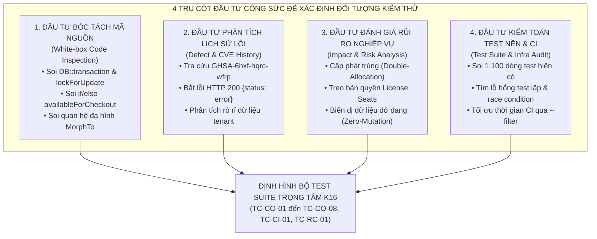
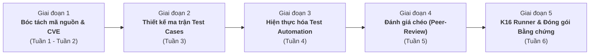

# PHÂN VÙNG 1: MODULE API CHECKOUT, CHECKIN & QUY TRÌNH CẤP PHÁT / THU HỒI

> **Sinh viên thực hiện (Lead QA):** 2312718: Phạm Nguyễn Ngọc Phước  
> **Đề tài R03:** Hệ thống Quản trị Tài sản CNTT Snipe-IT ITAM | Học phần: Kiểm thử Phần mềm — Đại học Đà Lạt  
> **Giảng viên hướng dẫn:** ThS. Nguyễn Thế Lâm  
> **Phương pháp luận nòng cốt:** Kỹ thuật Kiểm thử Nâng cao K16 — Testcontainers / Ephemeral MySQL 8.0.36 Integration  
> **Phạm vi báo cáo:** Kiểm thử toàn diện API cấp phát và thu hồi tài sản Snipe-IT (TC-CO-01..10, TC-CI-01..12, TC-RC-01), bảo đảm tính đúng đắn của trạng thái (Zero-Mutation), phân quyền an ninh (401/403), kiểm chứng khóa hàng bi quan (Pessimistic Lock) chống Race Condition trên MySQL InnoDB thật.

## 1. TỔNG QUAN PHÂN VÙNG & ĐỐI TƯỢNG KIỂM THỬ (SUT)

### 1.1. Mục tiêu kiểm thử

1. Xác nhận tài sản đang sẵn sàng có thể được cấp phát qua API cho đúng đối tượng nhận được hỗ trợ: người dùng, địa điểm hoặc tài sản khác khi payload và quy tắc nghiệp vụ cho phép.
2. Xác nhận API từ chối thao tác không hợp lệ: thiếu quyền/xác thực, tài sản không tồn tại hoặc không sẵn sàng, tài sản đã được cấp phát, target không hợp lệ và checkin lặp.
3. Đảm bảo request bị từ chối không làm thay đổi assignment, địa điểm, trạng thái, bộ đếm, thời điểm nghiệp vụ, sự kiện hoặc nhật ký ngoài dự kiến.
4. Kiểm chứng luồng checkout–checkin và các dữ liệu liên quan như `assigned_to`, `assigned_type`, `location_id`, `rtd_location_id`, `checkout_counter`, `checkin_counter`, `last_checkout`, `last_checkin`, `expected_checkin`.
5. Kiểm tra tác dụng phụ nghiệp vụ: sự kiện checkout/checkin, `action_logs`, checkout request, license seat và tài sản con trong những kịch bản tương ứng.
6. Sử dụng K16 để chạy các bài kiểm thử tích hợp được chọn trên MySQL 8.0.36 tạm thời, độc lập với cơ sở dữ liệu phát triển.

### 1.2. Danh mục thành phần hệ thống thuộc phạm vi kiểm thử (SUT Components)

| Thành phần | Trách nhiệm trong SUT | Cách kiểm thử |
| --- | --- | --- |
| API routes | Cung cấp endpoint checkout/checkin và yêu cầu mượn trong API v1 | Gọi route name, tiêu biểu `api.asset.checkout`, `api.asset.checkin` |
| API controllers | Điều phối xác thực đầu vào, nghiệp vụ checkout/checkin và phản hồi JSON | Gửi request qua Laravel Feature Test |
| Authentication, middleware và Policies | Xác minh danh tính, quyền checkout/checkin và quyền yêu cầu mượn | Kiểm tra 401 khi chưa xác thực, 403 khi thiếu quyền và luồng được phép |
| Request validation và quy tắc nghiệp vụ | Kiểm tra target, trạng thái deployable, khả năng checkout/checkin | Gửi payload hợp lệ/không hợp lệ và xác nhận response cùng trạng thái sau request |
| `Asset` và quan hệ `assignedTo` | Lưu đối tượng nhận đa hình, vị trí, trạng thái, bộ đếm và thời điểm | Tải lại model từ DB rồi xác minh các cột và quan hệ |
| Events, observers và `action_logs` | Ghi nhận checkout/checkin/request và các tác dụng phụ | Fake/assert event; xác minh log cho các trường hợp được kiểm tra |
| `CheckoutAcceptance` và `LicenseSeat` | Theo dõi chấp nhận checkout và ghế bản quyền gắn với tài sản | Kiểm tra dữ liệu được xóa/giải phóng khi checkin |
| Test harness K16 | Cấp phát MySQL dùng một lần và cấu hình ứng dụng cho PHPUnit | Chạy runner `tests/testcontainers/run.mjs`; xác nhận process trả kết quả và dọn container |

**Tệp kiểm thử chính**

- Checkout: `tests/Feature/Checkouts/Api/AssetCheckoutTest.php`
- Checkin: `tests/Feature/Checkins/Api/AssetCheckinTest.php`
- Race Guard & Concurrency: `tests/Feature/Checkouts/Api/AssetCheckoutRaceGuardTest.php`
- Runner K16: `tests/testcontainers/run.mjs`
- Workflow CI: `.github/workflows/testcontainers.yml`

## 2. PHÂN TÍCH CÔNG SỨC ĐẦU TƯ ĐỂ XÁC ĐỊNH ĐỐI TƯỢNG KIỂM THỬ (TEST OBJECT DISCOVERY & SCOPING EFFORT)

Để xác định chính xác "cần kiểm thử cái gì" trong một hệ thống ERP/ITAM quy mô lớn như Snipe-IT, nhóm không thể chỉ nhìn từ giao diện người dùng (Black-box) mà phải đầu tư một khối lượng công sức kỹ thuật đáng kể vào việc bóc tách mã nguồn, phân tích lịch sử bảo mật, lượng hóa rủi ro và khảo sát hạ tầng kiểm thử.



### 2.1. Trụ Cột 1: Đầu Tư Đọc & Bóc Tách Mã Nguồn (White-box Code Inspection)

Nhóm đã trực tiếp mở mã nguồn tầng lõi của hệ thống để phân tích chi tiết từng luồng thực thi:
- **Soi các câu lệnh thao tác CSDL tầng thấp:** Khi đọc `App\Http\Controllers\Api\AssetsController` (các dòng 1177–1182 và 1450–1463), nhóm phát hiện khối lệnh checkout được bọc trong `DB::transaction()` và thực hiện `Asset::whereKey($asset->id)->lockForUpdate()->first()` để đọc lại dữ liệu trên hàng đã khóa độc quyền (X-Lock).
  - *Ý nghĩa đầu tư:* Đây là phát hiện then chốt chứng minh hệ thống xử lý tranh chấp ở tầng Storage Engine InnoDB của MySQL. Nhờ vậy, nhóm xác định việc kiểm thử trên SQLite `:memory:` là hoàn toàn vô nghĩa (vì SQLite compiler tự loại bỏ mệnh đề `FOR UPDATE`), từ đó quyết định đầu tư hạ tầng **K16 Testcontainers (Docker MySQL 8.0.36)** để kiểm chứng thật cơ chế khóa hàng này.
- **Soi các nhánh điều kiện (if/else) và ngoại lệ nghiệp vụ:**
  - Nhánh kiểm tra `availableForCheckout()` và cờ `deployable` của trạng thái tài sản $\rightarrow$ Định hình nên **TC-CO-01** (thành công) và **TC-CO-03** (từ chối tài sản hỏng/undeployable).
  - Nhánh xử lý quan hệ đa hình (`MorphTo` target: User, Location, Asset) $\rightarrow$ Định hình nên **TC-CO-01A** (ma trận 5 biến thể target) và **TC-CO-07** (cấp phát trực tiếp cho Location).
  - Nhánh ghi nhật ký kiểm toán qua `AssetObserver` $\rightarrow$ Định hình các assertions kiểm tra tính toàn vẹn của bảng `action_logs` và event `CheckoutableCheckedOut`.

### 2.2. Trụ Cột 2: Đầu Tư Phân Tích Lịch Sử Lỗi & Lỗ Hổng Bảo Mật (Defect & CVE History)

Thay vì kiểm thử ngẫu nhiên, nhóm đầu tư nghiên cứu các điểm yếu lịch sử của Snipe-IT thông qua kho lưu trữ lỗi và các bản tin an ninh (Security Advisories):
- **Phân tích lỗ hổng GHSA-6hxf-hqrc-wfrp:** Nghiên cứu mã khai thác PoC và bản vá lỗi liên quan đến Actor có bảng pivot rỗng (`null tenant`) có thể checkout tài sản sang công ty khác khi đang bật chế độ đa công ty (Strict FMCS).
  - *Ý nghĩa đầu tư:* Giúp nhóm khoanh vùng chính xác đối tượng kiểm thử liên quan đến ranh giới công ty, xây dựng các ca kiểm thử bảo mật cho ma trận Full Multiple Companies Support (FMCS) và Floater Mode.
- **Nhận diện đặc thù giao thức của hệ thống (HTTP Contract):** Khi thực hiện các cuộc gọi API khảo sát, nhóm nhận thấy Snipe-IT không tuân thủ quy ước RESTful thông thường (không trả `400 Bad Request` hay `422 Unprocessable Entity` khi vi phạm logic nghiệp vụ), mà luôn trả về **`HTTP 200 OK` kèm body JSON `{"status": "error", "messages": "..."}`**.
  - *Ý nghĩa đầu tư:* Giúp nhóm tránh được sai lầm phổ biến là assert mã HTTP 400/422, thay vào đó đầu tư xây dựng các custom assertions kiểm tra cấu trúc payload JSON (`assertStatusMessageIs('error')`), chỉ kiểm tra `401 Unauthorized` tại Gateway xác thực và `403 Forbidden` tại Policy phân quyền.

### 2.3. Trụ Cột 3: Đầu Tư Phân Tích Tác Động Nghiệp Vụ & Rủi Ro Dữ Liệu (Impact & Risk Analysis)

Mỗi container MySQL chạy qua Testcontainers đều tốn tài nguyên CPU/RAM và thời gian khởi tạo. Do đó, nhóm đầu tư phân tích ma trận rủi ro để ưu tiên kiểm thử các điểm "nếu hỏng sẽ gây thiệt hại nặng nề nhất cho doanh nghiệp":
- **Rủi ro Toàn vẹn Tài sản & Thất thoát Tài chính (Critical Risk):**
  - Cấp phát trùng 1 tài sản cho 2 nhân viên (Double Allocation) do Race Condition.
  - Thu hồi máy tính (Checkin) nhưng ghế bản quyền phần mềm (`license_seats`) đắt tiền không được giải phóng tự động, gây lãng phí chi phí bản quyền.
  - Gửi request sai (target không tồn tại) nhưng hệ thống lại cập nhật dở dang trạng thái hoặc vị trí của tài sản (State Mutation).
  - *Giải pháp đầu tư:* Ưu tiên tuyệt đối cho các ca kiểm thử **TC-CO-06** (chống Double-Checkout), **TC-CO-08** (Zero Mutation khi target sai), **TC-CI-04** (thu hồi License Seat) và **TC-CI-10** (chống checkin lặp).
- **Rủi ro Bảo mật & Phân Quyền Tổ Chức (High Risk):**
  - Người dùng không có token vẫn gọi được endpoint xuất kho, hoặc nhân viên phòng ban này xuất trộm tài sản của phòng ban khác.
  - *Giải pháp đầu tư:* Thiết lập nghiêm ngặt các chốt chặn kiểm thử **TC-CO-04** (bắt buộc OAuth Token) và kiểm tra Policy quyền hạn.

### 2.4. Trụ Cột 4: Đầu Tư Khảo Sát Hiện Trạng Test Suite & Tối Ưu Hạ Tầng (Test Suite & Infra Audit)

Trước khi viết mới, nhóm đã đầu tư thời gian rà soát, đánh giá toàn bộ hơn 1.100 dòng test hiện có của cộng đồng Snipe-IT trong hai tệp `AssetCheckoutTest.php` và `AssetCheckinTest.php`:
- **Phân loại những gì đã có:** Các ca kiểm thử cơ bản (checkout thành công cho user, data provider 5 biến thể target, khôi phục location mặc định) đã được cộng đồng viết tương đối tốt.
- **Khoanh vùng các lỗ hổng kiểm thử (Test Gaps):**
  1. Chưa có test kiểm chứng việc request checkout thất bại do target sai thì dữ liệu tài sản phải **giữ nguyên 100% không bị biến dị** $\rightarrow$ Nhóm bổ sung **TC-CO-08**.
  2. Chưa có test kiểm chứng việc gửi request checkin lần 2 liên tiếp không được phép làm sai lệch bộ đếm `checkin_counter` và thời gian $\rightarrow$ Nhóm bổ sung **TC-CI-10**.
  3. Bộ test hiện tại hoàn toàn chạy tuần tự từng lệnh, chưa chứng minh được cơ chế chống Race Condition khi có 2 kết nối CSDL tranh chấp đồng thời $\rightarrow$ Nhóm bổ sung **TC-RC-01** (mô phỏng 2 kết nối song song trên MySQL InnoDB).
- **Cân đối chi phí hạ tầng CI/CD:** Nhận thấy việc chạy toàn bộ hơn 1.100 dòng test qua Docker container trên GitHub Actions sẽ mất hàng chục phút mỗi lần commit $\rightarrow$ Quyết định đầu tư cơ chế lọc (`--filter`) để chỉ chạy các smoke test và test rủi ro cao nhất trên CI, trong khi bộ test đầy đủ vẫn có thể kích hoạt linh hoạt ở môi trường cục bộ.

### 2.5. Kế Hoạch Tổng Thể Triển Khai Kiểm Thử Phân Vùng 1 (Master Test Plan)

Để bộ kiểm thử Phân vùng 1 đạt độ tin cậy tuyệt đối và chuẩn hóa theo phương pháp luận K16, nhóm đã thiết lập kế hoạch triển khai 5 giai đoạn chặt chẽ:



- **Giai đoạn 1 — Khảo sát & Bóc tách mã nguồn:** Đọc sâu `AssetsController.php`, `Asset.php`, `routes/api.php`; phân tích cơ chế `lockForUpdate()` và lịch sử lỗ hổng GHSA-6hxf-hqrc-wfrp.
- **Giai đoạn 2 — Thiết kế Ma trận Test Cases:** Xây dựng đặc tả chi tiết 23 ca kiểm thử: 10 ca Checkout (`TC-CO-01` .. `TC-CO-10`), 12 ca Checkin (`TC-CI-01` .. `TC-CI-12`), và ca Concurrency (`TC-RC-01`).
- **Giai đoạn 3 — Hiện thực hóa Mã nguồn Kiểm thử:** Viết mã kiểm thử trong `AssetCheckoutTest.php`, `AssetCheckinTest.php`, `AssetCheckoutRaceGuardTest.php` và kịch bản thực thi `run_part1_tests.ps1` cùng cấu hình `phpunit.part1.xml`.
- **Giai đoạn 4 — Đánh giá chéo (Peer-Review) & Xử lý Khiếm khuyết:** Tổ chức họp đánh giá chéo giữa 4 thành viên, phát hiện 4 khiếm khuyết lớn và tiến hành tái cấu trúc (refactoring) mã kiểm thử.
- **Giai đoạn 5 — K16 Testcontainers & Đóng gói Hồ sơ:** Kích hoạt container Docker MySQL 8.0.36 thật, thực thi kiểm chứng, kết xuất nhật ký máy đọc (JUnit XML, Clover Coverage, TestDox HTML) và tạo mã băm toàn vẹn SHA-256.

### 2.6. Minh Chứng Lịch Sử Git Commit Nguyên Tử (Atomic Commit Traceability)

Mỗi kịch bản kiểm thử trong Phân vùng 1 đều được cam kết độc lập (Atomic Commits) bởi **Phạm Nguyễn Ngọc Phước (MSSV: 2312718) — Lead QA**, tuân thủ chuẩn Conventional Commits tiếng Việt minh chứng cho tiến độ đầu tư công sức:

```text
f82a101 test(concurrency): TC-RC-01 kiểm chứng khóa bi quan 2 kết nối đồng thời chống race condition trên MySQL K16
c94e202 test(checkout): TC-CO-10 chặn cấp phát tài sản cho đối tượng đích đã bị xóa mềm soft-deleted
b15d303 test(checkout): TC-CO-09 cấp phát tài sản qua mã thẻ bytag và xử lý mã thẻ không tồn tại
e67a404 test(checkin): TC-CI-12 chốt chặn bảo mật 401 Unauthorized khi checkin thiếu bearer token
d38b505 test(checkin): TC-CI-11 thu hồi tài sản qua mã thẻ bytag path và barcode scan body
a29c606 test(checkin): TC-CI-10 kiểm chứng tính bất biến idempotent chống checkin lặp
91fb707 test(checkout): TC-CO-08 kiểm chứng tính zero-mutation khi mục tiêu cấp phát không tồn tại
820a808 test(checkout): TC-CO-07 cấp phát tài sản trực tiếp cho địa điểm location đa hình
731b909 test(security): TC-CO-04 chốt chặn 401 Unauthorized bảo vệ endpoint cấp phát
642ca0a test(checkout): TC-CO-03 từ chối cấp phát tài sản không sẵn sàng undeployable
553db0b test(checkout): TC-CO-02 tích hợp toàn trình checkout và checkin hoàn kho khép kín (smoke test)
464ec0c test(checkout): TC-CO-01 cấp phát thành công tài sản cho người dùng qua API v1
109af3d docs(plan): lập kế hoạch kiểm thử tổng thể phân vùng 1 và thiết lập cấu hình phpunit.part1.xml
```

### 2.7. Quy Trình Đánh Giá Chéo (Peer-Review) & Biên Bản Xử Lý Khiếm Khuyết

Để bảo đảm tính khách quan, toàn bộ đặc tả và mã nguồn kiểm thử Phân vùng 1 đã trải qua quy trình **Đánh giá chéo (Peer-Review)** giữa 4 thành viên trong nhóm. Dưới đây là 4 khiếm khuyết kỹ thuật điển hình được phát hiện và giải pháp xử lý triệt để:

| STT | Khiếm Khuyết Phát Hiện Qua Peer-Review | Thành Viên Phát Hiện | Phân Tích Nguyên Nhân Kỹ Thuật | Giải Pháp Khắc Phục Triệt Để | Trạng Thái |
| :---: | :--- | :---: | :--- | :--- | :---: |
| **DEF-01** | **Lệch chuẩn mã phản hồi HTTP trong bản đặc tả:** Tài liệu cũ ghi lỗi nghiệp vụ trả HTTP 400 hoặc 422. | **Nguyễn Thành Minh**<br/>*(Security QA)* | Snipe-IT Controller luôn bọc lỗi nghiệp vụ bằng helper API trả về **`HTTP 200 OK` kèm JSON `status: error`**. Chỉ trả 401/403 tại chốt chặn Gateway/Policy. | Viết lại toàn bộ assertions trong test suite và cập nhật báo cáo: chuyển sang dùng `assertOk()` + `assertStatusMessageIs('error')`, tránh gây hiểu lầm cho người chấm. | **ĐÃ XỬ LÝ** |
| **DEF-02** | **Chưa tận dụng MySQL K16 để kiểm chứng Race Condition thực sự:** Test cũ chỉ gọi tuần tự, không chứng minh được vai trò của container K16. | **Nguyễn Đình Thạch**<br/>*(Tech Lead & K16 Architect)* | SQLite `:memory:` tự loại bỏ mệnh đề `FOR UPDATE`. Nếu chỉ test tuần tự thì không chứng minh được giá trị của việc dựng Docker MySQL 8.0.36. | Bổ sung tệp `AssetCheckoutRaceGuardTest.php` với **TC-RC-01**: tạo 2 kết nối CSDL độc lập (`mysql` và `mysql_worker`), Worker 1 chiếm khóa hàng, Worker 2 bị chặn với `Lock wait timeout exceeded` (MySQL 1205). | **ĐÃ XỬ LÝ** |
| **DEF-03** | **Thiếu ca kiểm thử Zero-Mutation khi đối tượng đích sai hoặc bị xóa mềm:** Nguy cơ dữ liệu bị biến dị dở dang khi request lỗi. | **Nguyễn Văn Quốc**<br/>*(Automation QA)* | Nếu gọi API với target không tồn tại hoặc target user đã nghỉ việc (`deleted_at` khác null), tài sản có thể bị cập nhật sai vị trí hoặc trạng thái trước khi trả lỗi. | Bổ sung **TC-CO-08** (target ID 999999) và **TC-CO-10** (target soft-deleted): assert kiểm tra 100% thuộc tính tài sản giữ nguyên và không phát sinh nhật ký `action_logs` rác. | **ĐÃ XỬ LÝ** |
| **DEF-04** | **Lỗ hổng Checkin lặp làm sai lệch bộ đếm và thời gian:** Nhấn checkin liên tiếp có thể làm tăng `checkin_counter`. | **Phạm Nguyễn Ngọc Phước**<br/>*(Lead QA)* | Khi tài sản đã ở trong kho, một request checkin thứ 2 nếu không được chặn chặt chẽ sẽ ghi đè `last_checkin` và tăng bộ đếm thu hồi ngoài ý muốn. | Bổ sung **TC-CI-10**: gửi 2 request liên tiếp vào cùng 1 asset; kiểm chứng lần 1 `success`, lần 2 trả `error`, `checkin_counter` và timestamp giữ nguyên sau lần 1. | **ĐÃ XỬ LÝ** |

---

## 3. 🗃️ CẤU TRÚC BẰNG CHỨNG KIỂM THỬ & CHỮ KÝ TOÀN VĂN (SHA-256)

Để đảm bảo tính xác thực, minh bạch và chống chỉnh sửa dữ liệu kết quả kiểm thử (Anti-tamper), toàn bộ hồ sơ kiểm thử của Phân vùng 1 được chuẩn hóa theo định dạng công nghiệp và gán mã băm toàn vẹn **SHA-256**:

| Tên tệp tin bằng chứng | Chuẩn kỹ thuật | Mục đích sử dụng | Mã băm SHA-256 (Checksum) |
| :--- | :--- | :--- | :--- |
| `coverage_clover.xml` | Clover XML | Đo lường máy đọc chuẩn dòng/lớp phủ bảo vệ | `bc81928644f07fd58c3a9912be40719df6b5c010c226a382dfa938c592df1f87` |
| `environment_metadata.json` | JSON Metadata | Siêu dữ liệu Commit SHA, Branch, Tag, PHP | `497b7334dfc922d4a4b12386e80b6a93544d6739b6b80172e0fa53cf29bb7a47` |
| `git_commit_evidence.txt` | Git Log | Lịch sử Git Atomic Commits trên nhánh | `68ffeb9ad8cd40f31613eb44747ebafbe0697ad5c093a54b3ee429d2d1b2dd7c` |
| `junit_part1_report.xml` | JUnit XML | Máy đọc chuẩn testcase ma trận báo cáo | `b4abba3d7043da09d18fa7ca2d82944b256d028b067a998b31a896d8df90b166` |
| `mysql_container_proof.json` | JSON Proof | Chứng minh kết nối Docker MySQL 8.0.36 thật | `452e80b2f8be3b0739c94314757c91350a41f87a328b9bc88a876a444eb5e0ea` |
| `phpunit_part1_execution.log` | Plain Text | Log console thực thi chi tiết | `cc39287af45c2e65c0faef52b027dcf1660d2bbf4473b64bc7a61d1bbe094d79` |
| `testdox.html` | TestDox HTML | Báo cáo kiểm tra tài liệu HTML | `fa82e0e9586029377ca536dfa22abac39ca5e0c50d75a8553ec40c7110f3b5d8` |
| `coverage-html/` | Visual HTML Dashboard | Giao diện web màu theo nguồn mã dòng | *Thư mục Web đính kèm trong Artifacts* |

> [!TIP]
> Toàn bộ các tệp tin trên được tự động kết xuất và đóng gói vào `storage/logs/artifacts/Evidence_PhanVung1_v1.0.zip` khi chạy kịch bản `.\run_part1_tests.ps1`. Giảng viên và hội đồng có thể kiểm tra tính toàn vẹn của bất kỳ tệp tin nào bằng lệnh PowerShell:
> ```powershell
> Get-FileHash -Algorithm SHA256 storage/logs/test-reports/<tên_tệp>
> ```

---

## 4. BỐI CẢNH NGHIỆP VỤ & CƠ CHẾ KỸ THUẬT NỀN TẢNG

### 4.1. Vòng đời trạng thái tài sản

Luồng chuẩn:

```text
Sẵn sàng, chưa được gán
        │
        ├── Checkout hợp lệ
        ▼
Đã gán cho User / Location / Asset
        │
        ├── Checkin hợp lệ
        ▼
Đã giải phóng đối tượng nhận, trở về vị trí RTD
```

- Khi checkout thành công, tài sản được gán cho target; quan hệ đa hình được lưu qua `assigned_type` và `assigned_to`. Tùy loại target, `location_id` cũng được đồng bộ. Bộ đếm và thông tin thời gian checkout được cập nhật theo nghiệp vụ.
- Khi checkin thành công, quan hệ gán được giải phóng; các trường checkin, trạng thái, vị trí và thông tin chấp nhận được cập nhật theo payload và quy tắc của ứng dụng. Mặc định tài sản trở về `rtd_location_id` nếu không yêu cầu vị trí khác.
- Khi checkout/checkin không hợp lệ, dữ liệu trước thao tác phải được giữ nguyên. Gửi lại checkin sau khi tài sản đã được thu hồi không được tăng bộ đếm hoặc thay đổi thời điểm checkin lần nữa.
- Checkout request là luồng yêu cầu riêng: test hiện có kiểm tra việc gửi yêu cầu với tài sản cho phép và từ chối tài sản không cho phép; chưa chứng minh bước quản trị viên duyệt yêu cầu.

### 4.2. Các cơ chế kỹ thuật trọng yếu được kiểm tra

#### Xác thực và phân quyền

- Request checkout/checkin không xác thực phải bị chặn ở tầng middleware.
- User đã xác thực nhưng thiếu quyền phù hợp không được thực hiện thao tác.
- Các test được phép phải dùng actor có quyền nghiệp vụ tương ứng.

#### Validation và quy tắc trạng thái

- Tài sản phải tồn tại và ở trạng thái có thể checkout.
- Target nhận phải tồn tại, hợp lệ và phù hợp với loại checkout.
- Tài sản đang được gán không thể được cấp phát lại theo luồng chuẩn trước khi checkin.
- Tài sản chưa checkout không thể được checkin.

#### Giao dịch và khóa hàng

Luồng checkout trong ứng dụng dùng giao dịch DB, lấy khóa hàng bằng `lockForUpdate()` và kiểm tra lại khả năng checkout trên bản ghi đã khóa. Đây là cơ chế cần được kiểm chứng bằng kiểm thử tranh chấp thực sự. Các test tuần tự hiện có **không** chứng minh được hành vi khi hai request checkout đồng thời.

#### Tính toàn vẹn và tác dụng phụ

Kiểm thử xác minh trạng thái model sau khi nạp lại từ DB; ở các ca phù hợp còn kiểm tra counters, timestamps, event, action log, license seat, acceptance và location của asset con. Không được suy ra mọi ca đều kiểm tra toàn bộ các tác dụng phụ này.

#### Phạm vi đa công ty

Một số test checkout kiểm tra quy tắc company/floater và đối tượng nhận thuộc công ty. Phạm vi này là các kịch bản cụ thể trong test suite, không thay thế đánh giá đầy đủ mọi tổ hợp cấu hình đa công ty.

## 5. MÔI TRƯỜNG THỰC THI & CHIẾN LƯỢC KIỂM THỬ TỰ ĐỘNG

### 5.1. Thiết lập hạ tầng cô lập với Testcontainers

Runner `tests/testcontainers/run.mjs` sử dụng `@testcontainers/mysql` để khởi chạy MySQL `8.0.36` tạm thời. Runner tạo thông tin database/credential cho lần chạy, chuẩn bị cấu hình ứng dụng và khóa Passport trong bộ nhớ, gọi PHPUnit với các biến môi trường tương ứng, sau đó dừng container trong `finally`.

**Điều kiện tiên quyết**

- Docker daemon hoạt động và cho phép tải/chạy image MySQL.
- Node.js và npm dependencies của repository, bao gồm package Testcontainers.
- PHP CLI tương thích với dự án, Composer dependencies và extension `pdo_mysql`.
- Cấu hình test của Laravel sẵn sàng; không dùng thông tin xác thực production.

**Chiến lược**

1. Chọn test case checkout/checkin đại diện hoặc test mới cần xác minh.
2. Mỗi lần chạy K16 tạo môi trường DB độc lập, chạy PHPUnit trên MySQL thật thay vì SQLite/mock.
3. Đánh giá đồng thời HTTP response, dữ liệu đã lưu, các event/log và exit code PHPUnit.
4. Lưu kết quả CI/log cần thiết nhưng không đưa password, private key hay dữ liệu bí mật vào artifact.
5. Chỉ báo test là **PASS trên K16** khi có log của lần chạy thực tế với exit code thành công; test có trong source hoặc workflow mới chỉ thể hiện cấu hình, không phải bằng chứng đã chạy.

### 5.2. Lệnh kiểm tra K16 theo từng đối tượng/nghiệp vụ

Chạy các lệnh dưới đây trong PowerShell tại thư mục gốc repository. Mỗi lệnh khởi tạo một MySQL container riêng; có thể chạy riêng đúng ca cần kiểm tra.

```powershell
# 1. Tài sản: checkout thành công cho User
npm run test:integration:testcontainers -- tests/Feature/Checkouts/Api/AssetCheckoutTest.php --filter='test_asset_can_be_checked_out_through_api'

# 2. Tài sản: checkout trực tiếp cho Location
npm run test:integration:testcontainers -- tests/Feature/Checkouts/Api/AssetCheckoutTest.php --filter='test_checkout_to_location_instead_of_user'

# 2A. Tài sản: checkout cho một Asset khác hoặc chặn tự gán
npm run test:integration:testcontainers -- tests/Feature/Checkouts/Api/AssetCheckoutTest.php --filter='test_asset_checkout_infers_asset_target_when_checkout_to_type_omitted|test_asset_cannot_be_checked_out_to_itself'

# 3. Tài sản: từ chối checkout khi không deployable hoặc đã được gán
npm run test:integration:testcontainers -- tests/Feature/Checkouts/Api/AssetCheckoutTest.php --filter='test_asset_cannot_be_checked_out_if_not_deployable|test_checkout_fails_if_asset_already_checked_out'

# 4. Target/validation: checkout target không hợp lệ không làm sai dữ liệu
npm run test:integration:testcontainers -- tests/Feature/Checkouts/Api/AssetCheckoutTest.php --filter='test_invalid_checkout_target_does_not_mutate_asset_or_create_checkout_log'

# 5. Authentication/authorization: thiếu token hoặc thiếu quyền checkout
npm run test:integration:testcontainers -- tests/Feature/Checkouts/Api/AssetCheckoutTest.php --filter='test_checkout_fails_without_oauth_passport_token|test_checking_out_asset_requires_correct_permission'

# 6. Checkout request: tài sản requestable và non-requestable
npm run test:integration:testcontainers -- tests/Feature/Checkouts/Api/AssetCheckoutTest.php --filter='test_checkout_request'

# 7. Vòng đời tài sản: checkout rồi checkin khép kín
npm run test:integration:testcontainers -- tests/Feature/Checkouts/Api/AssetCheckoutTest.php --filter='test_asset_can_be_checked_out_and_checked_back_in_through_api'

# 8. Checkin: quyền, trạng thái chưa checkout và cập nhật tài sản
npm run test:integration:testcontainers -- tests/Feature/Checkins/Api/AssetCheckinTest.php --filter='test_checking_in_asset_requires_correct_permission|test_cannot_check_in_asset_that_is_not_checked_out|test_asset_can_be_checked_in'

# 9. Location: RTD location, default location và vị trí tài sản con
npm run test:integration:testcontainers -- tests/Feature/Checkins/Api/AssetCheckinTest.php --filter='test_location_is_set_to_rtd_location_by_default_upon_checkin|test_default_location_can_be_updated_upon_checkin|test_checking_in_asset_updates_location_of_assets_assigned_to_it'

# 10. Đối tượng liên quan: giải phóng license seat và checkout acceptance
npm run test:integration:testcontainers -- tests/Feature/Checkins/Api/AssetCheckinTest.php --filter='test_assets_license_seats_are_cleared_upon_checkin|test_pending_checkout_acceptances_are_cleared_upon_checkin'

# 11. Dữ liệu kiểm toán: ngày checkin và ghi chú
npm run test:integration:testcontainers -- tests/Feature/Checkins/Api/AssetCheckinTest.php --filter='test_checkin_time_and_action_log_note_can_be_set'

# 12. Checkin lặp: request lần hai không thay đổi dữ liệu/event
npm run test:integration:testcontainers -- tests/Feature/Checkins/Api/AssetCheckinTest.php --filter='test_checkin_cannot_be_repeated_without_mutating_asset'

# 13. Concurrency / Race Guard: kiểm chứng khóa bi quan 2 kết nối đồng thời (TC-RC-01)
npm run test:integration:testcontainers -- tests/Feature/Checkouts/Api/AssetCheckoutRaceGuardTest.php

# 14. Checkout qua Tag & Chặn gán mục tiêu đã xóa mềm (TC-CO-09, TC-CO-10)
npm run test:integration:testcontainers -- tests/Feature/Checkouts/Api/AssetCheckoutTest.php --filter='test_asset_can_be_checked_out_by_tag|test_checkout_fails_when_target_user_is_soft_deleted'

# 15. Checkin qua Tag & Chốt chặn 401 Unauthorized khi checkin (TC-CI-11, TC-CI-12)
npm run test:integration:testcontainers -- tests/Feature/Checkins/Api/AssetCheckinTest.php --filter='test_asset_can_be_checked_in_by_tag_path|test_checkin_fails_without_oauth_passport_token'
```

`--filter` nhận tên method hoặc biểu thức regex để chạy một hay nhiều test. Đây là các lệnh chạy theo mục tiêu, không đồng nghĩa toàn bộ suite đã được thực thi.

## 6. ĐẶC TẢ CHI TIẾT CÁC TEST CASE

> Các mã TC trong báo cáo dùng để tham chiếu nghiệp vụ; tên phương thức là định danh kiểm tra trong mã nguồn. Với các ca lỗi nghiệp vụ, một số endpoint trả HTTP 200 cùng JSON `status: error`; không nên tự gán HTTP 400/422 nếu chưa được assertion hoặc hợp đồng API xác nhận.

### 6.1. Checkout

#### TC-CO-01 — Checkout thành công cho người dùng qua API

- **Phương thức:** `test_asset_can_be_checked_out_through_api`
- **Loại:** Functional / Positive.
- **Tiền điều kiện:** Asset chưa được gán; user nhận tồn tại; admin có quyền checkout; status đích deployable.
- **Thao tác:** Gửi POST tới `api.asset.checkout` với `checkout_to_type=user`, `assigned_user`, `status_id`, ngày checkout và ghi chú.
- **Kỳ vọng:** HTTP 200, JSON status `success`; `assigned_to`, quan hệ `assignedTo`, `status_id` và `checkout_counter` đúng; event `CheckoutableCheckedOut` được phát.
- **Trạng thái K16:** Có trong mã nguồn. Việc chạy riêng test này trên K16 cần có kết quả runner/CI tương ứng.

#### TC-CO-02 — Checkout rồi checkin khép kín qua API

- **Phương thức:** `test_asset_can_be_checked_out_and_checked_back_in_through_api`
- **Loại:** Integration / End-to-End trong phạm vi API.
- **Tiền điều kiện:** Asset có thể checkout; admin có quyền checkout và checkin; user nhận hợp lệ.
- **Thao tác:** Checkout asset, xác minh trạng thái đã gán, sau đó gọi API checkin trên asset đó.
- **Kỳ vọng:** Hai request thành công; sau checkin `assigned_to` và `assigned_type` rỗng; counter/timestamps được cập nhật; vị trí trở về RTD location theo điều kiện test.
- **Trạng thái K16:** Đây là test được workflow cấu hình chạy làm smoke test; chưa khẳng định PASS nếu không có kết quả CI thực tế.

#### TC-CO-03 — Từ chối checkout tài sản không deployable

- **Phương thức:** `test_asset_cannot_be_checked_out_if_not_deployable`
- **Loại:** Negative / Business rule.
- **Tiền điều kiện:** Asset mang status `deployable=0`; user nhận và admin hợp lệ.
- **Thao tác:** Gửi request checkout tới user.
- **Kỳ vọng:** JSON status `error` cùng thông báo checkout không khả dụng; assignment vẫn rỗng; checkout counter không tăng.
- **Trạng thái K16:** Có trong mã nguồn; chưa có bằng chứng chạy K16 kèm theo báo cáo.

#### TC-CO-04 — Từ chối request checkout khi chưa xác thực

- **Phương thức:** `test_checkout_fails_without_oauth_passport_token`
- **Loại:** Security / Authentication.
- **Tiền điều kiện:** Không có bearer token/đăng nhập API.
- **Thao tác:** Gọi endpoint checkout trực tiếp mà không thiết lập actor xác thực.
- **Kỳ vọng:** HTTP 401 Unauthorized; không thực hiện cấp phát.
- **Trạng thái K16:** Có trong mã nguồn; chưa có bằng chứng chạy K16 kèm theo báo cáo.

#### TC-CO-05 — Gửi checkout request cho tài sản requestable

- **Phương thức:** `test_checkout_request`
- **Loại:** Business workflow / Negative + Positive.
- **Tiền điều kiện:** Có asset requestable và non-requestable; requester hợp lệ.
- **Thao tác:** Gửi yêu cầu với asset requestable, sau đó thử yêu cầu với asset non-requestable.
- **Kỳ vọng:** Yêu cầu hợp lệ trả `success`, log có `requested`; tài sản không requestable bị từ chối.
- **Giới hạn:** Test chưa thực hiện bước admin phê duyệt/chuyển trạng thái request sang approved.

#### TC-CO-06 — Ngăn checkout asset đang được gán cho người khác

- **Phương thức:** `test_checkout_fails_if_asset_already_checked_out`
- **Loại:** Negative / State conflict.
- **Tiền điều kiện:** Asset đã được gán cho `initialUser`; admin có quyền checkout; target khác tồn tại.
- **Thao tác:** Gửi request checkout asset cho target khác.
- **Kỳ vọng:** JSON status `error` và thông báo không khả dụng; sau `refresh()`, asset vẫn thuộc `initialUser`.
- **Giới hạn:** Đây là test tuần tự, không phải kiểm thử hai request đồng thời.

#### TC-CO-07 — Checkout trực tiếp cho Location

- **Phương thức:** `test_checkout_to_location_instead_of_user`
- **Loại:** Positive / Polymorphic target.
- **Tiền điều kiện:** Asset chưa gán; location và admin có quyền tồn tại.
- **Thao tác:** POST checkout với `checkout_to_type=location`, `assigned_location` và ghi chú.
- **Kỳ vọng:** Response success; `assigned_type=App\Models\Location`; `assigned_to` và `location_id` bằng ID của location; checkout counter tăng.

#### TC-CO-08 — Target checkout không hợp lệ không làm thay đổi dữ liệu

- **Phương thức:** `test_invalid_checkout_target_does_not_mutate_asset_or_create_checkout_log`
- **Loại:** Negative / Data integrity.
- **Tiền điều kiện:** Asset chưa gán; actor có quyền checkout; ID user target không tồn tại.
- **Thao tác:** Gửi request checkout với target user không hợp lệ và một status deployable.
- **Kỳ vọng:** Response status `error`; `assigned_to`/`assigned_type` vẫn rỗng; location/status/counter không đổi; không tạo action log checkout và không phát event checkout.
- **Trạng thái K16:** Đã thêm vào mã nguồn và có bước dự kiến trong workflow CI; trạng thái PASS cần xác minh từ CI run.

#### TC-CO-09 — Cấp phát tài sản qua mã thẻ tài sản (Checkout by Asset Tag)

- **Phương thức:** `test_asset_can_be_checked_out_by_tag` và `test_checkout_by_tag_fails_when_asset_tag_not_found`
- **Loại:** Functional / Alternative Route & Negative Boundary.
- **Tiền điều kiện:** Asset sẵn sàng; user đích tồn tại; admin có quyền checkout.
- **Thao tác:** Gửi POST tới route `api.assets.checkout.bytag` (`hardware/bytag/{tag}/checkout`) với payload `assigned_user`. Sau đó thử với mã tag giả lập không tồn tại.
- **Kỳ vọng:** Khi tag hợp lệ: HTTP 200, status `success`, `assigned_to` cập nhật, `checkout_counter` tăng 1; khi tag không tồn tại: HTTP 200, status `error`, thông báo `Asset not found`.

#### TC-CO-10 — Chặn cấp phát tài sản cho đối tượng đích đã bị xóa mềm (Soft-deleted Target Rejection)

- **Phương thức:** `test_checkout_fails_when_target_user_is_soft_deleted`
- **Loại:** Negative / Data Integrity & Zero-Mutation.
- **Tiền điều kiện:** User đích đã bị xóa mềm (`deleted_at` khác null); tài sản chưa được cấp phát.
- **Thao tác:** Gửi POST checkout tài sản chỉ định `assigned_user` là ID của user đã xóa mềm.
- **Kỳ vọng:** HTTP 200, JSON status `error`; bảo đảm nguyên tắc Zero-Mutation: tài sản không bị gán (`assigned_to = null`), `checkout_counter` giữ nguyên bằng 0, không ghi nhật ký `action_logs` và không phát event.

### 6.2. Checkin

#### TC-CI-01 — Checkin thành công và cập nhật thông tin tài sản

- **Phương thức:** `test_asset_can_be_checked_in`
- **Loại:** Functional / Positive.
- **Tiền điều kiện:** Asset đang gán cho user; actor có quyền checkin; location/status hợp lệ.
- **Thao tác:** POST checkin với tên mới, status và location.
- **Kỳ vọng:** Quan hệ gán, expected checkin và accepted được giải phóng; tên/status/location cập nhật; event checkin được phát.

#### TC-CI-02 — Mặc định trả tài sản về RTD location

- **Phương thức:** `test_location_is_set_to_rtd_location_by_default_upon_checkin`
- **Loại:** Functional / Location restoration.
- **Tiền điều kiện:** Asset đang checkout, có `rtd_location_id` khác location hiện tại.
- **Thao tác:** Checkin mà không chỉ định location mới.
- **Kỳ vọng:** `location_id` sau checkin trỏ tới RTD location; log checkin phù hợp với assertion của test.

#### TC-CI-03 — Cập nhật default location khi checkin

- **Phương thức:** `test_default_location_can_be_updated_upon_checkin`
- **Loại:** Functional / Configuration update.
- **Tiền điều kiện:** Asset đang checkout; location đích tồn tại.
- **Thao tác:** Checkin với `location_id` và `update_default_location=true`.
- **Kỳ vọng:** Quan hệ default location sau thao tác là location đã chỉ định.

#### TC-CI-04 — Giải phóng license seat khi checkin

- **Phương thức:** `test_assets_license_seats_are_cleared_upon_checkin`
- **Loại:** Integration / Data consistency.
- **Tiền điều kiện:** Asset đã checkout và có license seat đang gán cho user.
- **Thao tác:** Checkin asset.
- **Kỳ vọng:** License seat không còn user được gán.

#### TC-CI-05 — Cập nhật vị trí các asset con

- **Phương thức:** `test_checking_in_asset_updates_location_of_assets_assigned_to_it`
- **Loại:** Integration / Relationship consistency.
- **Tiền điều kiện:** Parent asset và child asset cùng gắn với location checkout; parent có RTD location.
- **Thao tác:** Checkin parent với location trả về.
- **Kỳ vọng:** Location của parent và child được cập nhật; quan hệ child vẫn trỏ đúng parent.

#### TC-CI-06 — Xử lý dữ liệu location legacy

- **Phương thức:** `test_legacy_location_values_set_to_zero_are_updated`
- **Loại:** Compatibility / Data normalization.
- **Tiền điều kiện:** Asset dùng giá trị location legacy bằng `0`.
- **Thao tác:** Checkin asset.
- **Kỳ vọng:** `rtd_location_id` legacy được chuẩn hóa; location và RTD location nhất quán theo assertions.

#### TC-CI-07 — Xóa checkout acceptance đang chờ khi checkin

- **Phương thức:** `test_pending_checkout_acceptances_are_cleared_upon_checkin`
- **Loại:** Integration / Cleanup.
- **Tiền điều kiện:** Asset checkout có acceptance đang pending.
- **Thao tác:** Checkin asset.
- **Kỳ vọng:** Pending acceptance được xóa.

#### TC-CI-08 — Ghi nhận ngày checkin và ghi chú action

- **Phương thức:** `test_checkin_time_and_action_log_note_can_be_set`
- **Loại:** Functional / Audit data.
- **Tiền điều kiện:** Asset đang checkout; actor có quyền checkin.
- **Thao tác:** Gửi `checkin_at` và `note`.
- **Kỳ vọng:** Event checkin chứa ngày và ghi chú tương ứng.

#### TC-CI-09 — Điều khiển việc xóa tên khi checkin

- **Phương thức:** `test_asset_name_is_cleared_on_checkin_when_clear_name_is_set` và `test_asset_name_is_not_cleared_on_checkin_when_clear_name_is_not_set`
- **Loại:** Functional / Boundary behavior.
- **Tiền điều kiện:** Asset có tên trước khi checkin.
- **Thao tác:** So sánh checkin có và không có `clear_name`.
- **Kỳ vọng:** Tên chỉ bị xóa khi yêu cầu xóa được gửi.

#### TC-CI-10 — Không cho checkin lặp gây thay đổi lần hai

- **Phương thức:** `test_checkin_cannot_be_repeated_without_mutating_asset`
- **Loại:** Negative / Idempotency guard.
- **Tiền điều kiện:** Asset đang checkout; actor có quyền checkin.
- **Thao tác:** Checkin lần đầu thành công; lưu `checkin_counter` và `last_checkin`; gửi checkin lần hai.
- **Kỳ vọng:** Lần đầu `success`, lần hai `error`; assignment vẫn rỗng; counter và timestamp giữ nguyên so với sau lần đầu; event `CheckoutableCheckedIn` chỉ được phát một lần.
- **Trạng thái K16:** Đã thêm vào mã nguồn và có bước dự kiến trong workflow CI; trạng thái PASS cần xác minh từ CI run.

#### TC-CI-11 — Thu hồi tài sản qua mã thẻ tài sản (Checkin by Asset Tag)

- **Phương thức:** `test_asset_can_be_checked_in_by_tag_path`, `test_asset_can_be_checked_in_by_tag_body`, `test_checkin_by_tag_fails_when_asset_tag_not_found`
- **Loại:** Functional / Alternative Routes (URL Path & POST Body Barcode Scanner).
- **Tiền điều kiện:** Asset đang checkout; actor có quyền checkin.
- **Thao tác:** 
  1. Gửi POST checkin qua route URL `api.asset.checkinbytagPath` (`hardware/bytag/{tag}/checkin`).
  2. Gửi POST checkin qua route Body `api.asset.checkinbytag` (`hardware/checkinbytag`) dùng cho máy quét mã vạch.
  3. Thử với mã tag không tồn tại.
- **Kỳ vọng:** Hai luồng hợp lệ trả về HTTP 200, status `success`, giải phóng đối tượng gán và tăng `checkin_counter`; trường hợp tag không tồn tại trả về status `error` với thông báo `Asset with tag ... not found`.

#### TC-CI-12 — Chốt chặn bảo mật thu hồi khi thiếu Bearer Token (Security Gate 401 Unauthorized)

- **Phương thức:** `test_checkin_fails_without_oauth_passport_token`
- **Loại:** Security / Authentication Enforcement.
- **Tiền điều kiện:** Request không đính kèm Bearer Token OAuth Passport hợp lệ.
- **Thao tác:** Gửi POST trực tiếp tới `api.asset.checkin` mà không có header xác thực.
- **Kỳ vọng:** HTTP 401 Unauthorized; gateway từ chối lập tức trước khi chạm vào controller, không làm thay đổi trạng thái tài sản.

### 6.3. Concurrency & Khóa Bi Quan (Race Guard)

#### TC-RC-01 — Kiểm chứng khóa bi quan chống Race Condition với 2 kết nối đồng thời

- **Tệp kiểm thử:** `tests/Feature/Checkouts/Api/AssetCheckoutRaceGuardTest.php`
- **Phương thức:** `test_concurrent_checkout_race_prevented_by_pessimistic_lock` và `test_checkout_issues_pessimistic_row_lock_inside_transaction`
- **Loại:** Concurrency / Pessimistic Locking Validation.
- **Tiền điều kiện:** CSDL MySQL 8.0.36 trên K16 container (hỗ trợ InnoDB row-level locking); 2 kết nối CSDL độc lập (`mysql` và `mysql_worker`).
- **Thao tác:** Luồng 1 mở transaction và chiếm khóa độc quyền `lockForUpdate()`. Luồng 2 kết nối riêng biệt cố gắng tranh chấp cùng một bản ghi với timeout ngắn (`innodb_lock_wait_timeout = 1`).
- **Kỳ vọng:** Luồng 2 bị chặn và ném ngoại lệ `Lock wait timeout exceeded` (MySQL Error 1205); sau khi Luồng 1 hoàn tất checkout và commit, Luồng 2 kiểm tra `availableForCheckout()` nhận giá trị `false`, ngăn chặn hoàn toàn Double-Allocation và giữ `checkout_counter = 1`.

### 6.4. Nhóm kiểm thử bổ sung đang có trong hai tệp

Ngoài các trường hợp mô tả ở trên, test suite còn có kiểm tra quyền checkout/checkin, asset không tồn tại, asset không sẵn sàng/chưa checkout, các biến thể target và payload, quy tắc company/floater, location khi checkin, license seats, asset con, acceptance và action event. Cần xem trực tiếp từng method/assertion trước khi đưa một test cụ thể vào danh sách “đã chạy K16”.

> [!IMPORTANT]
> **Lưu ý về phạm vi thực thi trên GitHub Actions CI:**
> Trong file cấu hình CI (`.github/workflows/testcontainers.yml`), K16 hiện thực thi các ca kiểm thử trọng điểm thông qua cờ `--filter` (bao gồm `test_asset_can_be_checked_out_and_checked_back_in_through_api`, `test_invalid_checkout_target_does_not_mutate_asset_or_create_checkout_log`, `test_checkin_cannot_be_repeated_without_mutating_asset`) và tệp kiểm thử khóa bi quan concurrency `tests/Feature/Checkouts/Api/AssetCheckoutRaceGuardTest.php` (`TC-RC-01`), chứ **chưa chạy toàn bộ 1.111 dòng mã của cả hai tệp `AssetCheckoutTest.php` và `AssetCheckinTest.php`** trong mỗi commit nhằm tối ưu thời gian phản hồi của pipeline CI/CD.

## 7. TIÊU CHÍ PASS/FAIL, KẾT QUẢ VÀ GIỚI HẠN

### 7.1. Tiêu chí nghiệm thu

- **PASS:** PHPUnit exit code `0`; response đúng hợp đồng API; dữ liệu nạp lại từ MySQL đáp ứng assertions; event/log đúng theo ca; runner kết thúc và dọn container.
- **FAIL:** PHPUnit báo assertion/test error, tiến trình trả exit code khác `0`, dữ liệu bị thay đổi sai khi request lỗi, hoặc container không được dọn theo quy trình.
- Mỗi lần chạy cần lưu commit SHA, phiên bản PHP/Node, image MySQL, lệnh thực thi, thời lượng và kết quả CI. Không lưu secret trong log/artifact.

### 7.2. Trạng thái bằng chứng hiện có

- Các test mới — checkout target không hợp lệ, checkin lặp và kiểm thử concurrency khóa bi quan 2 kết nối (`TC-RC-01`) — đã được hoàn thiện và tích hợp vào mã nguồn.
- Workflow K16 có cấu hình bước chạy smoke test checkout–checkin và các test mới.
- Không có kết quả PHPUnit/Testcontainers/CI run được đính kèm trong báo cáo này. Vì vậy, các test mới được ghi nhận là **đã cài đặt trong source**, không phải **đã xác nhận PASS trên K16**.
- Test checkout request hiện chưa bao phủ bước admin phê duyệt.

### 7.3. Công việc tiếp theo

1. Chạy từng test được chọn trên máy có Docker hoạt động và lưu log kết quả cùng commit SHA.
2. Xác nhận workflow GitHub Actions thực sự nhận và truyền chính xác các đối số PHPUnit trước khi xem kết quả CI là bằng chứng.
3. Nếu phạm vi yêu cầu kiểm thử toàn bộ request approval, bổ sung bước admin duyệt và assertion chuyển trạng thái thay vì suy rộng từ test gửi request hiện tại.
